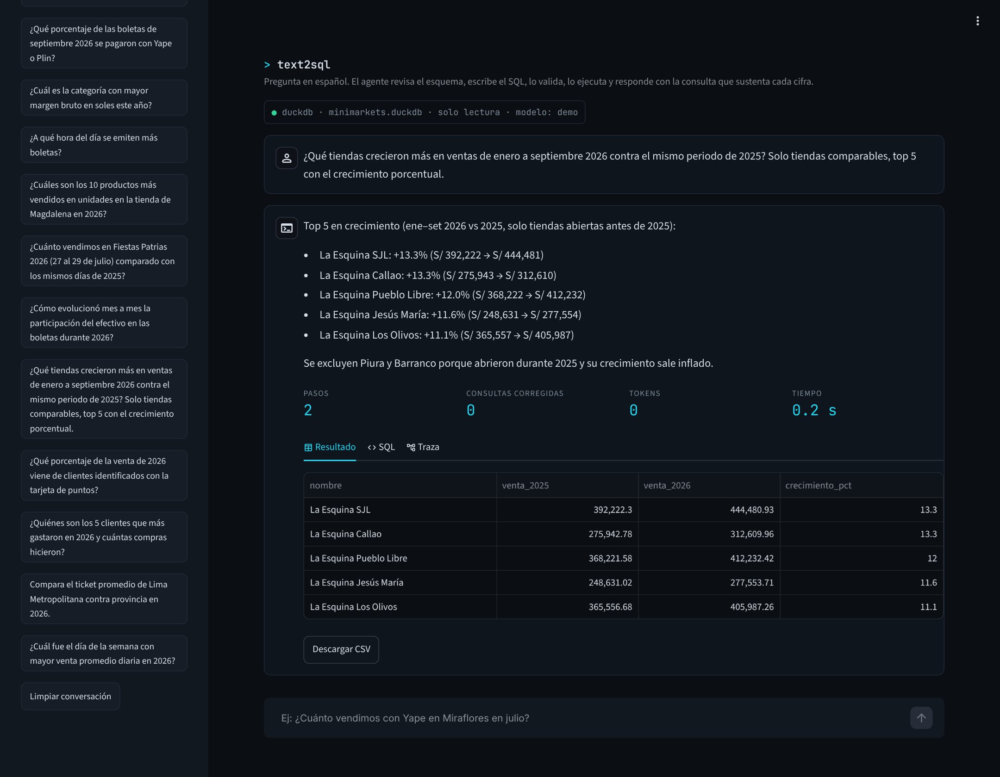
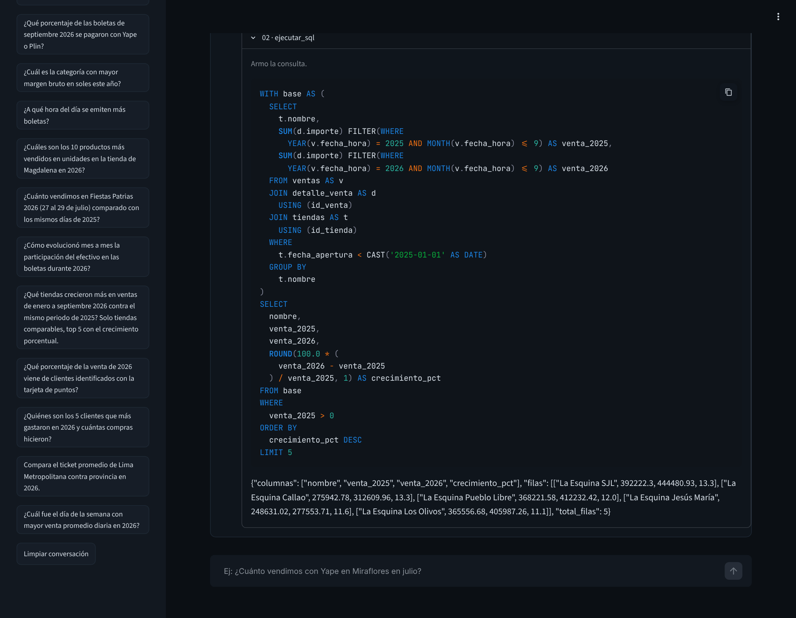
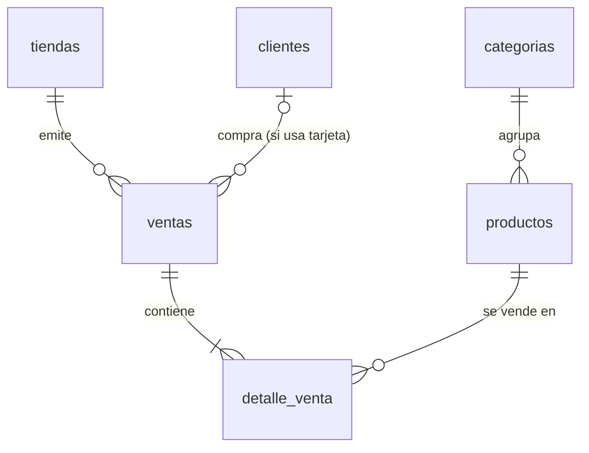
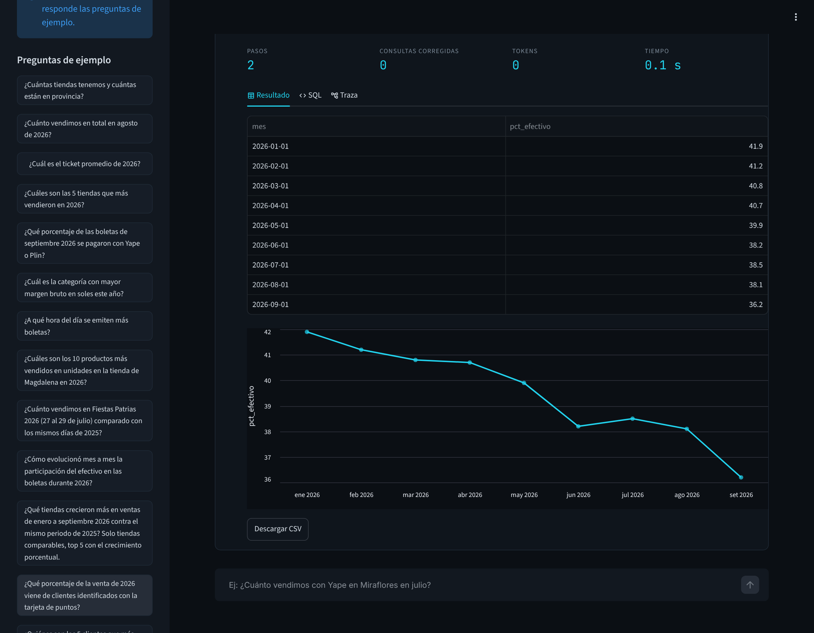
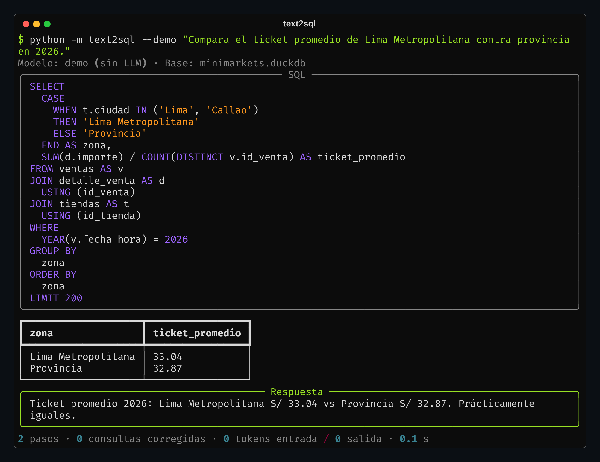

# Agente text-to-SQL con guardrails

Preguntas de negocio en español → SQL validado → respuesta con la cifra y la consulta que la sustenta.



## Por qué

En cualquier equipo de datos llegan a diario preguntas del tipo *"¿cuánto vendimos con Yape en Miraflores en julio?"*. Cada una toma cinco minutos, pero son veinte a la semana. Un LLM escribe SQL razonable; lo difícil es todo lo demás:

- que use las definiciones del negocio ("venta" es `SUM(importe)`, no `SUM(precio_lista)`; Callao cuenta como Lima),
- que no pueda leer ni modificar nada fuera de lo permitido,
- que cada número venga con la consulta que lo respalda,
- y poder medir si un cambio en el prompt lo mejora o lo empeora.

## Cómo funciona

```
pregunta → listar_tablas / describir_tabla → ejecutar_sql → guard → DuckDB → responder
                                                   ↑                   │
                                                   └── si falla, corrige
```

El modelo trabaja con cuatro herramientas (tool calling): `listar_tablas`, `describir_tabla`, `ejecutar_sql` y `responder`. `describir_tabla` devuelve también los valores posibles de las columnas de texto, así el modelo escribe `'Yape'` y no `'YAPE'`, que es el error más común en text-to-SQL. Si una consulta falla, el error vuelve al modelo y la corrige; la interfaz muestra cuántas veces pasó.

La respuesta final sale por la herramienta `responder`, con texto y SQL. Sin SQL no hay cifra.



El cliente funciona con cualquier API compatible con chat completions (OpenAI, Groq, Together, Ollama o vLLM en local). Se cambia el proveedor con `LLM_BASE_URL` y `LLM_MODELO`, sin tocar código.

## Guard de SQL

Todo SQL pasa por un validador que revisa el árbol sintáctico con sqlglot ([`guard.py`](src/text2sql/guard.py)), no expresiones regulares:

| Intento | Resultado |
|---|---|
| `DELETE`, `DROP`, `UPDATE`, `INSERT`, `CREATE` | Bloqueado: solo SELECT |
| `SELECT 1; DROP TABLE ventas` | Bloqueado: una sentencia por consulta |
| `SELECT * FROM read_csv('/etc/passwd')` | Bloqueado: funciones de tabla |
| `SELECT getenv('LLM_API_KEY')` | Bloqueado: función prohibida |
| `SELECT * FROM query('DROP ...')` | Bloqueado: SQL dinámico |
| `COPY`, `ATTACH`, `PRAGMA`, `SET`, `INSTALL` | Bloqueado |
| Tabla fuera de la lista permitida | Bloqueado |
| Consulta sin `LIMIT` | Se agrega `LIMIT 200` |
| Más de 15 s | Se cancela |

Además la conexión a DuckDB es de solo lectura. Cada caso tiene su test en [`test_guard.py`](tests/test_guard.py).

## Glosario de negocio

Muchos errores de text-to-SQL no son de sintaxis sino de definición. Las métricas están definidas una sola vez en [`prompts.py`](src/text2sql/prompts.py): venta, ticket promedio, Lima Metropolitana y tiendas comparables.

La última regla salió del set de evaluación: al preguntar qué tiendas crecieron más, Barranco aparecía primera con **+2,605%** porque abrió en septiembre de 2025. Un analista de retail lo descarta al toque; un modelo no tiene por qué saberlo. Ahora el glosario pide usar solo tiendas abiertas antes del periodo base, o advertirlo si no se aplica.

## Datos

La base es de una cadena de 24 minimarkets en Lima y provincias: unas 510 mil boletas y 1.4 millones de líneas de venta entre enero de 2025 y septiembre de 2026, generadas con [`generar_datos.py`](datos/generar_datos.py).

| Patrón | En los datos |
|---|---|
| Fin de semana, quincena, Fiestas Patrias y diciembre | Diciembre 2025 cierra en S/ 1.03 millones; un mes normal ronda S/ 0.7 millones |
| Horas punta | El pico es entre las 19:00 y las 20:00 |
| Pagos digitales | El efectivo baja de 42% a 36% de las boletas durante 2026 |
| Provincia paga más en efectivo | 51% de boletas en efectivo vs 41% en Lima |
| Tiendas nuevas | Piura (may-25) y Barranco (set-25) |
| Alza de precios | +4.5% en enero de 2026 |



Tablas y columnas tienen comentarios en la misma base (`COMMENT ON`) y el agente los lee: la documentación vive junto a los datos.

Cuando el resultado es una serie de tiempo, la app la grafica:



## Evaluación

[`evals/casos.json`](evals/casos.json) tiene 15 preguntas, de fáciles a difíciles, cada una con su SQL de referencia. No se compara el texto del SQL sino lo que devuelve (*execution accuracy*): mismas filas sin importar el orden ni el nombre de las columnas, con tolerancia para redondeos. La lógica está en [`evaluacion.py`](src/text2sql/evaluacion.py), con sus propios tests.

```bash
python evals/evaluar.py              # las 15 preguntas contra el modelo configurado
python evals/evaluar.py --solo e11   # una sola
```

Cada corrida deja un reporte en `evals/resultados/` con aciertos por dificultad, pasos, consultas corregidas, tokens y tiempo, para comparar modelos o versiones del prompt.

## Correrlo

Python 3.10+.

```bash
cd proyectos/01-agente-text-to-sql
pip install -e ".[app,dev]"
python datos/generar_datos.py           # ~5 s, 46 MB

# sin API key: modo demo con las preguntas del set de evaluación
python -m text2sql --demo "¿Cuál es el ticket promedio de 2026?"

# con un LLM
cp .env.example .env                    # LLM_API_KEY, LLM_MODELO y, si aplica, LLM_BASE_URL
python -m text2sql "¿Cuánto vendimos con Yape en Miraflores en julio 2026?"
python -m text2sql --detalle "..."      # muestra cada paso

streamlit run app.py
pytest                                  # 57 tests
```

El modo demo no usa un modelo: busca la pregunta en el set de evaluación, pasa el SQL de referencia por el mismo pipeline (guard, ejecución, interfaz) y arma la respuesta con el resultado real. Sirve para ver el flujo, no para medir calidad.



## Decisiones

- **Tool calling en vez de pedir el SQL en un bloque de código.** El modelo decide cuándo explorar, ejecutar o responder, y el formato final lo garantiza el esquema de `responder`.
- **DuckDB** porque corre embebido y agrega 1.4 millones de filas en milisegundos. Para Postgres, BigQuery o SQL Server se cambia `db.py` y el dialecto de sqlglot.
- **El modelo ve 50 filas, el usuario hasta 200.** Leer 200 filas no le ayuda a responder y cada fila cuesta tokens.
- **El LLM está detrás de una interfaz** (`completar()`). Eso permite el modo demo, testear el loop con respuestas guionadas y un test de integración con el SDK real interceptando el HTTP, sin red ni costo.

## Pendiente

- Memoria de conversación: hoy cada pregunta es independiente ("¿y en agosto?" no funciona).
- Repreguntar cuando la pregunta es ambigua; ahora toma un supuesto y lo dice.
- Mover el glosario a una capa semántica que también usen los dashboards.
- Caché de preguntas frecuentes.
