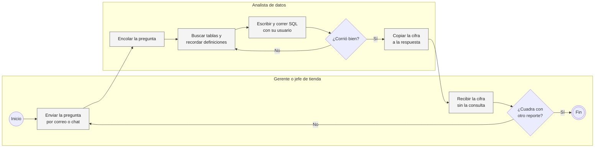
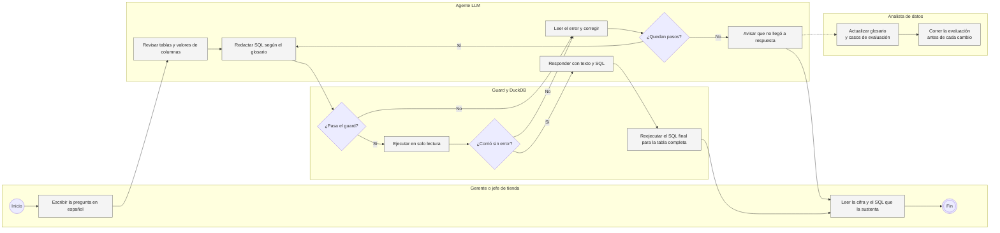
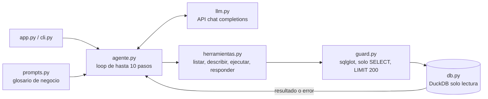
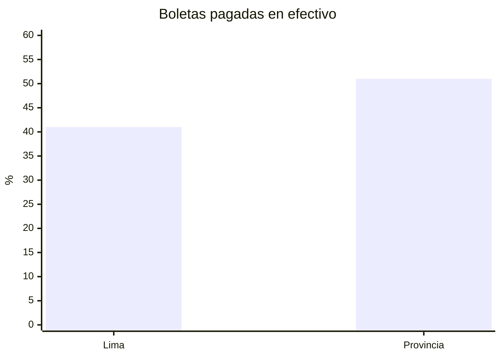
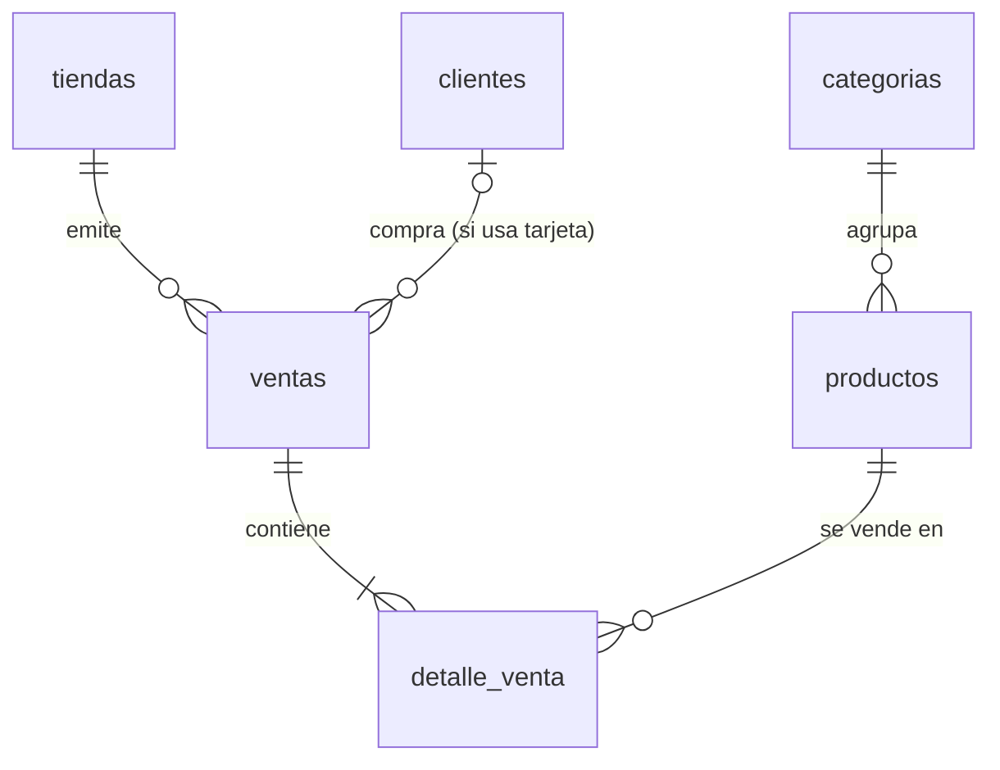

# Agente text-to-SQL con guardrails

Minimarkets La Esquina es una cadena ficticia de 24 tiendas en Lima y provincias. Sus gerentes y jefes de tienda le hacen al equipo de datos preguntas sueltas sobre ventas, medios de pago y tiendas, y este agente las responde en español con la cifra y la consulta que la respalda.

## Problemática

Preguntas como "¿cuánto vendimos con Yape en Miraflores en julio?" llegan a diario. Cada una toma unos cinco minutos, pero son veinte a la semana, y todas pasan por un analista que deja lo que estaba haciendo para escribir el SQL. La cola la arma quien pregunta más fuerte.

Además, la cifra llega sola, en un correo o un chat, sin la consulta que la produjo. Si dos analistas aplican distinto una definición (si Callao cuenta como Lima, qué es una tienda comparable), salen dos números para la misma pregunta y nadie puede revisar cuál está bien. Poner un LLM a escribir SQL resuelve la velocidad pero abre otro riesgo: que corra algo que no debe o que un cambio en el prompt lo empeore sin que nadie lo note.

## Solución

Construí un agente con tool calling que revisa el esquema, escribe el SQL según un glosario de negocio único, lo pasa por un guard que solo deja leer, lo ejecuta en DuckDB y responde con texto, tabla y SQL. El analista deja de escribir consultas repetidas y pasa a mantener el glosario y el set de evaluación.

Los entregables son el agente con su CLI y modo demo sin API key, el guard con sqlglot, el tablero en Streamlit, una base de prueba generada con semilla fija y un set de 15 preguntas con SQL de referencia para medir cada cambio. Quedan fuera la memoria de conversación, la repregunta ante ambigüedad y la conexión a una base productiva.

## AS IS: cada pregunta pasa por un analista



El cuello de botella es el analista: todo pasa por una sola persona y se atiende en orden de llegada. Las definiciones viven en la cabeza de cada uno, así que el reproceso aparece cuando dos cifras no cuadran y la pregunta vuelve a la cola. Y como la respuesta no trae el SQL, nadie fuera del equipo puede auditarla.

## TO BE: el agente responde y el analista mantiene las reglas



Los carriles del gerente, el agente y el guard están en el código. El del analista también existe como herramienta (`evals/evaluar.py` y el glosario en `prompts.py`), pero la rutina de revisar las preguntas que el agente no resolvió es cómo lo usaría el equipo y no está automatizada.

## Cómo cambian los indicadores

| Indicador | AS IS | TO BE |
|---|---|---|
| Quién escribe el SQL de una pregunta repetida | el analista, a mano | el agente, en hasta 10 pasos |
| Trazabilidad de la cifra | cifra sin consulta | cada respuesta trae su SQL |
| Definiciones de negocio | cada analista las aplica a su manera | un glosario único en `prompts.py` |
| Control de lo que se ejecuta | credenciales del analista | un solo SELECT, LIMIT 200, corte a los 15 s y conexión de solo lectura |
| Calidad medida antes de un cambio | no se medía | 15 preguntas con SQL de referencia comparadas por resultado |

## Por dentro



El modelo trabaja con cuatro herramientas vía tool calling: `listar_tablas`, `describir_tabla`, `ejecutar_sql` y `responder`. El formato final lo fija el esquema de `responder`, que exige texto y SQL. Sin SQL no hay cifra.

`describir_tabla` también devuelve los valores posibles de las columnas de texto. Con eso el modelo escribe `'Yape'` y no `'YAPE'`, el error más común en text-to-SQL. Si una consulta falla, el error vuelve al modelo y la corrige.

El cliente funciona con cualquier API compatible con chat completions (OpenAI, Groq, Together, Ollama o vLLM en local). El proveedor se cambia con `LLM_BASE_URL` y `LLM_MODELO`.

Usé DuckDB porque corre embebido; para Postgres o BigQuery basta cambiar `db.py` y el dialecto de sqlglot. El modelo ve 50 filas y el usuario hasta 200, porque cada fila cuesta tokens. Como el LLM está detrás de `completar()`, el loop se testea con respuestas guionadas, sin red ni costo.

## Qué deja pasar el guard

Todo SQL pasa por [`guard.py`](src/text2sql/guard.py), que revisa el árbol sintáctico con sqlglot en lugar de usar expresiones regulares. Acepta un solo `SELECT` sobre las tablas permitidas y bloquea `DROP`, `COPY`, `ATTACH`, `read_csv('/etc/passwd')`, `getenv('LLM_API_KEY')` y SQL dinámico. Si falta `LIMIT` agrega `LIMIT 200`, y cancela lo que pase de 15 s. La conexión a DuckDB, además, es de solo lectura. Cada caso tiene su test en [`test_guard.py`](tests/test_guard.py).

## El glosario

Muchos errores de text-to-SQL son de definición y no de sintaxis. Venta, ticket promedio, Lima Metropolitana y tiendas comparables están definidas una sola vez en [`prompts.py`](src/text2sql/prompts.py).

La regla de tiendas comparables salió del set de evaluación. Al preguntar qué tiendas crecieron más, Barranco salía primera con **+2,605%** porque abrió en septiembre de 2025. Un analista de retail lo descarta al toque. Ahora el glosario pide usar solo tiendas abiertas antes del periodo base, o advertirlo si no se aplica.

## La base

Es una cadena ficticia de 24 minimarkets en Lima y provincias, con unas 510 mil boletas y 1.4 millones de líneas de venta entre enero de 2025 y septiembre de 2026, generadas con [`generar_datos.py`](datos/generar_datos.py). Tiene estacionalidad (diciembre 2025 cierra en S/ 1.03 millones cuando un mes normal ronda S/ 0.7 millones), dos tiendas nuevas, Piura y Barranco, y un alza de precios de +4.5% en enero de 2026. Provincia paga más en efectivo:





Tablas y columnas tienen comentarios (`COMMENT ON`) que el agente lee.

## Cómo lo mido

[`evals/casos.json`](evals/casos.json) tiene 15 preguntas, de fáciles a difíciles, cada una con su SQL de referencia. Comparo lo que devuelve cada consulta y no su texto: mismas filas sin importar orden ni nombres de columna. La lógica está en [`evaluacion.py`](src/text2sql/evaluacion.py).

```bash
python evals/evaluar.py              # las 15 preguntas contra el modelo configurado
python evals/evaluar.py --solo e11   # una sola
```

Cada corrida deja un reporte en `evals/resultados/` con aciertos por dificultad, tokens y tiempo.

## Para correrlo

Python 3.10+.

```bash
cd proyectos/01-agente-text-to-sql
pip install -e ".[app,dev]"
python datos/generar_datos.py           # ~5 s, 46 MB

# sin API key: modo demo con las preguntas del set de evaluación
python -m text2sql --demo "¿Cuál es el ticket promedio de 2026?"

# con un LLM
cp .env.example .env                    # LLM_API_KEY, LLM_MODELO y, si aplica, LLM_BASE_URL
python -m text2sql "¿Cuánto vendimos con Yape en Miraflores en julio 2026?"
python -m text2sql --detalle "..."      # muestra cada paso

streamlit run app.py
pytest                                  # 57 tests
```

El modo demo no llama a ningún modelo: pasa el SQL de referencia de la pregunta por el mismo pipeline. Sirve para ver el flujo, no para medir calidad.

## Lo que falta

Hoy cada pregunta es independiente, así que "¿y en agosto?" no funciona; le falta memoria de conversación. Tampoco repregunta cuando algo es ambiguo, toma un supuesto y lo dice. Más adelante quiero mover el glosario a una capa semántica que usen también los dashboards, y agregar caché para las preguntas frecuentes.
