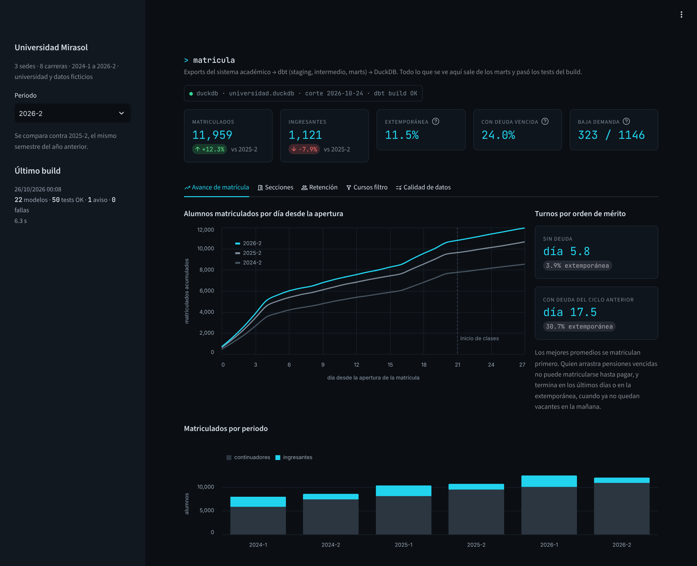
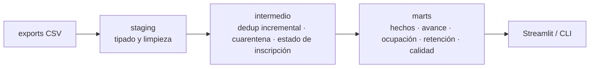
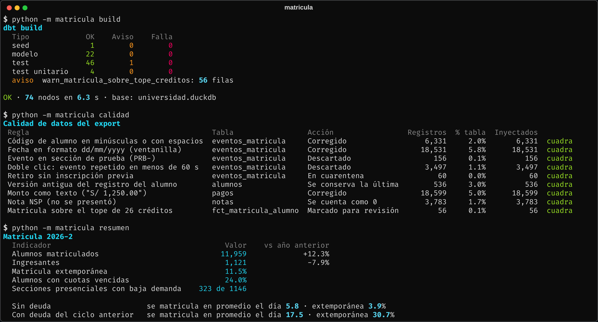
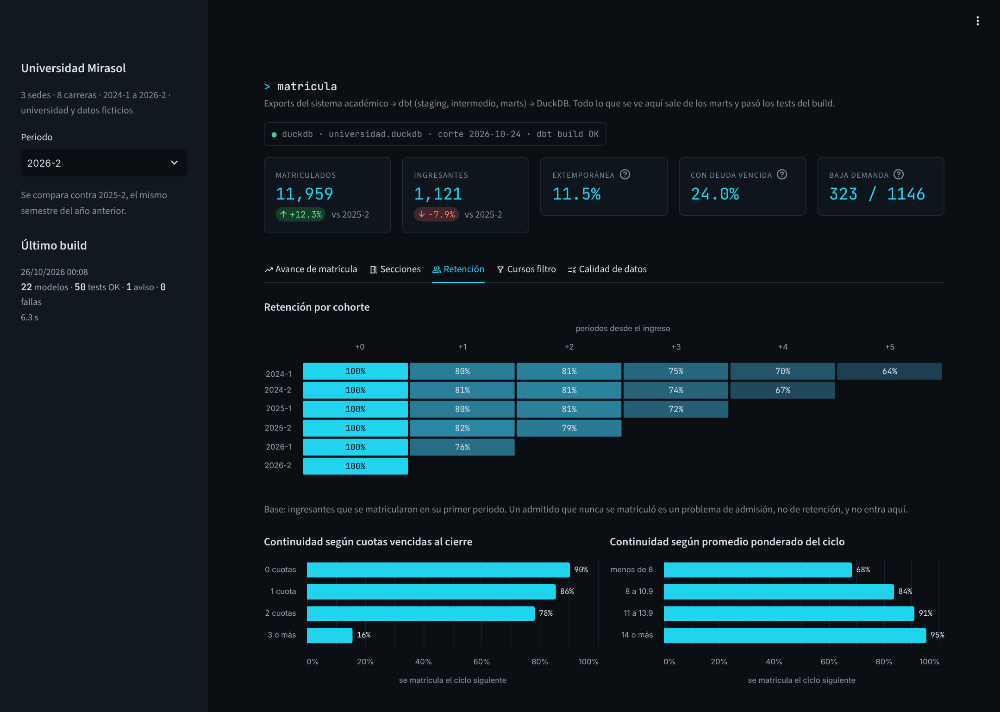
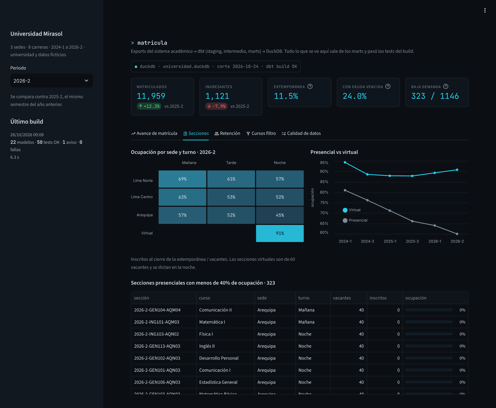
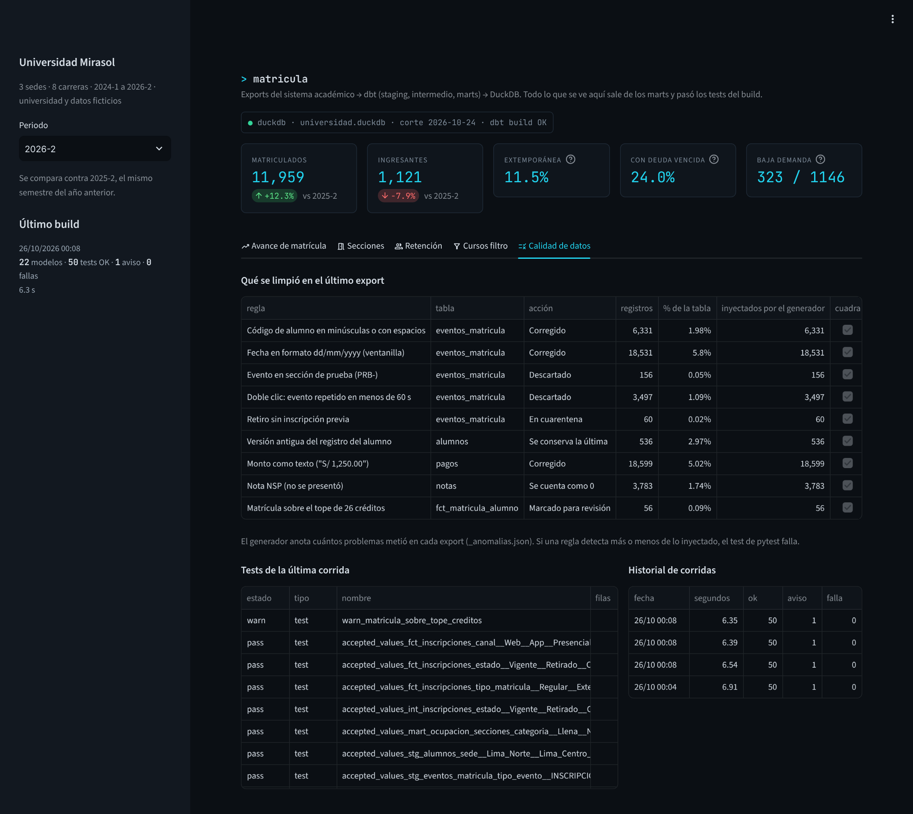

# Pipeline de matrícula con dbt + DuckDB

Toma los exports crudos de un sistema académico, los limpia y los modela en capas con dbt para medir matrícula, ocupación de secciones y retención. Cada build corre 47 tests de datos y 4 tests unitarios; el resultado se ve en un tablero y en la CLI.



## El problema

Durante las tres semanas de matrícula, Registros Académicos quiere saber cada mañana cuántos alumnos van contra el año pasado, qué secciones se llenan y cuáles conviene cerrar. Bienestar quiere saber quién no volvió. Finanzas cruza todo con la morosidad.

Los datos salen del sistema académico en CSV, y vienen con los problemas de siempre: dobles clics que duplican inscripciones, fechas en dos formatos según el canal, códigos de alumno con espacios, secciones de prueba, retiros sin inscripción previa, montos como texto (`"S/ 1,250.00"`) y notas `NSP`. Si cada analista los limpia a su manera, dos reportes del mismo día no cuadran. Aquí esas reglas están en un solo lugar, versionadas y con tests.

## Modelo



- **staging** (8 vistas): todo entra como texto y aquí se tipa. Normaliza sedes y códigos, parsea las dos variantes de fecha y los montos. No borra nada, solo marca (`es_prueba`, `codigo_corregido`, `fecha_formato_ddmm`).
- **intermedio**: saca secciones de prueba y dobles clics (`int_eventos_limpios`, incremental), manda los retiros sin inscripción a una tabla de cuarentena y reconstruye el estado de cada inscripción: vigente, retirada o cambio de sección.
- **marts** (10 tablas): `fct_inscripciones`, `fct_matricula_alumno`, curva de avance diaria, ocupación por sección, retención por cohorte, cursos filtro y un resumen de lo que se limpió en cada corrida.

dbt corre desde Python con `dbtRunner`; cada build queda registrado en el schema `auditoria` y el tablero muestra el estado de la última corrida.



## Lo que muestran los datos

Los datos son de una universidad con tres sedes, ocho carreras y secciones virtuales, periodos 2024-1 a 2026-2 (unas 935 mil filas entre alumnos, eventos de matrícula, secciones, pagos y notas). Se generan con [`generar_datos.py`](datos/generar_datos.py).

- **La matrícula 2026-2 crece 12.3% (11,959 alumnos), pero los ingresantes bajan 7.9%** (1,121 vs 1,217). Mirando solo el total, la caída de admisión no se ve.
- **La deuda anticipa el abandono.** Sin cuotas vencidas al cierre, el 90.4% se matricula el ciclo siguiente; con una, 85.6%; con dos, 78.3%; con tres o más, 15.7%. El promedio también pesa (68.4% con menos de 8, 95.5% con 14 o más), pero con menos fuerza.
- **Quien arrastra deuda se matricula tarde**: en promedio el día 17.5 de la ventana, contra el día 5.8 de los que no deben, y el 30.7% cae en la extemporánea.
- **La cohorte 2026-1 retiene peor**: 76.2% pasa al segundo ciclo, cuando las cohortes anteriores estaban entre 79.9% y 82.4%.
- **Las secciones presenciales se vacían**: su ocupación al cierre bajó de 81.0% (2024-1) a 60.0% (2026-2), mientras las virtuales siguen arriba de 87%. En 2026-2 hay 323 de 1,146 secciones presenciales bajo 40%, y 53 sin inscritos.
- **Matemática I es el primer filtro**: el 72.0% de los inscritos no la aprueba (63.0% desaprueba, 9.0% se retira). Le siguen Cálculo I (65.8%) y Física I (65.2%).





## Calidad de datos

| Regla | Registros | Acción |
|---|---:|---|
| Código de alumno en minúsculas o con espacios | 6,331 | Corrige |
| Fecha `dd/mm/yyyy` (ventanilla) | 18,531 | Corrige |
| Doble clic (mismo evento en menos de 60 s) | 3,497 | Descarta |
| Evento en sección de prueba | 156 | Descarta |
| Retiro sin inscripción previa | 60 | Cuarentena |
| Versión antigua del registro del alumno | 536 | Se queda la última |
| Monto como texto | 18,599 | Corrige |
| Nota `NSP` | 3,783 | Cuenta como 0 |
| Matrícula sobre el tope de 26 créditos | 56 | Aviso (`warn`) |

El generador guarda cuántos problemas de cada tipo metió en el export, y un test de pytest compara contra lo que detecta el pipeline: tienen que coincidir exacto.

Los tests de dbt cubren llaves, relaciones y valores aceptados, y hay tests singulares para reglas de negocio: una sección nunca supera sus vacantes (reconstruyendo la ocupación evento por evento), toda inscripción cae dentro de la ventana de matrícula, no hay notas en periodos abiertos. `dim_alumnos` y `fct_inscripciones` tienen contrato. Los tests unitarios de dbt fijan los casos delicados: un doble clic a 3 segundos se descarta y a 10 minutos no; retiro más alta en otra sección del mismo curso es cambio, no retiro.

El test de la ventana de matrícula encontró un bug en el generador: algunas inscripciones caían a las 00:00 del día siguiente al cierre, porque los cursos de una misma sesión se registran con segundos de diferencia y la sesión empezaba a las 23:59.



## Decisiones

- **Fuentes como texto (`all_varchar`).** Si DuckDB infiere tipos, un `"S/ 1,250.00"` en la fila 40 mil rompe la carga o termina en NULL sin avisar. Tipar en staging permite testearlo.
- **Cuarentena en vez de borrar.** Los retiros sin inscripción son un bug del sistema origen; borrarlos en silencio lo esconde.
- **Incremental con ventana de reproceso.** `int_eventos_limpios` es la tabla más grande y durante la matrícula el export se actualiza varias veces al día. Cada corrida reprocesa los últimos 3 días (`delete+insert` por `id_evento`) y la deduplicación mira un minuto antes de la ventana para no dejar pasar un doble clic en el borde. Un test construye la base con un export cortado a mitad de matrícula, corre el incremental con el export completo y lo compara contra un build desde cero.
- **La retención se mide sobre matriculados, no sobre admitidos.** Quien fue admitido y nunca se matriculó es un tema de admisión. Con los admitidos como base, la tasa baja entre 4 y 5 puntos en todas las cohortes (2024-1: 76.1% en vez de 80.1%).
- **La deuda se mide al cierre del ciclo**, no "hoy": si no, un alumno que pagó tarde parece no haber debido nunca.
- **Reglas de negocio como variables de dbt**: fecha de corte, tope de créditos, ventana de doble clic, días de reproceso y umbral de baja ocupación.
- dbt-duckdb deja la base abierta al terminar y el mismo proceso no puede reabrirla en solo lectura; `pipeline.py` la libera de forma explícita.

## Correrlo

Python 3.10+, dbt Core 1.10+.

```bash
cd proyectos/02-pipeline-matricula-dbt
pip install -e ".[app,dev]"

python -m matricula generar            # ~20 s
python -m matricula build              # seeds, modelos y tests (~7 s)
python -m matricula calidad
python -m matricula resumen --periodo 2026-2
streamlit run app.py
pytest                                 # 27 tests
```

O directo con dbt:

```bash
cd dbt_matricula
export MATRICULA_RAW=../datos/raw MATRICULA_DB=../datos/universidad.duckdb
dbt build --profiles-dir .
```

`generar` borra la base existente: el incremental guarda datos del export anterior y mezclar dos exports sin `--full-refresh` da números que no cuadran.

## Pendiente

- Snapshot (SCD tipo 2) del maestro de alumnos para no perder cambios de carrera.
- Proyectar la ocupación de cada sección durante la matrícula usando la curva de avance de años anteriores, para decidir cierres antes del día 27.
- Leer solo los archivos nuevos y guardar el crudo particionado por fecha de carga.
- Orquestación con Prefect y contratos en la entrada.
