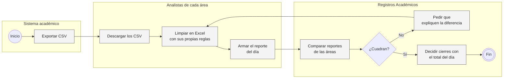
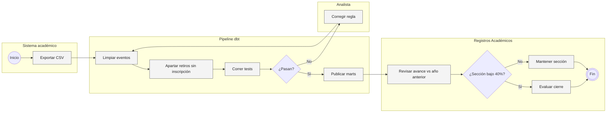
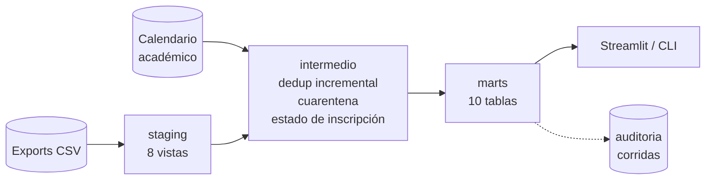
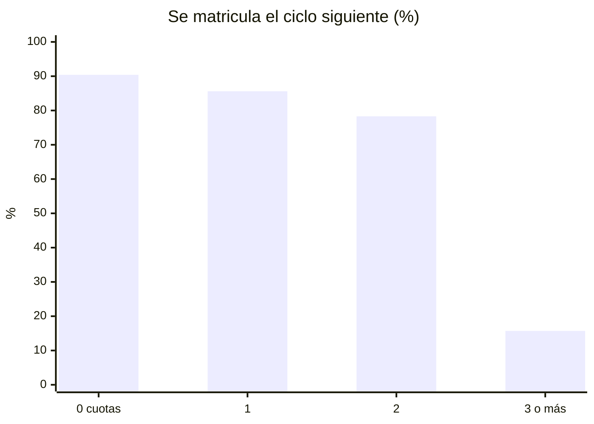

# Pipeline de matrícula con dbt + DuckDB

La Universidad Mirasol es una universidad privada ficticia con sedes en Lima Norte, Lima Centro y Arequipa y ocho carreras. Durante las tres semanas de matrícula, Registros Académicos, Bienestar y Finanzas trabajan con los exports del sistema académico, y este pipeline los limpia y modela una sola vez para todos.

## Problemática

Cada mañana de matrícula Registros Académicos quiere saber cuántos alumnos van contra el año pasado y qué secciones conviene cerrar. Bienestar pregunta quién no volvió y Finanzas cruza todo con la morosidad. Los tres parten de los mismos CSV, que vienen con dobles clics, fechas en dos formatos según el canal, códigos con espacios, secciones de prueba, retiros sin inscripción, montos como texto (`"S/ 1,250.00"`) y notas `NSP`.

Cada analista limpia a su manera, así que dos reportes del mismo día no cuadran y la reunión se va en discutir qué número es el bueno. Las decisiones que no admiten espera, como cerrar una sección con pocos inscritos, se toman con el reporte que llegó primero. Y el total esconde cosas: la matrícula puede crecer mientras los ingresantes caen.

## Solución

Puse las reglas de limpieza y las definiciones (inscripción vigente, retención, ocupación, deuda al cierre) en un proyecto dbt sobre DuckDB, en capas staging, intermedio y marts, con tests de datos en cada build y una cuarentena para lo que no se puede corregir. Los tres equipos leen las mismas tablas.

Los entregables son el generador de exports con los problemas reales del sistema, el proyecto dbt con 47 tests de datos y 4 unitarios, el registro de cada corrida en un schema de auditoría, una CLI y un tablero en Streamlit con avance, ocupación, retención y calidad. Quedan fuera la lectura incremental de archivos nuevos, el historial SCD2 del maestro de alumnos y la orquestación.

## AS IS: cada analista limpia su propia copia



El problema está en la limpieza repetida: la misma tarea la hacen varias personas con reglas distintas y sin pruebas, y el reproceso aparece cuando los reportes se comparan. Nadie aparta los registros dudosos, como un retiro sin inscripción previa, así que se mezclan con los buenos. La decisión de cierre se toma con un total que no separa ingresantes de continuadores.

## TO BE: una sola limpieza con tests y cuarentena



El carril del pipeline está en el código, y el tablero ya cuenta las secciones presenciales bajo 40% de ocupación. Evaluar y ejecutar el cierre le toca a Registros Académicos y no está programado.

## Cómo cambian los indicadores

| Indicador | AS IS | TO BE |
|---|---|---|
| Reglas de limpieza | una por analista, sin pruebas | un proyecto dbt con 47 tests de datos y 4 unitarios en cada build |
| Fechas en formato `dd/mm/yyyy` | se corregían o no según quién | 18,531 corregidas |
| Dobles clics | contados como inscripciones | 3,497 descartados |
| Retiros sin inscripción previa | mezclados con el resto | 60 en cuarentena |
| Ingresantes frente al total | escondidos en el total | 2026-2: matrícula +12.3%, ingresantes -7.9% |

## Capas



En staging todo entra como texto y ahí se tipa. Esa capa no borra nada, solo marca (`es_prueba`, `codigo_corregido`, `fecha_formato_ddmm`). [`int_eventos_limpios`](dbt_matricula/models/intermediate/int_eventos_limpios.sql) saca secciones de prueba y dobles clics, y [`int_inscripciones`](dbt_matricula/models/intermediate/int_inscripciones.sql) decide si cada inscripción está vigente, retirada o fue un cambio de sección. Los marts cubren hechos, avance diario, ocupación, retención por cohorte, cursos filtro y calidad.

dbt corre desde Python con `dbtRunner` en [`pipeline.py`](src/matricula/pipeline.py), y cada build queda registrado en el schema `auditoria`.

## Limpieza y tests

| Regla | Registros | Acción |
|---|---:|---|
| Fecha `dd/mm/yyyy` (ventanilla) | 18,531 | Corrige |
| Doble clic (mismo evento en menos de 60 s) | 3,497 | Descarta |
| Retiro sin inscripción previa | 60 | Cuarentena |
| Matrícula sobre el tope de 26 créditos | 56 | Aviso (`warn`) |

El generador guarda cuántos problemas metió en el export y un test de pytest exige que el pipeline detecte exactamente esos. Hay tests singulares de negocio: ninguna sección supera sus vacantes, toda inscripción cae dentro de la ventana y no hay notas en periodos abiertos. Ese test de la ventana encontró un bug en el generador, con inscripciones a las 00:00 del día siguiente al cierre porque la sesión empezaba a las 23:59.

## Qué salió

Los datos simulan una universidad con tres sedes y ocho carreras, periodos 2024-1 a 2026-2, unas 935 mil filas generadas con [`generar_datos.py`](datos/generar_datos.py).

La deuda es la que mejor anticipa el abandono. Sin cuotas vencidas al cierre, el 90.4% se matricula el ciclo siguiente; con tres o más, el 15.7%.



La matrícula 2026-2 crece 12.3% pero los ingresantes bajan 7.9%, algo que el total esconde. Y las presenciales se vacían: su ocupación al cierre pasó de 81.0% en 2024-1 a 60.0% en 2026-2, y ese ciclo hay 53 sin inscritos.

## Por qué así

Leo las fuentes con `all_varchar` porque si DuckDB infiere tipos, un monto como texto en la fila 40 mil rompe la carga o queda en NULL sin avisar. `int_eventos_limpios` es incremental y reprocesa los últimos 3 días con `delete+insert`; un test compara ese resultado contra un build desde cero. La retención la mido sobre matriculados y no sobre admitidos, y la deuda al cierre del ciclo, para que quien pagó tarde no parezca que nunca debió.

## Correrlo

Python 3.10+, dbt Core 1.10+.

```bash
cd proyectos/02-pipeline-matricula-dbt
pip install -e ".[app,dev]"
python -m matricula generar            # ~20 s
python -m matricula build              # seeds, modelos y tests (~7 s)
python -m matricula calidad
python -m matricula resumen --periodo 2026-2
streamlit run app.py
pytest                                 # 27 tests
```

`generar` borra la base existente, porque mezclar dos exports en el incremental sin `--full-refresh` da números que no cuadran.

## Estructura

```
datos/            generador de exports
dbt_matricula/    modelos, macros, seeds y tests de dbt
src/matricula/    CLI y corrida de dbt
app.py            tablero
tests/            pytest
```

## Límites y pendientes

Los datos son sintéticos. dbt-duckdb deja la base abierta al terminar, así que `pipeline.py` la cierra a mano. Falta un snapshot SCD2 del maestro de alumnos, proyectar la ocupación para decidir cierres antes del día 27, leer solo archivos nuevos y orquestar con Prefect.
