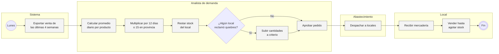
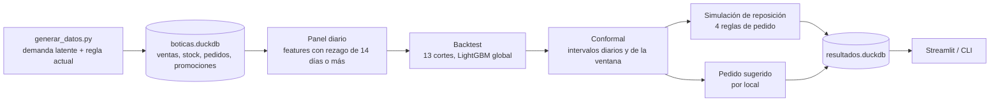
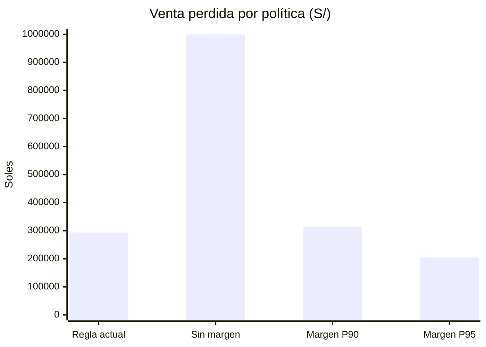

# Pronóstico de demanda y reposición para boticas

Boticas Alameda es una cadena ficticia de 24 locales en Lima, el norte y el sur, con 48 productos entre respiratorio, analgésicos y crónicos. Abastecimiento arma cada lunes el pedido de cada local, que llega en 2 días a Lima y en 4 a provincia.

## Problemática

El pedido se calcula con una regla fija: cubrir 12 días (15 en provincia) del promedio de venta de las últimas cuatro semanas. Funciona mientras la demanda no se mueve, y falla justo cuando más importa: al inicio del invierno, en un brote de dengue en el norte o después de un desabastecimiento del proveedor.

Hay un problema más escondido. El promedio se calcula sobre la venta, y en un día de quiebre la venta no es la demanda. Si el jarabe se acabó el martes, el promedio de esa semana baja y el pedido del lunes siguiente también, así que el quiebre se alimenta solo. Con esa regla la cadena perdió S/ 293,212 en venta entre abril y setiembre de 2026 y mantuvo S/ 360,676 de inventario promedio al costo, sin saber qué parte de ese stock servía de colchón y qué parte sobraba.

## Solución

Construí un pronóstico diario por local y producto con un LightGBM global que trata los días de quiebre como dato faltante, intervalos conformal para la ventana de cada pedido y una simulación que traduce el error del modelo a quiebres, inventario y venta perdida. Con eso la pregunta deja de ser cuánto mejora el pronóstico y pasa a ser con cuánto inventario se logra qué nivel de servicio.

El alcance incluye el generador de datos, el backtest de 13 cortes, la calibración de intervalos, la simulación de cuatro políticas de pedido, el pedido sugerido por local, la CLI y un tablero en Streamlit. Quedan fuera la sustitución entre productos, las transferencias entre locales y las variables externas como casos de dengue o temperatura.

## AS IS: el pedido sale del promedio de cuatro semanas



El proceso tiene tres fallas. La regla mira hacia atrás, así que reacciona tarde a la estacionalidad y a los brotes. Usa la venta como si fuera demanda, y en los días de quiebre subestima 49.5% lo que de verdad se iba a vender. Y el colchón de seguridad es implícito: nadie sabe si 12 días de cobertura para una ventana de 8 es mucho o poco, así que el ajuste termina dependiendo de qué local reclamó esa semana.

## TO BE: el pedido sale del pronóstico con un margen explícito

```mermaid
flowchart LR
    subgraph SIS[Sistema]
        ini((Lunes)) --> carga[Cargar venta y stock<br/>al cierre del domingo]
        carga --> reent{¿Toca reentrenar?}
        reent -- Sí, cada 2 semanas --> entrenar[Reentrenar LightGBM<br/>y recalibrar intervalos]
        reent -- No --> pron
        entrenar --> pron[Pronosticar los<br/>próximos 14 días]
        pron --> p95[Calcular P95 de la<br/>ventana de pedido]
        p95 --> neto[Restar stock y<br/>mercadería en tránsito]
    end
    subgraph AN[Analista de demanda]
        neto --> revisar[Revisar pedido<br/>sugerido por local]
        revisar --> alerta{¿Hay desabastecimiento<br/>o campaña nueva?}
        alerta -- Sí --> ajustar[Ajustar cantidades]
        alerta -- No --> aprobar
        ajustar --> aprobar[Aprobar pedido]
    end
    subgraph ABA[Abastecimiento]
        aprobar --> despachar[Despachar a locales]
    end
    subgraph LOC[Local]
        despachar --> recibir[Recibir mercadería<br/>2 días Lima, 4 provincia]
        recibir --> vender[Vender y registrar<br/>stock de cierre]
        vender --> fin(((Fin)))
    end
    classDef sobrio fill:#f4f4f4,stroke:#555,color:#222
    class carga,entrenar,pron,p95,neto,revisar,ajustar,aprobar,despachar,recibir,vender sobrio
```



El código cubre el carril del Sistema y deja el pedido sugerido por local en la CLI y el tablero. La revisión del analista, el despacho y la recepción son cómo lo usaría la cadena y no están programados.

## Cómo cambian los indicadores

| Indicador | AS IS | TO BE |
|---|---|---|
| Error del pronóstico semanal (WAPE) | 22.6% (promedio 28 días) | 19.0% (LightGBM) |
| Subestimación en días de quiebre | 49.5% | 32.9% |
| Nivel de servicio | 98.0% | 98.4% (margen P95) |
| Venta perdida, 28 abr a 28 set 2026 | S/ 293,212 | S/ 204,886 |
| Inventario promedio al costo | S/ 360,676 | S/ 303,494 |

Las cifras salen del backtest y de la simulación de reposición descritos más abajo.

## Cómo funciona por dentro




El backtest usa 13 cortes en lunes, cada 14 días, del 30/03 al 14/09/2026. En cada uno entreno con lo conocido hasta ese día y pronostico los 14 siguientes, comparando la regla actual, un naive estacional y dos LightGBM, con y sin tratar quiebres. Con los errores de cortes anteriores calibro el P10-P90 diario y el P90/P95 de la ventana de cada pedido.

## Los datos

24 locales, 48 productos, del 1 de enero de 2024 al 30 de setiembre de 2026. Son 1.13 millones de filas de venta y stock diario, generadas por [`generar_datos.py`](datos/generar_datos.py) con semilla fija.

El generador simula primero la demanda y luego la reposición con la regla actual. Lo que se vende es lo que había en anaquel, así que los quiebres aparecen solos cuando la demanda sube más rápido que el promedio. La demanda latente queda en una tabla que el modelo nunca lee y que solo uso para evaluar y simular.

Respiratorio en Lima pasa de 568 u/día en feb-25 a 1,507 en jul-25. Con el dengue en el norte el paracetamol se duplica y el ibuprofeno no se mueve, porque con dengue no se recomiendan AINEs. Hay además crónicos que venden 27% más del 1 al 5 que del 8 al 25, un desabastecimiento de jarabe infantil en pleno invierno y un local nuevo en Carabayllo. En total, 3.2% de los días-local-producto terminan con stock 0.

## Resultados

Backtest de 13 cortes x 14 días, evaluado contra la venta en días sin quiebre.

| Modelo | WAPE diario | WAPE semanal | Sesgo | Subestimación en días de quiebre |
|---|---:|---:|---:|---:|
| Promedio 28 días (regla actual) | 47.6% | 22.6% | -0.2% | 49.5% |
| Naive estacional | 62.3% | 25.8% | -1.0% | 44.0% |
| LightGBM sin tratar quiebres | 44.3% | 19.0% | -1.4% | 43.7% |
| LightGBM | 44.3% | 19.0% | -0.4% | 32.9% |

Por día el error es alto para cualquier modelo, porque un local vende 3 jarabes un día y 7 al siguiente. El pedido se decide por semana, y ahí el LightGBM baja el WAPE de 22.6% a 19.0%. Gana más en respiratorio (10.0% menos error) que en analgésicos (4.3%).

Tratar los quiebres como faltantes no cambia el WAPE, pero en días de quiebre el modelo que toma la venta tal cual se queda 43.7% corto y el que los trata, 32.9%. Un backtest normal no lo ve porque se evalúa contra la venta, que es justo lo censurado.

El P10-P90 cubre 80.2% de los días y, en la ventana de pedido, el P90 cubrió 90.3% y el P95, 95.2%.



| Política (28 abr - 28 set 2026) | Nivel de servicio | Días con quiebre | Venta perdida | Inventario promedio al costo | Días de inventario |
|---|---:|---:|---:|---:|---:|
| Regla actual | 98.0% | 3.1% | S/ 293,212 | S/ 360,676 | 7.4 |
| Pronóstico sin margen | 92.1% | 11.8% | S/ 999,396 | S/ 183,956 | 3.8 |
| Pronóstico + margen P90 | 97.5% | 4.1% | S/ 314,376 | S/ 269,616 | 5.5 |
| Pronóstico + margen P95 | 98.4% | 2.8% | S/ 204,886 | S/ 303,494 | 6.2 |

Lo que más me sorprendió fue que **un buen pronóstico sin margen es peor que la regla actual**. Pedir exactamente lo pronosticado baja el inventario a la mitad, pero el servicio cae a 92.1%. La regla actual tiene un colchón implícito de 12 días de cobertura para una ventana de 8, y el pronóstico necesita uno explícito.

Con margen P95 se gana por los dos lados, con 30% menos venta perdida y 16% menos inventario. No mejora en todo. Analgésicos baja de 99.6% a 98.5% de servicio porque la regla actual les sobraba stock, mientras respiratorio sube de 96.9% a 98.1%.

La regla actual simulada reproduce exactamente la historia del generador, día por día y serie por serie, y eso lo prueba [`test_reposicion.py`](tests/test_reposicion.py).

## Por qué lo armé así

Un solo modelo global y no 1,152, porque las series de un local son cortas y ruidosas. Entrenado con todos los locales aprende la forma del invierno y le sirve hasta al local nuevo. Objetivo Tweedie, porque son conteos con muchos ceros.

Las variables de venta miran 14 días atrás o más, así una tabla de features sirve para todo el horizonte sin filtrar el futuro. Hay un test que lo verifica.

Los quiebres van como dato faltante; imputarlos con la demanda latente sería trampa. El conformal divide el error entre la raíz del pronóstico, para que un cuantil le sirva igual a una serie que vende 40 al día y a una que vende 2, y cada corte se calibra con los dos anteriores, nunca con el propio.

## Correrlo

Python 3.10+.

```bash
cd proyectos/03-pronostico-demanda-boticas
pip install -e ".[app,dev]"

python -m demanda generar              # ~2 s, base de 15 MB
python -m demanda backtest             # 26 entrenamientos, ~10 min con 2 núcleos
python -m demanda reposicion           # ~5 s
python -m demanda pronostico --local 1 # pedido sugerido de un local
python -m demanda todo                 # los cuatro pasos

streamlit run app.py
pytest                                 # 33 tests, ~15 s
```

Para una corrida rápida sirve `backtest --cortes 4 --rondas 100`. Los resultados quedan en `datos/resultados.duckdb`, que es lo que lee la app.

```
03-pronostico-demanda-boticas/
├── app.py                    tablero Streamlit
├── datos/generar_datos.py    demanda y regla de reposición
├── src/demanda/
│   ├── calendario.py         feriados y quincenas
│   ├── datos.py              panel diario sin huecos
│   ├── features.py           rezagos y medias móviles
│   ├── modelos.py            baselines y LightGBM
│   ├── backtest.py           cortes y métricas
│   ├── intervalos.py         conformal por segmento
│   ├── reposicion.py         simulación de pedidos
│   ├── pronostico.py         pedido sugerido
│   ├── resultados.py         resultados.duckdb
│   └── cli.py
└── tests/
```

## Lo que falta

La demanda latente es un lujo de los datos sintéticos. Con datos reales habría que estimarla, y aunque el modelo no depende de ella, la simulación sí. La simulación además usa la historia real para las features, cuando con otra política el modelo vería otra venta. No hay sustitución entre productos ni transferencias entre locales, y el modelo reacciona al dengue con 14 días de retraso.

Lo siguiente que haría:

- Nivel de servicio por categoría según costo de quiebre e inventario (newsvendor), no solo por rotación.
- Casos de dengue y temperatura como variables externas.
- Pronóstico jerárquico por local, región y cadena.
- MLflow y reentrenamiento programado.
