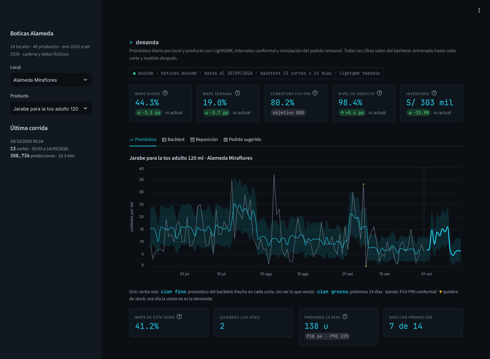
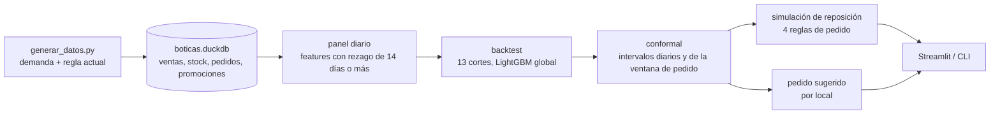
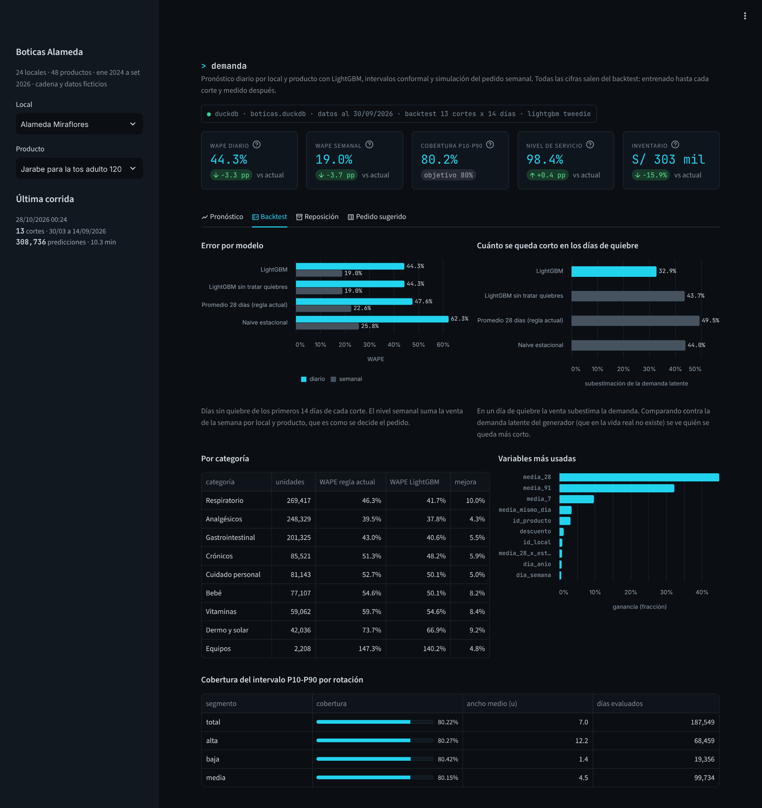
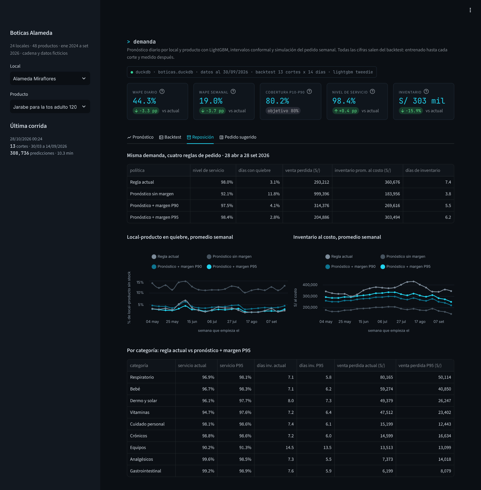
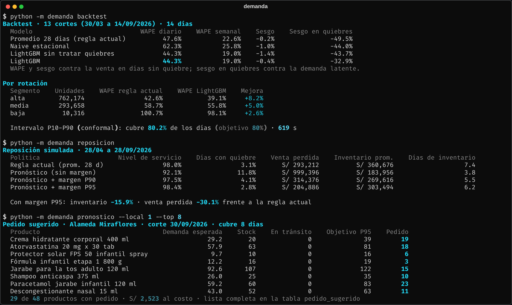
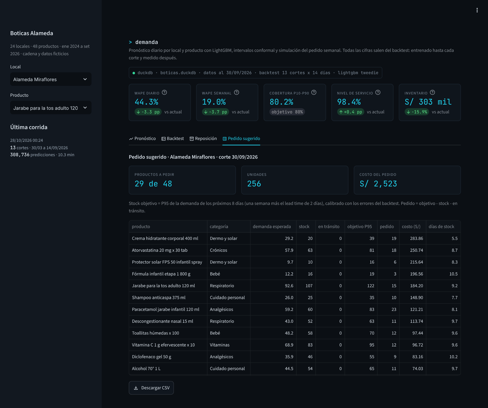

# Pronóstico de demanda y reposición para boticas

Pronóstico diario por local y producto con un LightGBM global, intervalos con conformal prediction y una simulación que traduce el error del modelo a lo que le importa a operaciones: quiebres, inventario y venta perdida.



## El problema

Boticas Alameda (cadena ficticia) tiene 24 locales en Lima, el norte y el sur, y repone cada lunes con una regla simple: pedir hasta cubrir 12 días (15 en provincia) del promedio de venta de las últimas cuatro semanas. En meses tranquilos funciona. Falla justo cuando más importa: cuando la demanda cambia rápido, como al inicio del invierno, en un brote de dengue en el norte o después de un desabastecimiento del proveedor.

Tiene además un problema más escondido: el promedio se calcula sobre la venta, y en un día de quiebre la venta no es la demanda. Si el jarabe se acabó el martes, el promedio de esa semana baja y el pedido del lunes siguiente también. El quiebre se alimenta solo.

Lo que quería responder no era solo "¿cuánto mejora el pronóstico?", sino "¿con cuánto inventario se logra qué nivel de servicio?".

## Qué hace



- **Backtest con origen móvil**: 13 cortes (lunes, cada 14 días, del 30/03 al 14/09/2026). En cada uno se entrena con lo conocido hasta ese día y se pronostican los 14 siguientes. Se comparan la regla actual (promedio de 28 días), un naive estacional y dos LightGBM, con y sin tratamiento de quiebres.
- **Intervalos conformal**: P10-P90 diario y P90/P95 de la demanda acumulada en la ventana que cubre cada pedido, calibrados con los errores de los cortes anteriores.
- **Simulación de reposición**: la misma demanda de abril a setiembre de 2026, con cuatro reglas de pedido.
- **Pedido sugerido**: entrena con toda la historia y arma la lista de pedido de cada local con stock y mercadería en tránsito.

## Datos

24 locales, 48 productos, del 1 de enero de 2024 al 30 de setiembre de 2026: 1.13 millones de filas de venta y stock diario, 154 mil órdenes de reposición y 170 campañas. Todo sale de [`generar_datos.py`](datos/generar_datos.py) con semilla fija.

El generador simula primero la **demanda** (lo que la gente quiso comprar) y después la **reposición** con la regla actual: el pedido sale cada lunes y llega a los 2 días en Lima y a los 4 en provincia. Lo que se vende es lo que había en anaquel, así que los quiebres no se sortean: aparecen solos cuando la demanda sube más rápido que el promedio. La demanda latente se guarda en una tabla aparte que el modelo nunca lee; solo sirve para evaluar y para simular.

| Patrón | En los datos |
|---|---|
| Invierno en Lima | Respiratorio en Lima pasa de 568 u/día en feb-25 a 1,507 en jul-25. El invierno de 2025 fue más fuerte (jul-24: 1,213) y el de 2026 se adelantó a junio (1,565) |
| Dengue en el norte | Repelente en spray: 36 u/día en abr-24 contra 8 en set-24. El paracetamol se duplica (220 vs 114) y el ibuprofeno no se mueve (57 vs 62): con dengue no se recomiendan AINEs |
| Crónicos a inicio de mes | Losartán, metformina y compañía venden 27% más del 1 al 5 que del 8 al 25 |
| Formato del local | El domingo un local en centro comercial vende 44% más que entre semana; uno de avenida, 28% menos |
| Promociones | En los productos con campañas, un día en promoción vende 7.8 u por local contra 4.2 sin promoción (descuento medio 23%). En lo que se puede almacenar (pañales, vitaminas) hay bajón las dos semanas siguientes |
| Quiebres | 3.2% de los días-local-producto terminan con stock 0; la cadena atiende el 98.1% de la demanda. En respiratorio de Lima: 6.6% de quiebre en la subida del invierno (1 jun - 15 jul 2025) y 2.4% en la bajada |
| Desabastecimientos | Jarabe para la tos infantil sin proveedor en pleno invierno: 83% de días-local en quiebre del 14 jul al 3 ago 2025. Losartán: 65% del 16 feb al 1 mar 2026 |
| Local nuevo | Carabayllo abre el 2 jun 2025, con arranque gradual |

## Resultados

Backtest: 13 cortes x 14 días, evaluado contra la venta en días sin quiebre.

| Modelo | WAPE diario | WAPE semanal | Sesgo | Subestimación en días de quiebre |
|---|---:|---:|---:|---:|
| Promedio 28 días (regla actual) | 47.6% | 22.6% | -0.2% | 49.5% |
| Naive estacional | 62.3% | 25.8% | -1.0% | 44.0% |
| LightGBM sin tratar quiebres | 44.3% | 19.0% | -1.4% | 43.7% |
| **LightGBM** | **44.3%** | **19.0%** | **-0.4%** | **32.9%** |



Lo que encontré:

- **A nivel día-local-producto el error es alto para cualquier modelo.** Un local vende 3 jarabes un día y 7 al siguiente, y eso no lo predice nadie. El LightGBM baja el WAPE diario de 47.6% a 44.3%; a nivel semanal, que es como se decide el pedido, de 22.6% a 19.0% (16% menos error). Donde más gana es donde la demanda se mueve: respiratorio (10.0% menos error), dermo y solar (9.2%), vitaminas (8.4%) y bebé (8.2%). En analgésicos, que son estables, apenas 4.3%.
- **Tratar los quiebres no mueve el WAPE, pero sí el sesgo donde importa.** Medido contra la venta, los dos LightGBM quedan igual (44.3%). Medido contra la demanda latente en los días de quiebre, el modelo que toma la venta tal cual se queda 43.7% corto; el que trata esos días como faltantes, 32.9%. La regla actual, 49.5%. Es un error que no se ve en ninguna métrica de backtest normal porque se evalúa contra la venta, que justamente es lo que está censurado.
- **Los intervalos cumplen lo que prometen.** El P10-P90 cubre 80.2% de los días, y por rotación entre 80.2% y 80.4%. Para la ventana de pedido, el P90 cubrió 90.3% de las ventanas (sin quiebre) de los cortes siguientes y el P95, 95.2%.
- **Un buen pronóstico sin margen es peor que la regla actual.** Pedir exactamente lo pronosticado baja el inventario a la mitad, pero el nivel de servicio cae a 92.1% y la venta perdida pasa de S/ 293 mil a S/ 999 mil. La regla actual tiene un colchón implícito (12 días de cobertura para una ventana de 8); el pronóstico necesita uno explícito.
- **Con margen P95 se gana por los dos lados.** Mismo nivel de servicio o mejor (98.4% vs 98.0%), 30% menos venta perdida y 16% menos inventario: de 7.4 a 6.2 días. Con P90 el inventario baja 25% a cambio de medio punto de servicio; cuál conviene depende de cuánto cuesta un quiebre frente a un sol inmovilizado.
- **No mejora en todo.** Con P95, analgésicos baja de 99.6% a 98.5% de servicio y gastrointestinal de 99.2% a 98.9%: son productos estables a los que la regla actual les sobraba stock. Respiratorio sube de 96.9% a 98.1% y vitaminas de 94.7% a 97.6%. El margen se calibra por rotación, no por categoría, y se nota.

| Política (28 abr - 28 set 2026) | Nivel de servicio | Días con quiebre | Venta perdida | Inventario promedio al costo | Días de inventario |
|---|---:|---:|---:|---:|---:|
| Regla actual | 98.0% | 3.1% | S/ 293,212 | S/ 360,676 | 7.4 |
| Pronóstico sin margen | 92.1% | 11.8% | S/ 999,396 | S/ 183,956 | 3.8 |
| Pronóstico + margen P90 | 97.5% | 4.1% | S/ 314,376 | S/ 269,616 | 5.5 |
| **Pronóstico + margen P95** | **98.4%** | **2.8%** | **S/ 204,886** | **S/ 303,494** | **6.2** |



La simulación de la regla actual reproduce exactamente la historia del generador, día por día y serie por serie (venta y stock de cierre). Es la prueba de que el simulador está bien antes de creerle a las otras tres filas; está en [`test_reposicion.py`](tests/test_reposicion.py).

## Decisiones

- **Un modelo global y no 1,152.** Las series de un local son cortas y ruidosas; un solo LightGBM aprende la forma del invierno con todos los locales y le sirve a Carabayllo, que abrió en junio de 2025.
- **Todas las variables de venta miran 14 días atrás o más.** Así una sola tabla de features sirve para todo el horizonte sin filtrar el futuro. Hay un test que cambia la venta de los últimos 13 días y verifica que las features no se muevan. Lo que sí se conoce de antemano entra con la fecha del día a pronosticar: calendario, feriados y promociones planificadas.
- **Objetivo Tweedie.** Son conteos, con muchos ceros en los productos lentos y colas largas en las campañas.
- **Quiebres como dato faltante**, en los promedios y en el objetivo. Imputarlos con la demanda latente sería hacer trampa: en la vida real no se conoce.
- **Conformal normalizado y calibrado hacia atrás.** El error se divide entre la raíz del pronóstico, para que un mismo cuantil le sirva a una serie que vende 40 al día y a una que vende 2. Cada corte se calibra con los dos anteriores, nunca con el propio. Para el pedido se calibra aparte la suma de la ventana: sumar los P90 diarios da un margen mucho más ancho de lo necesario.
- **Medir en la decisión.** El WAPE diario sirve para comparar modelos, pero la pregunta de negocio se responde con el error semanal y con la simulación.
- **Cortes en lunes, reentrenamiento cada dos semanas, pedido cada semana.** Es como se trabajaría en producción; el modelo de un corte también decide el pedido del lunes siguiente.

## Correrlo

Python 3.10+.

```bash
cd proyectos/03-pronostico-demanda-boticas
pip install -e ".[app,dev]"

python -m demanda generar              # ~2 s, base de 15 MB
python -m demanda backtest             # 26 entrenamientos, ~10 min con 2 núcleos
python -m demanda reposicion           # ~5 s
python -m demanda pronostico --local 1 # pedido sugerido de un local
python -m demanda todo                 # los cuatro pasos

streamlit run app.py
pytest                                 # 33 tests, ~15 s
```

`backtest --cortes 4 --rondas 100` sirve para una corrida rápida. Los resultados quedan en `datos/resultados.duckdb`, que es lo que lee la app.



## Estructura

```
03-pronostico-demanda-boticas/
├── app.py                    tablero (pronóstico, backtest, reposición, pedido)
├── datos/generar_datos.py    demanda, regla de reposición y exports
├── src/demanda/
│   ├── calendario.py         feriados, quincenas, etiquetas de fecha
│   ├── datos.py              carga y panel diario sin huecos
│   ├── features.py           rezagos, medias móviles, estacionalidad del año anterior
│   ├── modelos.py            baselines y LightGBM global
│   ├── backtest.py           cortes, métricas y calibración
│   ├── intervalos.py         conformal normalizado por segmento
│   ├── reposicion.py         simulación de políticas de pedido
│   ├── pronostico.py         pronóstico vigente y pedido sugerido
│   ├── resultados.py         lectura y escritura en resultados.duckdb
│   └── cli.py
└── tests/                    generador, features, intervalos, backtest, simulación, cli
```



## Limitaciones

- **La demanda latente es un lujo de los datos sintéticos.** Con datos reales habría que estimarla: hora del quiebre, ventas de días comparables, sustitutos. El tratamiento de quiebres del modelo no depende de ella, pero la simulación sí.
- **La simulación usa la historia real para las features.** Con otra política habría menos quiebres y el modelo vería otra venta; el efecto es chico porque los quiebres se tratan como faltantes, pero existe.
- No hay sustitución entre productos (si no hay jarabe de una marca, se lleva otro) ni transferencias entre locales.
- El modelo reacciona al dengue con 14 días de retraso. Los casos reportados por semana epidemiológica serían una buena variable externa.
- El margen se calibra por rotación. Lo correcto sería fijar el nivel de servicio por producto según el costo de quedarse sin stock frente al de tenerlo (lógica newsvendor), y ahí analgésicos no tendría el mismo P95 que respiratorio.

## Lo que sigue

- Nivel de servicio objetivo por categoría con costos de quiebre y de inventario.
- Variable externa de casos de dengue y de temperatura para el inicio del invierno.
- Pronóstico jerárquico (local → región → cadena) para el pedido al proveedor.
- Registro de corridas con MLflow y reentrenamiento programado.
