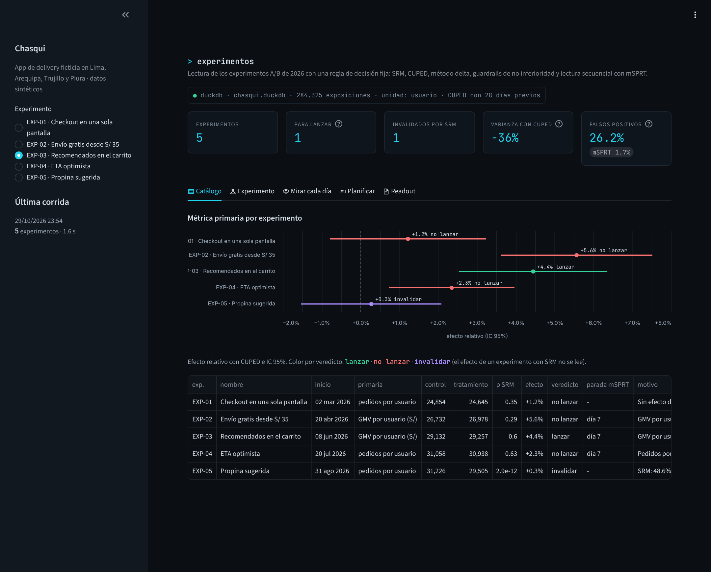
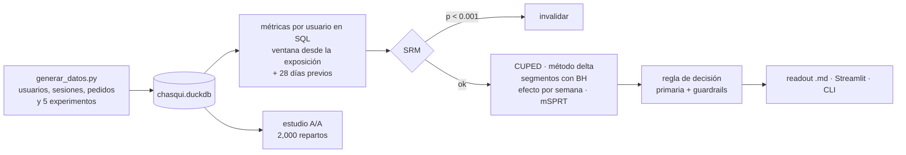
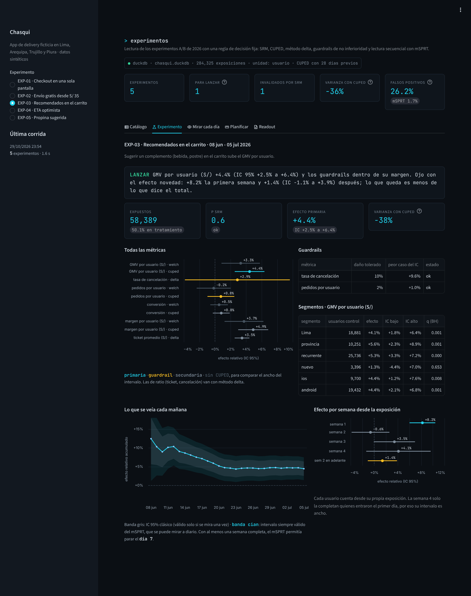
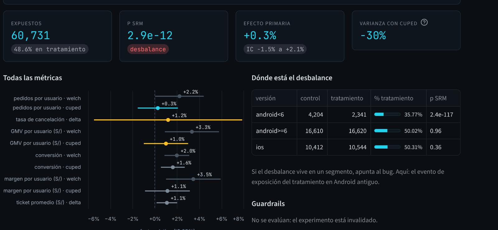
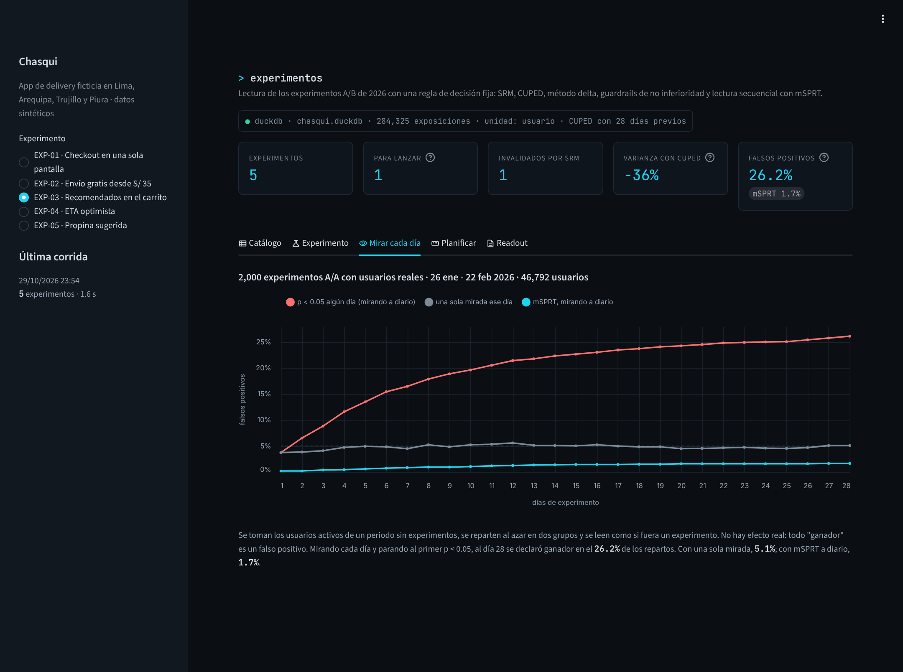
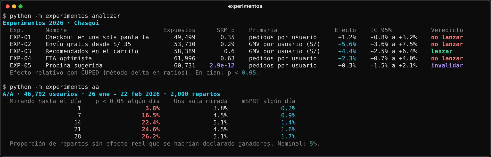
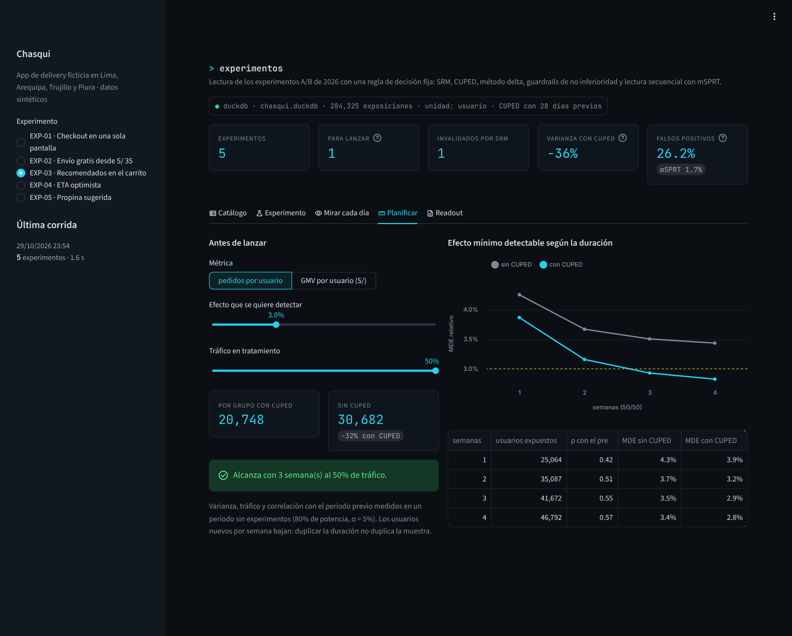

# Lectura de experimentos A/B para una app de delivery

Toma los experimentos que corrió un equipo de producto, revisa que la asignación esté sana, mide el efecto con CUPED y método delta, aplica una regla de decisión escrita de antemano y deja un readout en Markdown por experimento. Incluye un estudio A/A que mide cuánto se equivoca uno al mirar el tablero todos los días.



## El problema

Chasqui (app ficticia) opera delivery en Lima, Arequipa, Trujillo y Piura. En 2026 el equipo de producto corrió cinco experimentos de cuatro semanas cada uno. La lectura la hacía quien había propuesto el cambio, mirando un dashboard cada mañana, y cada vez se discutía lo mismo:

- ¿Paramos ya? Ayer salió p = 0.03.
- Sube el GMV, pero el margen baja. ¿Lanzamos o no?
- En Lima funciona y en provincia no. ¿Lo lanzamos solo en Lima?
- El grupo tratamiento tiene 1,700 usuarios menos que el control. ¿Importa?

Quería una lectura que no dependa de quién la haga: los mismos chequeos para todos, las mismas métricas definidas en SQL y una regla de decisión fija antes de ver los datos.

## Qué hace



- **Métricas por usuario expuesto**, armadas en SQL ([`metricas.py`](src/experimentos/metricas.py)): cada usuario cuenta sus pedidos desde el día de su primera exposición hasta el fin de la ventana. La covariable de CUPED es la misma métrica en los 28 días previos al inicio.
- **SRM** (Sample Ratio Mismatch) con chi-cuadrado, y desglosado por versión de la app para ubicar el problema.
- **CUPED** en las métricas por usuario y **método delta** en las de ratio (ticket promedio, tasa de cancelación), donde la unidad de aleatorización es el usuario y no el pedido.
- **Guardrails de no inferioridad**: cada experimento declara cuánto daño tolera en cada guardrail (por ejemplo, margen -3%) y se evalúa el extremo malo del intervalo.
- **Segmentos** (región, usuario nuevo o recurrente, plataforma) con q-valores de Benjamini-Hochberg.
- **Efecto por semana desde la exposición**, para detectar efecto novedad.
- **Lectura secuencial con mSPRT**: un p-valor que se puede mirar a diario sin inflar los falsos positivos.
- **Readout en Markdown** por experimento, listo para pegar en el canal del equipo.

La regla de decisión ([`decision.py`](src/experimentos/decision.py)):

| Condición | Veredicto |
|---|---|
| SRM con p < 0.001 | invalidar (no se lee nada más) |
| Algún guardrail con daño significativo | no lanzar |
| Primaria positiva y guardrails dentro de su margen | lanzar |
| Primaria positiva y algún guardrail sin concluir | extender |
| Primaria sin efecto o negativa | no lanzar |

## Datos

150 mil usuarios, 1.05 millones de pedidos y 284 mil exposiciones a experimentos, del 1 de diciembre de 2025 al 27 de setiembre de 2026. Todo sale de [`generar_datos.py`](datos/generar_datos.py) con semilla fija, en unos 4 segundos.

El generador simula por usuario y por día si abre la app y, si abre, si pide. Cada experimento asigna con el mismo hash que usa el análisis ([`asignacion.py`](src/experimentos/asignacion.py)) y registra la primera sesión dentro de la ventana como exposición. Los efectos verdaderos quedan en la tabla `efectos_reales`, que el análisis no lee; sirve para comprobar si la lectura los recupera.

| Patrón | En los datos |
|---|---|
| Pocos usuarios piden mucho | El 10% más activo hace el 45.7% de los pedidos de 2026 |
| Fin de semana | El sábado entran 4,407 pedidos por día; el martes, 2,932 |
| Quincena | Los días 1, 15, 16 y fin de mes tienen 11% más pedidos que el resto |
| Estacionalidad y crecimiento | 2,836 pedidos por día en febrero, 4,230 en julio (frío y Fiestas Patrias) |
| Lima vs provincia | Ticket de S/ 41.9 en Lima y S/ 34.0 en provincia; en Lima cada usuario pide 26% más seguido |
| Usuarios nuevos | 30% se registró durante el periodo, con un primer mes más activo |
| Persistencia | La correlación entre los pedidos de 4 semanas y los de las 4 previas es 0.57: es lo que aprovecha CUPED |

| Experimento | Efecto real en el generador |
|---|---|
| EXP-01 Checkout en una pantalla | +2% en la probabilidad de pedir |
| EXP-02 Envío gratis desde S/ 35 | Carritos de S/ 24 a 35 que suben al umbral (30% en Lima, 40% en provincia), +3% de pedidos, el comercio cofinancia 75% de la tarifa |
| EXP-03 Recomendados en el carrito | Ticket +0.8% + 9%·e^(-días/5): fuerte la primera semana, casi nada después |
| EXP-04 ETA optimista | +3.5% de pedidos, cancelación x1.55 |
| EXP-05 Propina sugerida | Ninguno. Bug de logging: en Android antiguo, el tratamiento registra la exposición recién en la segunda sesión |

## Resultados



| Experimento | Expuestos | SRM p | Primaria | Efecto (CUPED) | IC 95% | Veredicto |
|---|---:|---:|---|---:|---|---|
| EXP-01 Checkout en una pantalla | 49,499 | 0.35 | pedidos por usuario | +1.2% | -0.8% a +3.2% | no lanzar |
| EXP-02 Envío gratis desde S/ 35 | 53,710 | 0.29 | GMV por usuario | +5.6% | +3.6% a +7.5% | no lanzar |
| EXP-03 Recomendados en el carrito | 58,389 | 0.60 | GMV por usuario | +4.4% | +2.5% a +6.4% | lanzar, con alerta de novedad |
| EXP-04 ETA optimista | 61,996 | 0.63 | pedidos por usuario | +2.3% | +0.7% a +4.0% | no lanzar |
| EXP-05 Propina sugerida | 60,731 | 2.9e-12 | pedidos por usuario | +0.3% | -1.5% a +2.1% | invalidar |

Lo que encontré:

- **Mirar el tablero cada día y parar al primer p < 0.05 convierte un 5% de error en 26%.** En el estudio A/A (2,000 repartos al azar de 46,792 usuarios reales de un periodo sin experimentos) una sola lectura al día 28 da 5.1% de falsos positivos, como debe ser. Revisando todos los días y parando apenas aparece significancia, al día 7 ya van 16.5% y al día 28, 26.2%. Con mSPRT mirando a diario: 1.7%.
- **EXP-05 parecía un ganador y era un bug.** Sin CUPED, pedidos por usuario sube 2.2% (p = 0.043) y GMV 3.3% (p = 0.006). El SRM salta (48.6% en tratamiento) y el desglose lo ubica: en Android antiguo el tratamiento tiene 35.8% de los expuestos; en Android nuevo e iOS, 50.0% y 50.3%. El bug registraba solo a quienes abrían la app dos veces, o sea a los más activos. CUPED baja el falso efecto en pedidos a +0.3%, pero no lo arregla: la conversión sigue saliendo +1.6% con p = 0.003. Por eso el SRM va primero y no se negocia.
- **EXP-02 sube el GMV y se come el margen.** GMV +5.6%, ticket +2.8% y pedidos +3.2%: la gente completa el carrito para llegar a S/ 35 (los pedidos de S/ 35 o más pasan de 51.9% a 62.2%). Pero la tarifa promedio cobrada cae de S/ 5.59 a S/ 2.09 y el margen por usuario baja 7.9% (IC -9.8% a -6.1%), contra un daño tolerado de 3%. El veredicto es no lanzar tal cual; lo que sigue es probar un umbral más alto.
- **EXP-03 se lanza, pero el +4.4% del mes no es lo que va a quedar.** La primera semana desde la exposición el GMV sube 8.2%; de la segunda en adelante, 1.4% (IC -1.1% a +3.9%). La regla de decisión lo marca como alerta de novedad. El generador tiene justamente eso: un efecto que se apaga en días.
- **EXP-04 vende más pedidos con una promesa que no cumple.** Pedidos +2.3%, pero la cancelación pasa de 3.15% a 4.92% (+56%). El margen incluso sube 2.3% porque un pedido cancelado no cuesta rider; el guardrail de cancelación es el que frena el lanzamiento.
- **EXP-01 no tenía cómo detectar su efecto.** El efecto real era +2% y la lectura da +1.2% con un IC de -0.8% a +3.2%. Con el tráfico de cuatro semanas (unos 24,700 usuarios por grupo) el efecto mínimo detectable es 2.8% con CUPED y 3.4% sin él. Para ver +2% hacían falta 46,683 usuarios por grupo con CUPED (69,033 sin CUPED). Ese cálculo se hace antes de lanzar, no después; la pestaña Planificar está para eso.
- **CUPED baja la varianza de la primaria entre 29% y 42%**, según el experimento. En EXP-01 el error estándar del efecto pasa de 1.22% a 1.03% de la media. Probé una ventana previa de 56 días en vez de 28: la correlación sube de 0.57 a 0.59 y el MDE a 4 semanas apenas baja de 2.83% a 2.78%, así que me quedé con 28.
- **"Significativo en Lima y no en provincia" no es lo mismo que "funciona solo en Lima".** En EXP-04, Lima da +3.3% (q = 0.007) y provincia +0.3% (IC -2.5% a +3.1%). El generador no tiene ninguna diferencia por región: el efecto es el mismo en todas partes. Los segmentos se reportan con su q-valor para dar contexto, no para buscar dónde lanzar.





### Parar antes

El mSPRT permite revisar el resultado cada mañana. Exigiendo al menos una semana completa (el efecto de un lunes no es el de un sábado), EXP-02, EXP-03 y EXP-04 podían cerrarse el día 7 en la métrica primaria. Con el p-valor clásico, EXP-02 y EXP-03 ya daban p < 0.05 el primer día, y en EXP-03 parar ahí habría reportado el efecto inflado por la novedad. Parar antes solo aplica si los guardrails también están leídos: en EXP-04 la primaria cruzó el día 7, pero lo que decide es la cancelación.

## Decisiones de diseño

- **La unidad es el usuario, no el pedido.** Es lo que se aleatoriza. Las métricas de ratio (ticket, cancelación) se calculan como suma sobre suma por grupo y su varianza con método delta; tratar cada pedido como observación independiente subestima el error. Hay un test que compara el método delta contra un bootstrap por usuario.
- **Ventana desde la exposición de cada usuario**, no desde el inicio del experimento. Un pedido anterior a que el usuario vea el cambio no puede ser efecto del cambio, y meterlo diluye la diferencia.
- **θ de CUPED estimado con los dos grupos juntos.** Así no depende de la asignación y el estimador sigue siendo insesgado; el test lo verifica con 300 simulaciones.
- **Guardrails como no inferioridad y no como "que no sea significativo".** Un guardrail con IC ancho no "pasa" por no ser significativo: si el extremo malo supera el margen, queda sin concluir y el veredicto es extender.
- **mSPRT con τ = 5% de la media del control.** τ es el tamaño de efecto donde el test tiene más potencia. Como las métricas son acumuladas y su nivel crece con los días, la garantía no sale del libro: la verifiqué con el A/A sobre los datos reales. El intervalo siempre válido no se intersecta entre días, porque con novedad el estimando cambia.
- **La regla de decisión está en código**, con un test por cada rama. Cambiarla es un PR, no una conversación.
- **El readout sale de la misma lectura que el tablero**, así no hay dos versiones de una cifra.

## Correrlo

Python 3.10+.

```bash
cd proyectos/04-experimentos-ab-delivery
pip install -e ".[app,dev]"

python -m experimentos generar          # ~4 s, base de 150 mil usuarios
python -m experimentos analizar         # los 5 experimentos, ~2 s
python -m experimentos analizar --exp EXP-04
python -m experimentos aa               # 2,000 repartos, ~6 s
python -m experimentos planificar       # MDE por semanas de duración
python -m experimentos reporte EXP-02   # deja reportes/EXP-02.md
python -m experimentos todo             # todo lo anterior y los 5 readouts

streamlit run app.py
pytest                                  # 31 tests, ~6 s
```

`generar --escala 0.2` arma una base más chica para probar. Los resultados quedan en `datos/resultados.duckdb`, que es lo que lee la app.



## Estructura

```
04-experimentos-ab-delivery/
├── app.py                     tablero (catálogo, experimento, A/A, planificar, readout)
├── datos/generar_datos.py     usuarios, sesiones, pedidos y efectos de cada experimento
├── src/experimentos/
│   ├── catalogo.py            experimentos, métricas, guardrails y márgenes tolerados
│   ├── asignacion.py          hash determinístico por usuario y experimento
│   ├── metricas.py            tablas por usuario y acumulado diario en SQL (DuckDB)
│   ├── estadistica.py         Welch, CUPED, método delta, SRM, BH, MDE
│   ├── secuencial.py          mSPRT e intervalo siempre válido
│   ├── analisis.py            lectura completa de un experimento
│   ├── decision.py            regla de decisión y alerta de novedad
│   ├── aa.py                  estudio A/A vectorizado
│   ├── planificacion.py       MDE con tráfico y varianza reales
│   ├── reporte.py             readout en Markdown
│   ├── resultados.py          resultados.duckdb
│   └── cli.py
└── tests/                     asignación, estadística, SQL, decisión, generador, análisis, cli
```



## Limitaciones

- **Los efectos reales se conocen porque los datos son sintéticos.** Con datos reales, la única forma de calibrar la lectura es el A/A y, si existe, un histórico de experimentos con resultados conocidos.
- **No hay interacción entre experimentos.** Aquí corren en ventanas separadas; con experimentos en paralelo sobre los mismos usuarios habría que revisar interacciones o usar capas de asignación.
- **El efecto es sobre la ventana de cuatro semanas.** No mide efectos de largo plazo (retención a 3 meses, hábito). Para eso se usa un holdout que se queda sin el cambio varios meses.
- **Las métricas de ratio no llevan CUPED.** Se puede combinar con el método delta (ajustando numerador y denominador), pero aquí las de ratio son guardrails o secundarias.
- **El SRM detecta el desbalance, no lo corrige.** Si el bug es de logging, a veces se puede reconstruir la exposición desde otro evento; aquí el veredicto es no leer y volver a correr.
- Los segmentos son fijos. Buscar el segmento ganador entre muchos es la forma más rápida de encontrar ruido.

## Lo que sigue

- Capa semántica de métricas (definición única en YAML) que use el análisis y el dashboard del negocio.
- CUPED con varias covariables (regresión) y para métricas de ratio.
- Holdout de largo plazo para los cambios que se lanzan.
- Programar `python -m experimentos analizar` cada mañana y mandar el readout al canal cuando un experimento cruza su umbral o salta el SRM.
