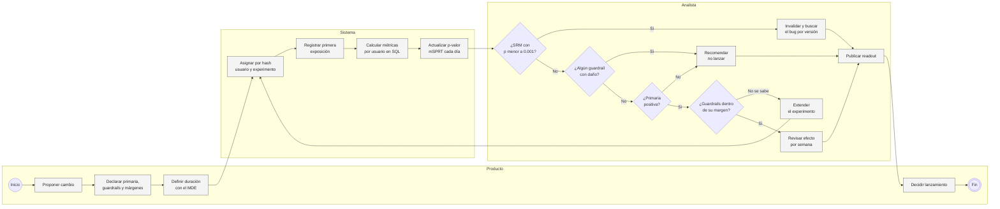
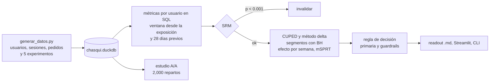
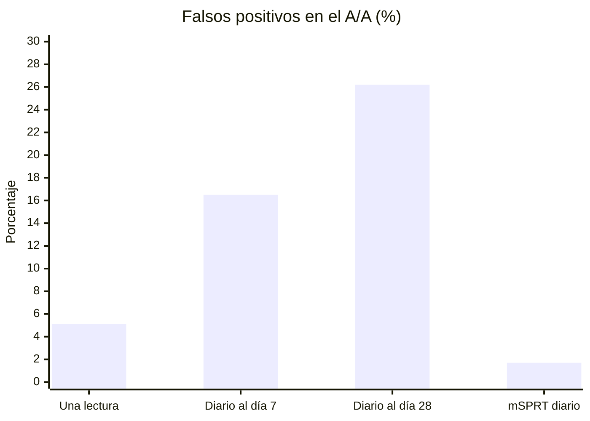

# Lectura de experimentos A/B para una app de delivery

Chasqui es una app de delivery ficticia que opera en Lima, Arequipa, Trujillo y Piura. En 2026 su equipo de producto corrió cinco experimentos de cuatro semanas. Cada uno lo leía quien había propuesto el cambio, mirando un dashboard cada mañana, y las discusiones se repetían. Que ayer salió p = 0.03 y ya se puede parar. Que sube el GMV pero baja el margen. Que en Lima funciona y en provincia no. Que el tratamiento tiene 1,700 usuarios menos que el control y nadie sabe si eso importa.

Armé este proyecto para que la lectura no dependa de quién la haga: los mismos chequeos, métricas definidas en SQL y una regla de decisión fijada antes de ver los datos, con un readout en Markdown por experimento. También hay un estudio A/A que mide cuánto se equivoca uno cuando revisa el tablero todos los días.

## Cómo queda el proceso

Producto declara qué va a medir y cuánto daño tolera antes de lanzar, y la lectura sigue un orden fijo.



La regla vive en [`decision.py`](src/experimentos/decision.py) y tiene un test por cada rama. Si alguien quiere cambiarla, abre un PR.

| Condición | Veredicto |
|---|---|
| SRM con p < 0.001 | invalidar, no se lee nada más |
| Algún guardrail con daño significativo | no lanzar |
| Primaria positiva y guardrails dentro de su margen | lanzar |
| Primaria positiva y algún guardrail sin concluir | extender |
| Primaria sin efecto o negativa | no lanzar |

## Por dentro



La unidad de análisis es el usuario expuesto, porque es lo que se aleatoriza. En [`metricas.py`](src/experimentos/metricas.py) cada usuario acumula sus pedidos desde el día de su primera exposición hasta el fin de la ventana; un pedido anterior a ver el cambio no puede ser efecto del cambio. La covariable de CUPED es la misma métrica en los 28 días previos y el θ se estima con los dos grupos juntos para que el estimador siga insesgado. Las métricas de ratio, como ticket promedio o tasa de cancelación, se calculan como suma sobre suma por grupo con varianza por método delta, contrastada en los tests con un bootstrap por usuario.

Los guardrails se evalúan como no inferioridad. Cada experimento declara cuánto daño tolera, por ejemplo margen -3%, y se mira el extremo malo del intervalo. Un guardrail con IC ancho no pasa solo por no ser significativo; queda sin concluir y el veredicto es extender.

Para el mSPRT usé τ = 5% de la media del control y verifiqué la garantía con el A/A, porque con métricas acumuladas no me fié de la teoría. Los segmentos (región, nuevo o recurrente, plataforma) salen con q-valores de Benjamini-Hochberg.

## Los datos

150 mil usuarios, 1.05 millones de pedidos y 284 mil exposiciones, del 1 de diciembre de 2025 al 27 de setiembre de 2026, generados con semilla fija por [`generar_datos.py`](datos/generar_datos.py). Asigna con el mismo hash que usa el análisis ([`asignacion.py`](src/experimentos/asignacion.py)).

Traté de que se parezca a un delivery de verdad: el 10% más activo hace el 45.7% de los pedidos de 2026 y el ticket es de S/ 41.9 en Lima y S/ 34.0 en provincia. La correlación entre los pedidos de 4 semanas y los de las 4 previas es 0.57, que es justo lo que aprovecha CUPED.

Los efectos verdaderos quedan en la tabla `efectos_reales`, que el análisis nunca lee. EXP-01 sube 2% la probabilidad de pedir. EXP-04 sube 3.5% los pedidos pero multiplica la cancelación por 1.55. EXP-05 no tiene efecto, pero sí un bug de logging: en Android antiguo el tratamiento registra la exposición recién en la segunda sesión.

## Qué salió

| Experimento | Expuestos | SRM p | Primaria | Efecto (CUPED) | IC 95% | Veredicto |
|---|---:|---:|---|---:|---|---|
| EXP-01 Checkout en una pantalla | 49,499 | 0.35 | pedidos por usuario | +1.2% | -0.8% a +3.2% | no lanzar |
| EXP-02 Envío gratis desde S/ 35 | 53,710 | 0.29 | GMV por usuario | +5.6% | +3.6% a +7.5% | no lanzar |
| EXP-03 Recomendados en el carrito | 58,389 | 0.60 | GMV por usuario | +4.4% | +2.5% a +6.4% | lanzar, con alerta de novedad |
| EXP-04 ETA optimista | 61,996 | 0.63 | pedidos por usuario | +2.3% | +0.7% a +4.0% | no lanzar |
| EXP-05 Propina sugerida | 60,731 | 2.9e-12 | pedidos por usuario | +0.3% | -1.5% a +2.1% | invalidar |

Lo que más quería medir era el costo de mirar el tablero a diario. En el A/A hice 2,000 repartos al azar de 46,792 usuarios de un periodo sin experimentos. Con una sola lectura al día 28 hay 5.1% de falsos positivos, como corresponde. Si uno revisa todos los días y para apenas ve p < 0.05, al día 7 ya va en 16.5% y al día 28 en **26.2%**. Con mSPRT mirando a diario se queda en 1.7%.



EXP-05 parecía un ganador, con GMV +3.3% (p = 0.006) sin CUPED. Pero el SRM salta con 48.6% en tratamiento, y al desglosar por versión el problema aparece en Android antiguo, donde el tratamiento tiene 35.8% de los expuestos contra 50.0% y 50.3% en Android nuevo e iOS. El bug solo registraba a quienes abrían la app dos veces, que son los más activos. CUPED baja el falso efecto en pedidos a +0.3%, pero la conversión sigue saliendo +1.6% con p = 0.003. Por eso el SRM se revisa primero y no se negocia.

EXP-02 sube el GMV 5.6% porque la gente completa el carrito para llegar a S/ 35. El problema es que la tarifa promedio cobrada cae de S/ 5.59 a S/ 2.09 y el margen por usuario baja 7.9% (IC -9.8% a -6.1%), cuando lo tolerado era 3%. Lo que toca es probar un umbral más alto. EXP-04 vende 2.3% más pedidos con una promesa que no cumple, y la cancelación pasa de 3.15% a 4.92%.

EXP-03 sí se lanza, aunque el +4.4% del mes no es lo que va a quedar. La primera semana desde la exposición el GMV sube 8.2% y de la segunda en adelante 1.4% (IC -1.1% a +3.9%). En EXP-01 el efecto real era +2%, y con unos 24,700 usuarios por grupo el mínimo detectable era 2.8% con CUPED. Para verlo hacían falta 46,683 usuarios por grupo con CUPED. Esa cuenta se hace antes de lanzar, y para eso está la pestaña Planificar.

Con el mSPRT, exigiendo al menos una semana completa, EXP-02, EXP-03 y EXP-04 podían cerrarse el día 7. Pero en EXP-04 quien decide es la cancelación, así que parar antes solo vale si los guardrails también están leídos.

## Para correrlo

Python 3.10+.

```bash
cd proyectos/04-experimentos-ab-delivery
pip install -e ".[app,dev]"

python -m experimentos generar          # ~4 s, base de 150 mil usuarios
python -m experimentos analizar         # los 5 experimentos, ~2 s
python -m experimentos analizar --exp EXP-04
python -m experimentos aa               # 2,000 repartos, ~6 s
python -m experimentos planificar       # MDE por semanas de duración
python -m experimentos reporte EXP-02   # deja reportes/EXP-02.md
python -m experimentos todo             # todo lo anterior y los 5 readouts

streamlit run app.py
pytest                                  # 31 tests, ~6 s
```

`generar --escala 0.2` arma una base chica. Los resultados quedan en `datos/resultados.duckdb`, que es lo que lee la app.

```
04-experimentos-ab-delivery/
├── app.py                     tablero (catálogo, experimento, A/A, planificar, readout)
├── datos/generar_datos.py     usuarios, sesiones, pedidos y efectos de cada experimento
├── src/experimentos/
│   ├── catalogo.py            experimentos, métricas, guardrails y márgenes tolerados
│   ├── asignacion.py          hash determinístico por usuario y experimento
│   ├── metricas.py            tablas por usuario y acumulado diario en SQL (DuckDB)
│   ├── estadistica.py         Welch, CUPED, método delta, SRM, BH, MDE
│   ├── secuencial.py          mSPRT e intervalo siempre válido
│   ├── analisis.py            lectura completa de un experimento
│   ├── decision.py            regla de decisión y alerta de novedad
│   ├── aa.py                  estudio A/A vectorizado
│   ├── planificacion.py       MDE con tráfico y varianza reales
│   ├── reporte.py             readout en Markdown
│   ├── resultados.py          resultados.duckdb
│   └── cli.py
└── tests/                     asignación, estadística, SQL, decisión, generador, análisis, cli
```

## Hasta dónde llega

Conozco los efectos reales porque los datos son sintéticos. Con datos de verdad la única forma de calibrar la lectura es el A/A y, si existe, un histórico de experimentos con resultado conocido.

Los experimentos corren en ventanas separadas; con varios en paralelo sobre los mismos usuarios harían falta capas de asignación. Tampoco mido nada más allá de las cuatro semanas; retención o hábito necesitan un holdout de varios meses. Las métricas de ratio van sin CUPED, y el SRM detecta el desbalance pero no lo corrige.

Lo próximo que haría es una capa semántica de métricas en YAML que compartan el análisis y el dashboard del negocio, CUPED con varias covariables, y programar `python -m experimentos analizar` cada mañana para que mande el readout al canal cuando un experimento cruce su umbral o salte el SRM.
