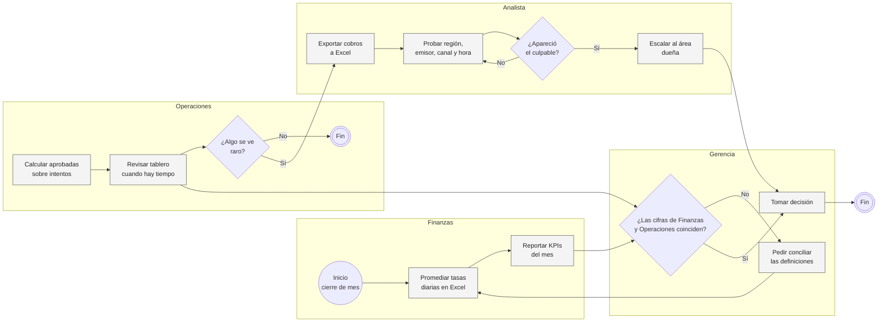
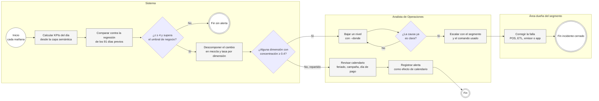
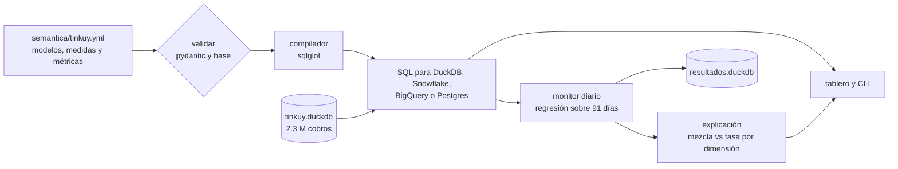
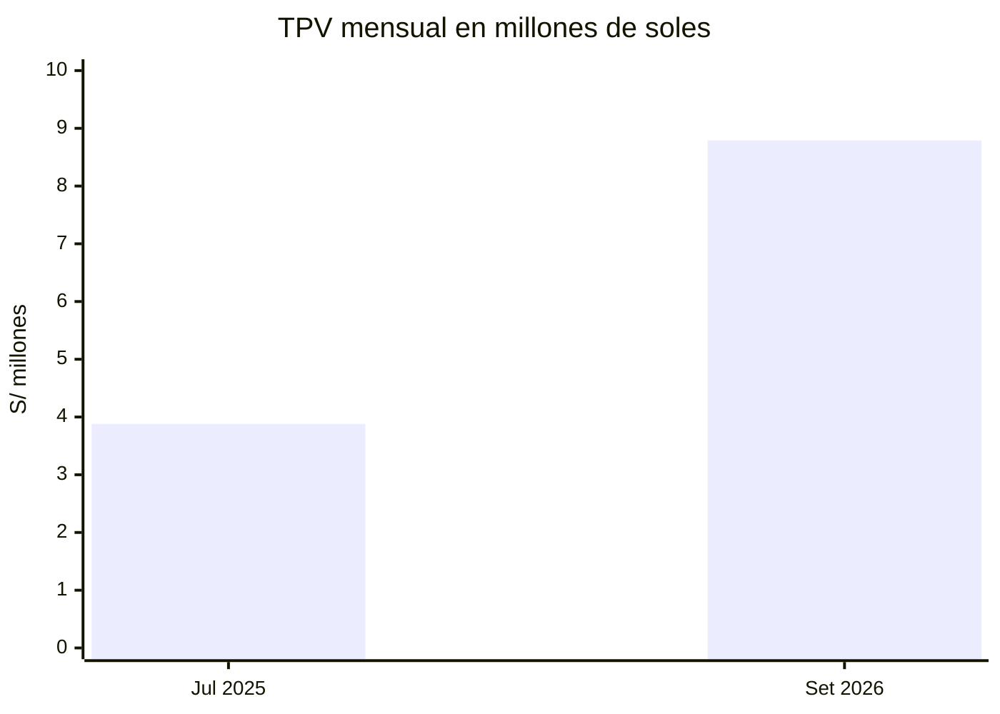

# Capa semántica y monitor de KPIs para una pasarela de pagos

Tinkuy Pay es una empresa ficticia que procesa cobros de bodegas, restaurantes, farmacias, tiendas de ropa y servicios en Lima, Arequipa, Trujillo, Piura y Cusco, con QR interoperable, débito, crédito y link de pago, desde la app del comercio o un POS. Entre julio de 2025 y setiembre de 2026 pasaron por su plataforma 2.3 millones de intentos de cobro.

## Problemática

Cada área calculaba los KPIs a su manera. Finanzas sacaba la tasa de aprobación como promedio de las tasas diarias y Operaciones como aprobadas sobre intentos, así que en meses con días de mucho y poco volumen las cifras no coincidían y las reuniones empezaban discutiendo qué número era el correcto. "Comercios activos" se sumaba por semana para armar el mes, y un comercio que cobra todos los días contaba 30 veces.

Cuando un KPI se movía, nadie se enteraba hasta que alguien miraba el tablero. Y para saber por qué, un analista abría Excel y probaba dimensión por dimensión hasta encontrar al culpable. Tampoco había forma de separar un problema real de un cambio de mezcla: si el ticket promedio bajaba, no se sabía si los comercios vendían menos o si habían entrado muchos comercios de ticket bajo.

## Solución

Armé una capa semántica donde cada métrica se define una vez en YAML, con responsable, formato y umbral de negocio, y se compila a SQL para DuckDB, Snowflake, BigQuery o Postgres. Encima corre un monitor diario que compara cada KPI contra lo esperado para ese día y, cuando salta, descompone el cambio en efecto mezcla y efecto tasa por dimensión para decir en qué segmento está.

El alcance incluye el YAML con ocho métricas, el compilador con sqlglot, la validación contra la base, el monitor, la explicación, una CLI y un tablero en Streamlit, probado contra cuatro incidentes simulados. Quedan fuera los joins entre tablas de hechos (cobros con contracargos), el envío automático de alertas a un canal y la calibración con postmortems reales.

## AS IS: cada área con su número y la causa se busca a mano



Los problemas están en tres lugares. Hay dos definiciones de la misma métrica, y cada mes se reprocesa para conciliarlas. La detección depende de que alguien mire el tablero, así que una falla de unas horas, como la caída de un emisor un viernes al mediodía, puede pasar sin que nadie la note. Y la búsqueda de la causa es un ciclo manual de prueba y error que no deja rastro de qué se revisó.

## TO BE: una definición, alerta diaria y causa por segmento



El carril del Sistema está en el código, igual que el comando `explicar` con `--donde` que usa el analista. Revisar el calendario, escalar y corregir la falla son tareas de las personas y no están programadas.

## Cómo cambian los indicadores

| Indicador | AS IS | TO BE |
|---|---|---|
| Definiciones de la tasa de aprobación en uso | dos, una por área | una, en el YAML versionado |
| Incidentes detectados con su segmento | dependía de que alguien mirara | 4 de 4, tres el mismo día y el bug de la app al tercer día |
| Falsas alarmas | no se medían | 10 días-alerta sin incidente de 1,098 revisados (0.9%) |
| Búsqueda de la causa | manual, dimensión por dimensión | descomposición mezcla y tasa en todas las dimensiones a la vez |
| Lectura de una caída del ticket promedio | sin separar mezcla de tasa | mezcla -S/ 7.97 y tasa +S/ 0.17 entre abril y agosto de 2026 |

Las cifras de la columna TO BE salen de la corrida del monitor que se describe más abajo.

## Piezas



La capa ([`tinkuy.yml`](semantica/tinkuy.yml)) tiene dos modelos, cobros y comercios, cinco medidas y ocho métricas. Las hay simples, ratios y derivadas, como `tpv_por_comercio = tpv / comercios_activos`. Cada una lleva responsable, formato y, si se vigila, su umbral de negocio.

El [`compilador.py`](src/kpis/compilador.py) recibe métricas, dimensiones, grano, rango y filtros y arma el SQL como árbol de sqlglot, sin f-strings. Los ratios siempre son suma sobre suma en el grano pedido, el maestro entra por `LEFT JOIN` solo cuando hace falta y los cobros sin comercio quedan como `(sin dato)`. Los tests reparsean la salida en los cuatro dialectos.

[`validacion.py`](src/kpis/validacion.py) revisa referencias y ciclos del YAML, tablas y columnas contra la base, que cada métrica corra y que cada medida aditiva concilie, que el total iguale la suma por cualquier dimensión.

No usé dbt MetricFlow ni Cube porque para cinco medidas un compilador de menos de 200 líneas se lee y se testea entero.

## Datos

2,339,910 intentos de cobro de 7,911 comercios del maestro, del 1 de julio de 2025 al 30 de setiembre de 2026, generados con [`generar_datos.py`](datos/generar_datos.py) con semilla fija en unos 20 segundos.



Los días de pago (1, 15, 16 y fin de mes) tienen 6,870 cobros por día contra 6,048 el resto en 2026, y en los días previos al pago la aprobación baja de 94.1% a 93.1% por falta de fondos. El QR pasa de 32.9% a 55.7% de los cobros cobrando 0.99% de comisión, contra 2.2% a 4% de tarjetas y links. Entre mayo y julio de 2026 la campaña "Bodega Digital" afilia 2,242 bodegas de ticket bajo.

Además hay cuatro incidentes en la tabla `incidentes`, que el monitor no lee.

| Incidente | Qué pasó | Primera alerta | Qué dijo la explicación |
|---|---|---|---|
| INC-1, 21 mar 2026 | Cae la red de los POS de 18:00 a 21:59 | el mismo día | `plataforma = pos`, la aprobación de los POS cae de 93.1% a 81.2% |
| INC-2, 20 may 2026 | El ETL no carga los cobros de Arequipa | el mismo día | `region = Arequipa`, en TPV y transacciones |
| INC-3, 14 ago 2026 | Banco del Pacífico no responde de 11:00 a 15:59 | el mismo día | `emisor = Banco del Pacífico` (90% del cambio) y `hora = 11, 12, 13, 14, 15` |
| INC-4, 3-12 set 2026 | La app Android 5.12 falla en QR | 5 set | `version_app = 5.12`, alerta del 5 al 11 |

## Lo que salió

El monitor revisó 366 días de TPV, transacciones y tasa de aprobación, entre el 30 de setiembre de 2025 y el 30 de setiembre de 2026. Son 1,098 días-métrica, y agrupó las alertas en 15 eventos.

Los cuatro incidentes salen con su segmento. El caso más limpio es el 14 de agosto: la aprobación cae de 94.3%, el promedio de los cuatro viernes previos, a 89.6%. La explicación dice que el 90% de la caída está en Banco del Pacífico, que pesa 29% del volumen, y al bajar un nivel con `--donde "emisor=Banco del Pacífico" --por hora` el 101% del cambio queda entre las 11 y las 15 horas, la ventana del incidente.

Hubo diez días-alerta sin incidente, 0.9% del total. Siete caen entre el 15 de diciembre y el 10 de enero, porque el monitor ve su primera Navidad sin un año de historia y no sabe que el 15 de diciembre se cobra 22% más. Casi todos salen como "repartido", como se ve un efecto de calendario.

Sin la variable de días previos al pago, la banda se ensancha y el bug de la 5.12 recién salta el 8 de setiembre; con ella salta el 5, con las mismas 10 falsas alarmas. Y sacar del entrenamiento los días con alerta fue peor: los días-alerta sin incidente pasaron de 10 a 28.

De abril a agosto de 2026 el ticket promedio pasa de S/ 43.00 a S/ 35.20; por rubro, el efecto mezcla es -S/ 7.97 y el efecto dentro de cada rubro +S/ 0.17, y por canal de afiliación lo lleva `bodega_digital`. Si alguien reportaba que el ticket se desploma, la respuesta era que llegaron 2,242 bodegas.

## Cómo decide el monitor

Cada día ajusta una regresión sobre los 91 días previos con tendencia, día de la semana, días de pago, días previos al pago, feriados y campaña navideña. El ajuste descarta residuos mayores a 3 MAD y reajusta.

Para alertar pide dos cosas, un z de 4 o más y superar el umbral de negocio del YAML, que es 8% para volumen y 0.6 pp para aprobación. Con 260 mil cobros al mes, un z alto aparece con cambios que a nadie le importan.

La explicación usa una identidad exacta entre efecto mezcla y efecto tasa, Δr = Σ (w1 − w0)·(r0_i − r0) + Σ w1·(r1_i − r0_i), verificada en un test con 50 casos al azar. La concentración es el exceso del grupo de segmentos que lleva el cambio dividido entre todo lo que se movió en la dimensión; desde 0.4 la dimensión explica el cambio.

Versión de la app y cohorte llevan `deriva: true` porque su mezcla cambia sola cada semana, así que solo explican ratios. Ahí fue donde apareció la 5.12.

## Correrlo

Python 3.10+.

```bash
cd proyectos/05-capa-semantica-kpis-pagos
pip install -e ".[app,dev]"

python -m kpis todo                    # genera, valida y corre el monitor (~30 s)

python -m kpis catalogo
python -m kpis validar                 # ~2 s
python -m kpis consultar tpv tasa_aprobacion --grano mes --desde 2026-01-01
python -m kpis consultar tasa_aprobacion --por rubro --grano mes --dialecto snowflake   # solo el SQL
python -m kpis monitor                 # ~6 s, deja datos/resultados.duckdb
python -m kpis explicar tasa_aprobacion --fecha 2026-08-14
python -m kpis explicar tasa_aprobacion --fecha 2026-08-14 --donde "emisor=Banco del Pacífico" --por hora
python -m kpis explicar ticket_promedio --periodo 2026-08 --contra 2026-04

streamlit run app.py
pytest                                 # 50 tests, ~22 s
```

`generar --escala 0.2` arma una base más chica para probar. Con poco volumen el ruido pesa más, y en los tests (escala 0.25) la carga faltante de Arequipa no supera el z de 4.

```
05-capa-semantica-kpis-pagos/
├── app.py                     tablero: resumen, explorar con SQL, monitor, explicar, catálogo
├── semantica/tinkuy.yml       modelos, medidas y métricas
├── datos/generar_datos.py     comercios, cobros e incidentes
├── src/kpis/
│   ├── modelo.py              esquema del YAML (pydantic) y validación estática
│   ├── compilador.py          consulta -> SQL con sqlglot, en cuatro dialectos
│   ├── capa.py                cargar, compilar y ejecutar
│   ├── validacion.py          esquema contra la base, conciliación, huérfanos, no aditividad
│   ├── monitor.py             regresión diaria, eventos, cruce con incidentes
│   ├── explicacion.py         mezcla vs tasa y concentración por dimensión
│   ├── calendario.py          feriados de Perú, días de pago, etiquetas en español
│   ├── formato.py             soles, porcentajes y puntos porcentuales
│   ├── resultados.py          resultados.duckdb
│   └── cli.py
└── tests/                     modelo, compilador, validación, monitor, explicación, generador, cli
```

## Dónde se queda corto

Hay una sola tabla de hechos y joins de un salto. Combinar cobros con contracargos pediría joins entre hechos a un grano común, que es justo lo difícil de una capa semántica.

El monitor necesita un año de historia para la estacionalidad anual, y las alertas de diciembre y enero vienen de ahí. Con dos años se puede agregar el mismo periodo del año anterior como regresor.

La concentración no mide ruido. Con poco volumen, un segmento grande que fluctúa puede competir con la causa real. Además se explica una dimensión a la vez, y si la causa es una combinación como emisor X solo en POS, hay que bajar a mano con `--donde`.

Los incidentes se conocen porque los datos son sintéticos. Con datos reales calibraría revisando los postmortems de un año contra las alertas.

Lo próximo que quiero hacer:

- Que el agente text-to-SQL del proyecto 01 pida métricas por nombre a esta capa en vez de escribir el SQL de cero.
- Exportar el YAML a MetricFlow y probarlo contra un warehouse real.
- Programar el monitor cada mañana y mandar al canal de Operaciones solo las alertas con concentración ≥ 0.4, con el segmento y el comando para bajar un nivel.
- Normalizar la concentración por la variabilidad de cada segmento en las semanas base.
