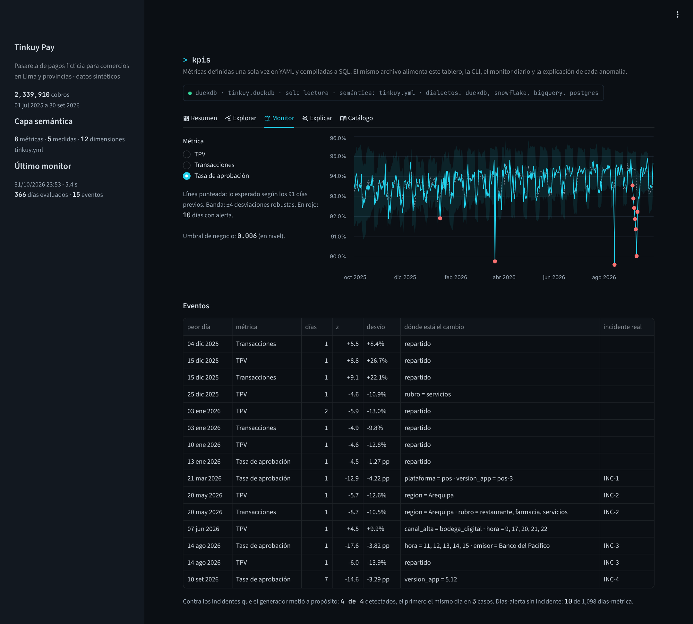
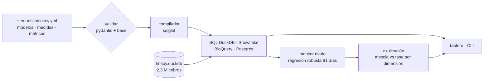
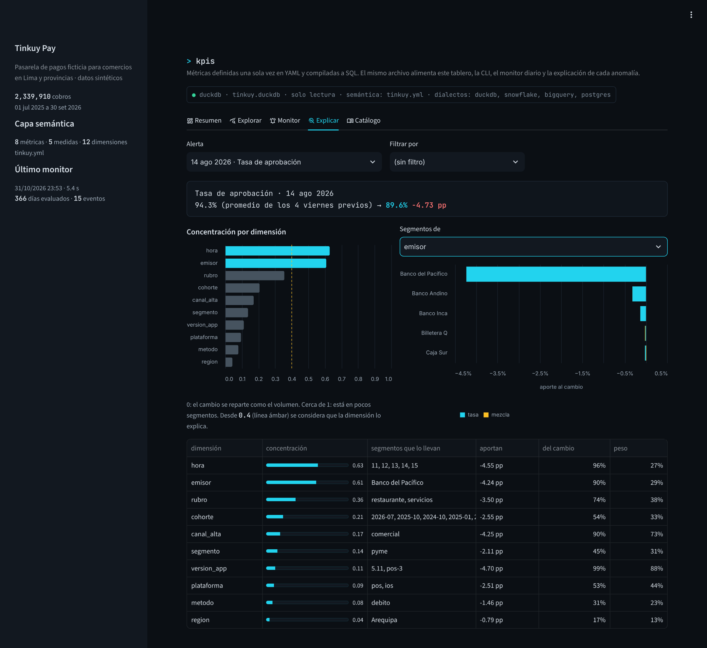
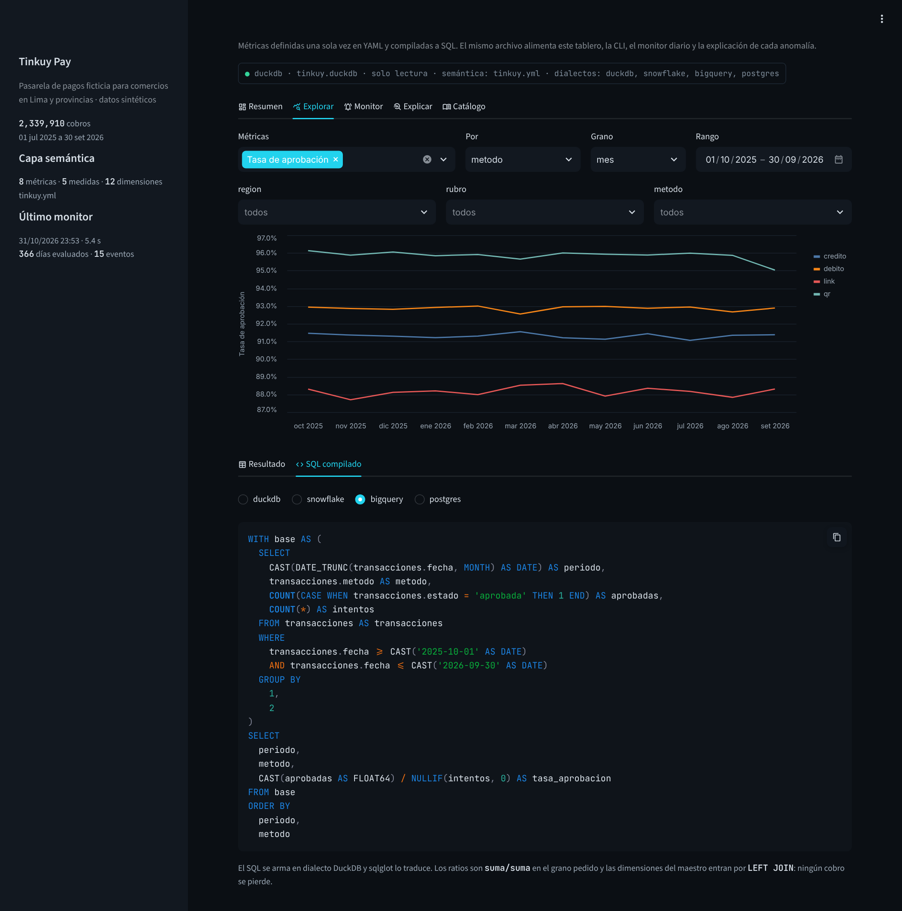
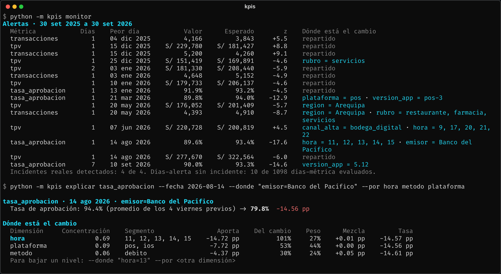
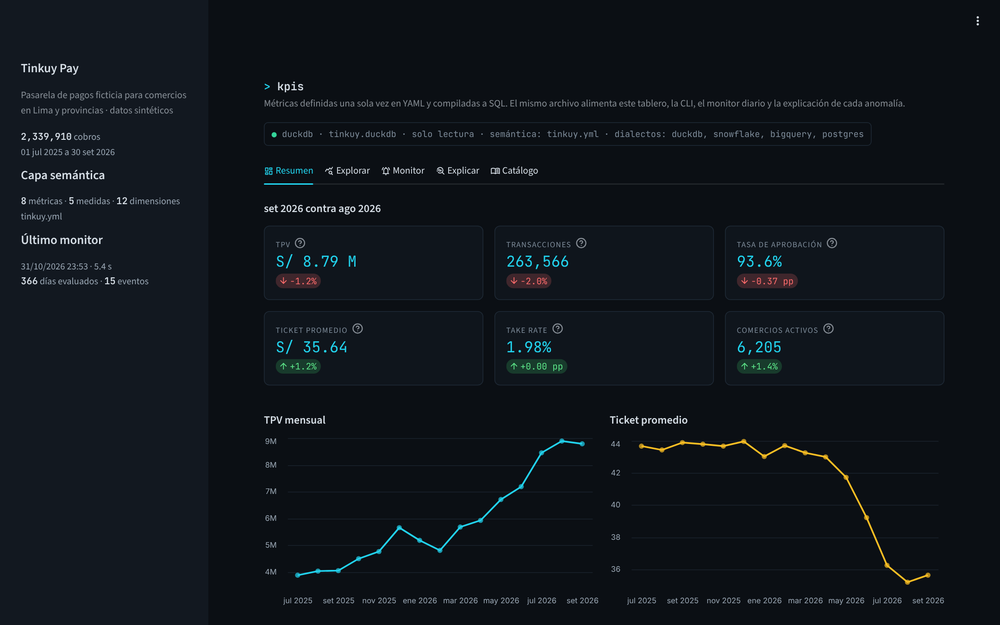

# Capa semántica y monitor de KPIs para una pasarela de pagos

Las métricas se definen una sola vez en YAML y se compilan a SQL para DuckDB, Snowflake, BigQuery o Postgres. Sobre esa capa corre un monitor diario que avisa cuando un KPI se sale de lo esperado y una explicación automática que dice en qué segmento está el cambio.



## El problema

Tinkuy Pay (empresa ficticia) procesa cobros de bodegas, restaurantes, farmacias, tiendas de ropa y servicios en Lima, Arequipa, Trujillo, Piura y Cusco: QR interoperable, débito, crédito y link de pago, desde la app del comercio o un POS.

Pasaba lo de siempre:

- Finanzas calculaba la tasa de aprobación como promedio de las tasas diarias; Operaciones, como aprobadas sobre intentos. En meses con días de mucho y poco volumen, las cifras no coinciden.
- "Comercios activos" se sumaba por semana para armar el mes. Un comercio que cobra todos los días contaba 30 veces.
- Un reporte cruzaba cobros con el maestro de comercios con `INNER JOIN` y perdía en silencio los cobros de comercios dados de baja.
- Cuando la tasa de aprobación caía, alguien abría Excel y probaba dimensión por dimensión hasta encontrar al culpable. Se demoraba media mañana.

Quería que la definición de cada métrica viva en un solo archivo, versionado, y que el tablero, la CLI y el monitor la lean de ahí. En el proyecto 01 lo dejé como pendiente: mover el glosario del agente a una capa semántica que también usen los dashboards.

## Qué hace



- **Capa semántica** ([`tinkuy.yml`](semantica/tinkuy.yml)): dos modelos (cobros y comercios), cinco medidas y ocho métricas de tres tipos: simple (`tpv`), ratio (`tasa_aprobacion = aprobadas / intentos`) y derivada (`tpv_por_comercio = tpv / comercios_activos`). Cada métrica tiene responsable, formato y, si se vigila, su umbral de negocio.
- **Compilador** ([`compilador.py`](src/kpis/compilador.py)): recibe métricas, dimensiones, grano, rango y filtros, y arma el SQL con el árbol de sqlglot. Los ratios siempre son suma sobre suma en el grano pedido, las dimensiones del maestro entran por `LEFT JOIN` y el join solo aparece si hace falta.
- **Validación** ([`validacion.py`](src/kpis/validacion.py)): referencias y ciclos en el YAML, tablas y columnas contra la base, que cada métrica corra y que cada medida aditiva concilie: el total es igual a la suma por cualquier dimensión.
- **Monitor** ([`monitor.py`](src/kpis/monitor.py)): para cada día ajusta una regresión sobre los 91 días previos y marca alerta si el valor se sale ±4 desviaciones robustas **y** supera el umbral de negocio.
- **Explicación** ([`explicacion.py`](src/kpis/explicacion.py)): descompone el cambio por cada dimensión en efecto mezcla y efecto tasa, y ordena las dimensiones por qué tan concentrado está el cambio.

## Datos

2,339,910 intentos de cobro de 7,911 comercios del maestro, del 1 de julio de 2025 al 30 de setiembre de 2026, generados con [`generar_datos.py`](datos/generar_datos.py) (semilla fija, unos 20 segundos). El generador simula por comercio y por día cuántos cobros intenta y, para cada uno, hora, método, emisor, monto y si se aprueba. Los emisores son bancos ficticios.

| Patrón | En los datos |
|---|---|
| Crecimiento | El TPV pasa de S/ 3.88 millones en julio de 2025 a S/ 8.79 millones en setiembre de 2026; los comercios activos, de 2,233 a 6,205 |
| Fin de semana | Restaurantes: 2,810 cobros diarios los sábados y 1,678 los lunes. Servicios: 501 los lunes y 194 los domingos (2026) |
| Días de pago (1, 15, 16 y fin de mes) | 6,870 cobros por día contra 6,048 el resto (+14%, 2026) |
| Días previos al pago (10-14 y 25-29) | Más rechazos por fondos: la aprobación baja de 94.1% a 93.1% |
| Campaña navideña | Ropa cobra 81% más entre el 15 y el 24 de diciembre que en las mismas fechas de noviembre |
| QR desplaza a la tarjeta | El QR pasa de 32.9% a 55.7% de los cobros; cobra 0.99% de comisión contra 2.2% a 4% de tarjetas y links |
| Campaña "Bodega Digital" (may-jul 2026) | Se afilian 2,242 bodegas de ticket bajo |
| Comercios de prueba | 19 comercios borrados del maestro dejaron 3,574 cobros (S/ 115,094 de TPV) |

Y cuatro incidentes con fecha conocida, en la tabla `incidentes`. El monitor no la lee; solo sirve para comprobar después si los encontró.

| Incidente | Qué pasó |
|---|---|
| INC-1 · 21 mar 2026 | Cae el proveedor de red de los POS entre las 18:00 y las 21:59 |
| INC-2 · 20 may 2026 | Falla el ETL y no se cargan los cobros de Arequipa |
| INC-3 · 14 ago 2026 | Banco del Pacífico no responde como emisor entre las 11:00 y las 15:59 |
| INC-4 · 3-12 set 2026 | La versión 5.12 de la app Android falla en cobros QR; el hotfix 5.12.1 sale el 10 |

## Resultados



Entre el 30 de setiembre de 2025 y el 30 de setiembre de 2026 el monitor revisó 366 días de tres métricas (TPV, transacciones y tasa de aprobación): 1,098 días-métrica. Agrupó las alertas en 15 eventos.

| Incidente | Primera alerta | Lo que dijo la explicación |
|---|---|---|
| INC-1 · POS | el mismo día | `plataforma = pos`: la aprobación de los POS cae de 93.1% a 81.2% y explica 113% del cambio del día |
| INC-2 · Arequipa | el mismo día | `region = Arequipa`, en TPV y en transacciones |
| INC-3 · emisor | el mismo día | `hora = 11, 12, 13, 14, 15` y `emisor = Banco del Pacífico` (90% del cambio) |
| INC-4 · versión 5.12 | 5 set, dos días después del lanzamiento | `version_app = 5.12`; la alerta dura del 5 al 11 |

Lo que encontré:

- **Los cuatro incidentes salen y cada uno con su segmento.** El 14 de agosto la tasa de aprobación cae de 94.3% (promedio de los cuatro viernes previos) a 89.6%. La explicación no se queda en "bajó la aprobación": dice que el 90% de la caída está en Banco del Pacífico, que pesa 29% del volumen. Bajando un nivel (`--donde "emisor=Banco del Pacífico" --por hora`), 101% del cambio está entre las 11 y las 15 horas. Es la ventana del incidente.
- **Diez días-alerta sin incidente de 1,098 (0.9%), y la mayoría tiene la misma causa.** Siete caen entre el 15 de diciembre y el 10 de enero: el monitor ve su primera Navidad sin un año de historia y no sabe que el 15 de diciembre se cobra 22% más. La explicación marca casi todos como "repartido": se mueven todos los segmentos a la vez, que es como se ve un efecto de calendario y no una falla. La excepción útil es el 25 de diciembre, donde señala a `servicios`: es feriado y servicios casi no cobra. Las otras tres: el 4 de diciembre (+8% de transacciones, repartido), el 13 de enero (-1.27 pp de aprobación, repartido) y el 7 de junio, feriado en domingo, donde el TPV sube 10% y la explicación apunta a las bodegas de la campaña, que estaban en plena afiliación.
- **Modelar los días previos al pago adelantó tres días la alerta de la versión 5.12.** Sin esa variable, la regresión no sabe que del 10 al 14 la aprobación baja un punto por falta de fondos; la banda se ensancha y el bug de la 5.12 recién salta el 8 de setiembre. Con la variable salta el 5. Las falsas alarmas fueron 10 en los dos casos.
- **El ticket promedio cayó 18% y casi nada cambió dentro de cada rubro.** De abril a agosto de 2026 pasa de S/ 43.00 a S/ 35.20. Por rubro, el efecto mezcla es -S/ 7.97 y el efecto dentro de cada rubro +S/ 0.17. Por canal de afiliación, el segmento que lo lleva es `bodega_digital`, que no existía en abril. Si alguien hubiera reportado "el ticket se desploma", la respuesta correcta era "llegaron 2,242 bodegas".
- **El take rate bajó de 2.34% a 1.98% (set 2025 a set 2026) solo por mezcla.** Por método, el efecto mezcla es -0.36 pp y el efecto tasa, prácticamente cero: las comisiones no cambiaron, cambió cuánto se cobra con QR.
- **Comercios activos no se suma.** En setiembre de 2026 la suma de los comercios activos de cada día da 108,585; el mes tiene 6,205. La capa lo marca como no aditiva y la explicación se niega a descomponerla.
- **La conciliación detecta joins que duplican filas.** En el test que duplica los comercios de ropa en el maestro, el TPV por rubro, región y segmento deja de cuadrar con el total; por emisor sigue cuadrando, porque no pasa por el join.



## Decisiones de diseño

- **YAML propio en vez de dbt MetricFlow o Cube.** Para cinco medidas y una tabla de hechos, un compilador de menos de 200 líneas con sqlglot se lee completo y se testea entero. Los conceptos son los mismos (modelos con entidades, medidas, métricas simple/ratio/derivada), así que migrar a MetricFlow es traducir el archivo.
- **El SQL se arma como árbol, no con f-strings.** sqlglot califica cada columna con su tabla, traduce `extract(hour ...)`, `strftime` y `DATE_TRUNC` a cada motor, y los tests reparsean la salida en los cuatro dialectos. En BigQuery la semana se trunca con `ISOWEEK`: su `WEEK` empieza el domingo y los otros tres motores usan lunes.
- **`LEFT JOIN` y `(sin dato)`.** Un cobro de un comercio que no está en el maestro sigue siendo un cobro. La validación informa cuántos hay; no los esconde.
- **Regresión en vez de "mismo día de la semana pasada".** Tendencia, día de la semana, días de pago, días previos al pago, feriados y campaña navideña. Volumen en logaritmo (un sábado es +20%, no +800 cobros); tasas en nivel. El ajuste descarta residuos mayores a 3 MAD y reajusta, así un incidente no infla la banda de los días siguientes.
- **Probé sacar del entrenamiento los días con alerta y fue peor.** Cuando el nivel cambia de verdad (diciembre, la campaña de bodegas), el modelo tarda en actualizarse y los días siguientes también alertan: los días-alerta sin incidente pasan de 10 a 28. El ajuste robusto ya se encarga de que un incidente de un día no contamine la banda.
- **Dos condiciones para alertar: z ≥ 4 y umbral de negocio.** Con 260 mil cobros al mes, un z alto aparece con cambios que a nadie le importan. El umbral vive en el YAML: 8% para volumen, 0.6 pp para aprobación.
- **Mezcla y tasa con identidad exacta.** Δr = Σ (w1 − w0)·(r0_i − r0) + Σ w1·(r1_i − r0_i). Un test lo verifica con 50 casos al azar. Un segmento nuevo (la versión 5.12, las bodegas de la campaña) es mezcla pura.
- **Concentración = exceso del grupo de segmentos que lleva el cambio / todo lo que se movió en la dimensión.** La primera versión dividía entre el cambio total y explotaba cuando Arequipa caía y Lima crecía: el total casi no se movía. La segunda tomaba un solo segmento y no veía una caída repartida en cinco horas seguidas. Desde 0.4 se considera que la dimensión explica el cambio; por debajo, "repartido".
- **Dimensiones con `deriva: true`.** La mezcla de versiones de la app y de cohortes cambia sola cada semana. En métricas aditivas todo cambio de peso parece causa, así que esas dimensiones no entran a explicar TPV ni transacciones; sí entran en ratios, que es donde se encontró la 5.12. Estado y motivo de rechazo son resultados, no causas, y llevan `explicable: false`.

## Correrlo

Python 3.10+.

```bash
cd proyectos/05-capa-semantica-kpis-pagos
pip install -e ".[app,dev]"

python -m kpis todo                    # genera, valida y corre el monitor (~30 s)

python -m kpis catalogo
python -m kpis validar                 # ~2 s
python -m kpis consultar tpv tasa_aprobacion --grano mes --desde 2026-01-01
python -m kpis consultar tasa_aprobacion --por rubro --grano mes --dialecto snowflake   # solo el SQL
python -m kpis monitor                 # ~6 s, deja datos/resultados.duckdb
python -m kpis explicar tasa_aprobacion --fecha 2026-08-14
python -m kpis explicar tasa_aprobacion --fecha 2026-08-14 --donde "emisor=Banco del Pacífico" --por hora
python -m kpis explicar ticket_promedio --periodo 2026-08 --contra 2026-04

streamlit run app.py
pytest                                 # 50 tests, ~22 s
```

`generar --escala 0.2` arma una base más chica para probar. Con poco volumen el ruido pesa más: en los tests (escala 0.25) la carga faltante de Arequipa no supera el z de 4.



## Estructura

```
05-capa-semantica-kpis-pagos/
├── app.py                     tablero: resumen, explorar con SQL, monitor, explicar, catálogo
├── semantica/tinkuy.yml       modelos, medidas y métricas
├── datos/generar_datos.py     comercios, cobros e incidentes
├── src/kpis/
│   ├── modelo.py              esquema del YAML (pydantic) y validación estática
│   ├── compilador.py          consulta -> SQL con sqlglot, en cuatro dialectos
│   ├── capa.py                cargar, compilar y ejecutar
│   ├── validacion.py          esquema contra la base, conciliación, huérfanos, no aditividad
│   ├── monitor.py             regresión robusta diaria, eventos, cruce con incidentes
│   ├── explicacion.py         mezcla vs tasa y concentración por dimensión
│   ├── calendario.py          feriados de Perú, días de pago, etiquetas en español
│   ├── formato.py             soles, porcentajes y puntos porcentuales
│   ├── resultados.py          resultados.duckdb
│   └── cli.py
└── tests/                     modelo, compilador, validación, monitor, explicación, generador, cli
```



## Limitaciones

- **Una sola tabla de hechos y joins de un salto.** Métricas que combinan cobros con, por ejemplo, contracargos necesitarían joins entre hechos a un grano común, que es justo lo difícil de una capa semántica.
- **El monitor necesita un año de historia para la estacionalidad anual.** Las alertas de diciembre y enero son eso. Con dos años se agrega el mismo periodo del año anterior como regresor.
- **La concentración no mide ruido.** Compara cuánto se aparta un segmento de su peso, no si ese apartarse es más grande que su variación normal. Con poco volumen, un segmento grande que fluctúa puede competir con la causa real. Lo siguiente sería normalizar por la variabilidad de cada segmento en las semanas base.
- **Se explica una dimensión a la vez.** Si la causa es una combinación (emisor X solo en POS), sale como dos dimensiones altas y hay que bajar un nivel a mano con `--donde`.
- **La base de comparación para un día son los cuatro mismos días de la semana previos.** Si uno de ellos fue feriado o tuvo un incidente, la base se mueve.
- Los incidentes se conocen porque los datos son sintéticos. Con datos reales, la forma de calibrar es revisar los postmortems de un año contra las alertas.

## Lo que sigue

- Que el agente text-to-SQL del proyecto 01 consulte métricas por nombre a través de esta capa en vez de escribir el SQL de cero.
- Exportar el YAML a MetricFlow para probarlo contra un warehouse real.
- Programar `python -m kpis monitor` cada mañana y mandar al canal de Operaciones solo las alertas con concentración ≥ 0.4, con el segmento y el comando para bajar un nivel.
- Normalizar la concentración por la variabilidad de cada segmento.
