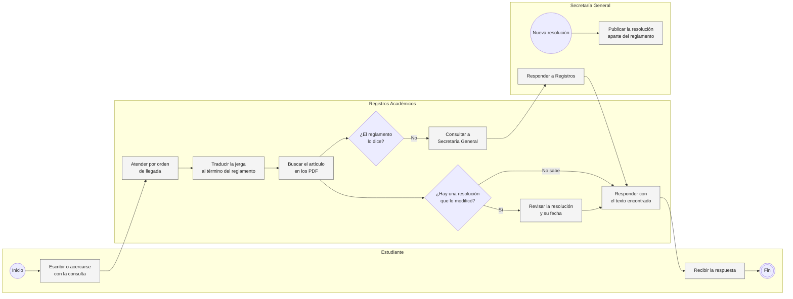
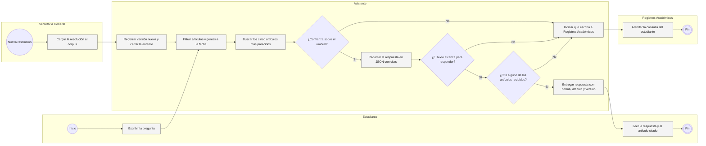
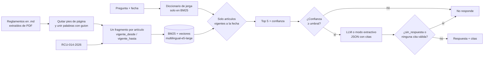
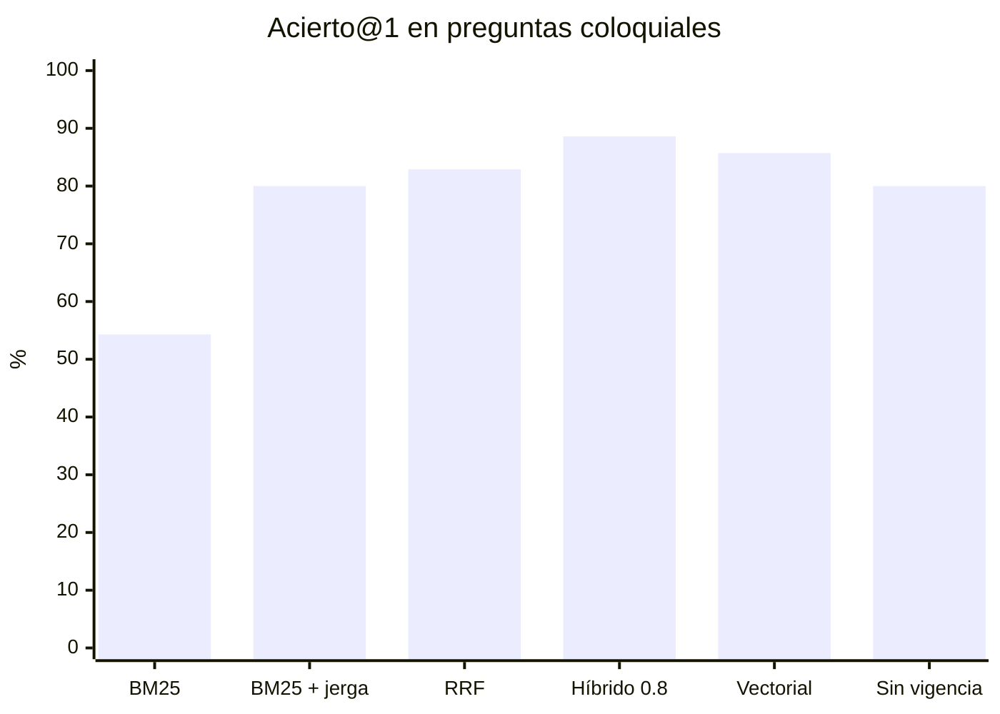

# Asistente del reglamento académico con RAG

La Universidad Qhapaq Ñan (ficticia) tiene sus normas en seis documentos: cuatro reglamentos, un régimen disciplinario y una resolución de 2026 que cambió cinco artículos del reglamento de estudios e incorporó uno nuevo. Registros Académicos atiende las consultas de los estudiantes sobre esas normas.

## Problemática

Cada semestre llegan las mismas preguntas: hasta cuándo me puedo retirar de un curso, qué pasa si jalo por cuarta vez, cuánto es la mora. Las responde el personal de Registros a mano, buscando en los PDF, y en las semanas de matrícula y retiro la cola crece justo cuando el plazo importa.

Buscar en los PDF tampoco es sencillo. Los alumnos dicen "jalar", "congelar" o "trica" y el reglamento dice desaprobar, reserva de matrícula y tercera matrícula. El texto viejo sigue publicado: la resolución 014-2026-CU bajó el plazo de retiro de la semana 10 a la 8, pero el reglamento original todavía dice semana 10, y quien consulta el documento equivocado da una respuesta vencida con la cita en la mano. Un chatbot que "lea los PDF" agrava esto, porque además inventa cuando el reglamento no dice nada.

## Solución

Armé un asistente que responde con el artículo vigente a la fecha de la consulta y lo cita con norma, número y versión. Si no encuentra algo parecido o el texto no alcanza, no responde y deriva a Registros Académicos. Cuando sale una resolución, el artículo modificado entra con su fecha de vigencia y la versión anterior deja de ser elegible desde ese día.

El alcance incluye el corpus por artículo con su vigencia, la búsqueda BM25, vectorial e híbrida, el diccionario de jerga, el umbral de abstención, la redacción con un LLM (o modo extractivo sin API key), la evaluación con 145 preguntas, la CLI y un tablero en Streamlit. Quedan fuera la calidad de las respuestas redactadas por un LLM, que no medí, la extracción de PDF reales y la integración con los canales de atención.

## AS IS: Registros responde cada consulta a mano



El cuello de botella es la atención uno a uno de preguntas que se repiten, y se agrava en las semanas con plazos. El reproceso está en la búsqueda: cada vez hay que traducir la jerga y ubicar el artículo. Y el riesgo mayor es la vigencia, porque la resolución se publica aparte y nada obliga a revisarla antes de responder.

## TO BE: el asistente responde con la norma vigente y deriva lo que no sabe



Todo el carril del Asistente está en el código, incluida la carga de una resolución con su fecha. La atención de lo derivado en Registros y la publicación del asistente en un canal real no lo están. La primera abstención evita gastar una llamada al modelo cuando la búsqueda no encontró nada parecido.

## Cómo cambian los indicadores

| Indicador | AS IS | TO BE |
|---|---|---|
| Atención de preguntas frecuentes | una por una, por personal de Registros | automática, Registros recibe solo lo derivado |
| Respuestas con texto derogado en artículos modificados | dependía de revisar la resolución (6 de 10 sin filtro de fecha) | 0 de 10 con el filtro de vigencia |
| Acierto@1 en preguntas coloquiales | 54.3% buscando por palabras (BM25) | 85.7% con búsqueda vectorial |
| Preguntas sin respuesta en el reglamento | se consultaban a Secretaría | 5 de 8 frenadas por el umbral; el resto lo decide el LLM |
| Respuestas con el artículo correcto citado | sin registro | 57 de 64 en modo extractivo |

Las cifras salen de la evaluación con las 72 preguntas de prueba que se describe más abajo. La fila de BM25 es una referencia de búsqueda por palabras, no una medición del personal.

## Por dentro



[`corpus.py`](src/reglamento/corpus.py) limpia el texto y deja un fragmento por artículo, que es la unidad que se cita. Cuando la resolución modifica uno, el texto nuevo entra como otro fragmento con su fecha y el original queda vigente hasta el día anterior. La vigencia es un metadato; el LLM nunca ve el texto derogado.

[`recuperador.py`](src/reglamento/recuperador.py) busca con un BM25 propio de 30 líneas, con vectores `multilingual-e5-large` corriendo local con fastembed, o con los dos fusionados por rangos (RRF). La fecha filtra antes de rankear, así que un artículo derogado ni compite. [`texto.py`](src/reglamento/texto.py) tiene 28 patrones de jerga que agregan a la pregunta el término del reglamento. [`asistente.py`](src/reglamento/asistente.py) aplica el umbral y descarta citas fuera de rango, y [`llm.py`](src/reglamento/llm.py) llama a cualquier API compatible con chat completions a temperatura 0 con salida JSON. Sin API key devuelve el artículo mejor ubicado tal cual.

Los embeddings corren en CPU, sin costo por consulta y sin mandar las preguntas de los alumnos a un tercero. Al LLM solo le llegan la pregunta y cinco artículos.

## Los reglamentos

Todo es sintético y sale de [`generar_corpus.py`](datos/generar_corpus.py) con semilla fija.

| Código | Documento | Artículos |
|---|---|---|
| RE-2024 | Reglamento de Estudios de Pregrado | 35 |
| RCU-014-2026 | Resolución que modifica el RE-2024, vigente desde el 1 mar 2026 | modifica 6, 10, 17, 18 y 25; incorpora 35-A |
| RP-2025 | Reglamento de Pagos y Pensiones | 13 |
| RG-2024 | Reglamento de Grados y Títulos | 8 |
| RB-2025 | Reglamento de Becas y Bienestar Estudiantil | 7 |
| RD-2024 | Reglamento de Disciplina | 3 |

Son 72 fragmentos: 66 artículos originales, 5 versiones modificadas y 1 artículo nuevo sobre uso de IA generativa en trabajos. Les metí ruido de PDF a propósito, pies de página repetidos y palabras partidas como "estud-iantes". El set de evaluación tiene 145 preguntas, formales y coloquiales, de las que 16 no tienen respuesta; 73 son de desarrollo y 72 de prueba.

## Qué tan bien encuentra el artículo

Consultas al 1 de setiembre de 2026, con la resolución vigente. Ajusté con desarrollo y reporto prueba: 64 preguntas con respuesta (29 formales y 35 coloquiales) y 8 sin respuesta.

| Configuración | Acierto@1 formal | Acierto@1 coloquial | Acierto@5 | MRR |
|---|---|---|---|---|
| BM25 | 89.7% | 54.3% | 84.4% | 0.754 |
| BM25 + diccionario de jerga | 89.7% | 80.0% | 93.8% | 0.878 |
| Híbrido RRF (pesos iguales) | 93.1% | 82.9% | 98.4% | 0.916 |
| Híbrido, 0.8 a vectores | 96.5% | 88.6% | 95.3% | 0.930 |
| **Vectorial (por defecto)** | 96.5% | 85.7% | 95.3% | 0.918 |
| Vectorial sin filtro de vigencia | 96.5% | 80.0% | 93.8% | 0.899 |



Lo más grave fue el texto derogado. Sin filtro de fecha, en 6 de las 10 preguntas sobre artículos modificados sale primero la versión vieja: "si jalo un curso por cuarta vez, ¿me botan?" devolvía "separado definitivamente" cuando lo vigente es "suspendido por dos semestres". Una respuesta equivocada con cita correcta. Con el filtro, 0 de 10.

Con BM25 solo, las coloquiales aciertan 54.3% contra 89.7% de las formales, y el diccionario las sube a 80.0%. Pesa más el modelo de vectores que la fusión: MiniLM-L12 acierta 34.3% de las coloquiales, mpnet-base 51.4% y multilingual-e5-large 85.7%, a cambio de unos 180 ms por pregunta en CPU y 2.2 GB de modelo. El híbrido con 0.8 a vectores gana en prueba, pero en desarrollo fue peor que vectorial solo (87.7% contra 90.8%), así que me quedé con vectorial.

El umbral, coseno 0.833, detecta 5 de las 8 preguntas sin respuesta y deja pasar 62 de 64 válidas. Las que se escapan son las trampas, como natación en verano o estudiar dos carreras a la vez, que comparten vocabulario con artículos reales. Ahí decide el LLM con `sin_respuesta`. Con la confianza de BM25 el AUC es 0.68 y no hay umbral que sirva.

En modo extractivo, 57 de las 64 respuestas citan el artículo correcto. Lo que no medí es la calidad de las respuestas redactadas por un LLM, porque no tenía API key en esta corrida; el flujo está probado interceptando el HTTP, pero no tengo cifras.

## Correrlo

Python 3.10+.

```bash
cd proyectos/06-asistente-reglamento-rag
pip install -e ".[app,dev]"

python -m reglamento generar                  # corpus y preguntas (<1 s)
python -m reglamento evaluar                  # ~30 s; la primera vez baja multilingual-e5-large (~2.2 GB)
python -m reglamento evaluar --modelos        # además compara MiniLM, mpnet y e5-large (~3 min)

# sin API key: respuesta extractiva
python -m reglamento preguntar "si jalo un curso por cuarta vez me botan?" --demo --detalle
python -m reglamento preguntar "hasta cuando me puedo retirar de un curso?" --demo --fecha 2025-10-01
python -m reglamento preguntar "..." --demo --sin-vectores    # solo BM25, sin descargar modelos

# con un LLM
cp .env.example .env                          # LLM_API_KEY, LLM_MODELO y, si aplica, LLM_BASE_URL
python -m reglamento preguntar "puedo usar chatgpt para hacer mis trabajos?"

python -m reglamento corpus                   # normas, artículos y modificaciones
streamlit run app.py
pytest                                        # 52 tests, ~1 s
```

`evaluar` guarda el umbral en `datos/resultados/resumen.json`, de donde lo leen la CLI y el tablero; sin ese archivo el asistente no se abstiene por confianza. Para un modelo más liviano está `EMBEDDINGS_MODELO=sentence-transformers/paraphrase-multilingual-MiniLM-L12-v2`. Los tests no descargan modelos, usan vectores por trigramas de caracteres.

## Estructura

```
06-asistente-reglamento-rag/
├── app.py                     tablero: preguntar con fecha, evaluación, normas y versiones
├── datos/generar_corpus.py    reglamentos, resolución y preguntas con respuesta esperada
├── src/reglamento/
│   ├── corpus.py              limpieza del PDF, fragmentos por artículo, resoluciones y vigencia
│   ├── texto.py               normalización, raíces y diccionario de jerga
│   ├── bm25.py                BM25 Okapi
│   ├── embeddings.py          fastembed local, codificador de prueba y caché de vectores
│   ├── recuperador.py         BM25, vectorial e híbrido con filtro por fecha
│   ├── llm.py                 prompt, salida JSON, modo extractivo
│   ├── asistente.py           umbral, verificación de citas y abstención
│   ├── evaluacion.py          acierto@k, MRR, errores de versión, umbral y AUC
│   └── cli.py
└── tests/                     corpus, texto, bm25, búsqueda, asistente, LLM con HTTP interceptado, evaluación, cli
```

## Hasta dónde llega

El corpus es chico y cada artículo trata un solo tema; un reglamento real de 200 páginas obligaría a partir por inciso. Las preguntas las escribí yo, igual que el diccionario, así que la mejora de BM25 con jerga es un techo optimista. Cada pregunta tiene un solo artículo correcto, y algunas fallas son en realidad dos respuestas válidas. La vigencia solo entiende "modificar" e "incorporar", no derogaciones sin reemplazo ni disposiciones transitorias.

Lo siguiente que haría:

- Evaluar las respuestas con dos o tres modelos, uno local con Ollama, y ver cómo les va con las tres preguntas trampa.
- Probar un reranker multilingüe sobre los 20 primeros, a ver si separa mejor las preguntas sin respuesta que el coseno.
- Hacer que la vigencia dependa también de la cohorte del alumno.
- Guardar las preguntas sin respuesta en producción, que son la lista de lo que falta normar o explicar.
