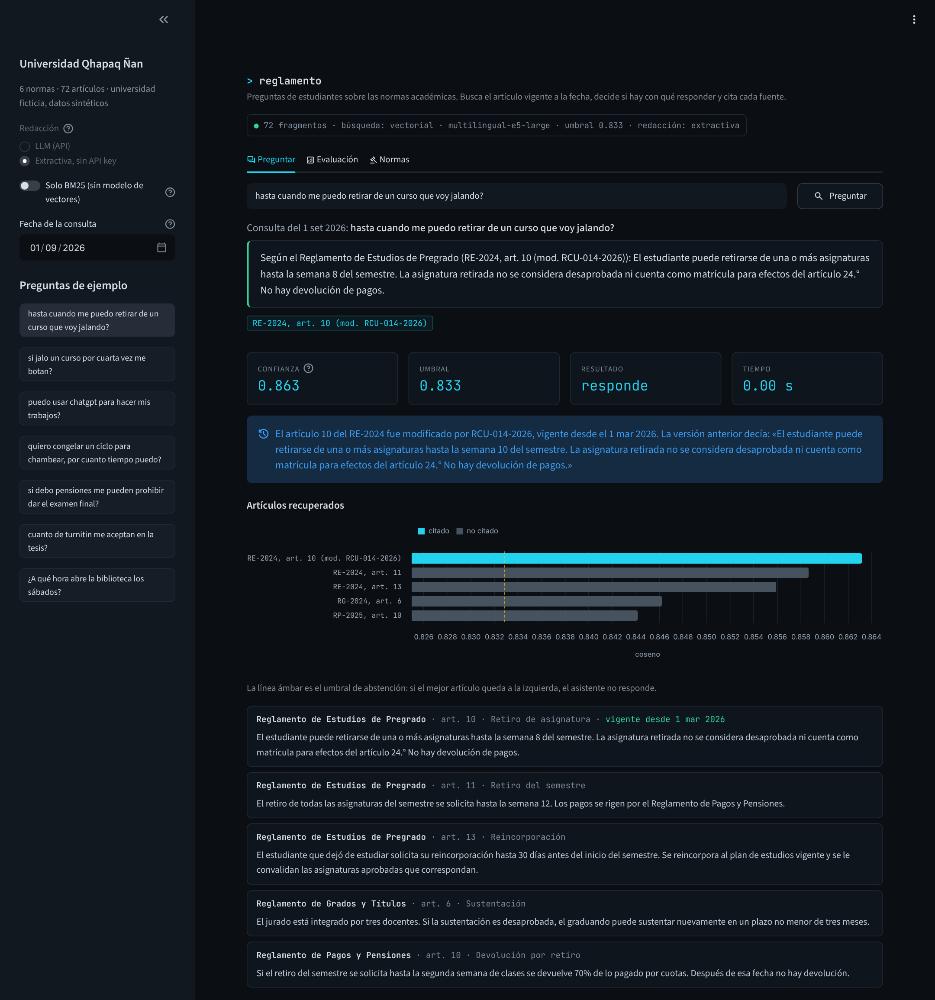
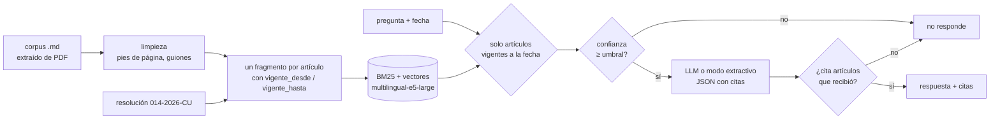
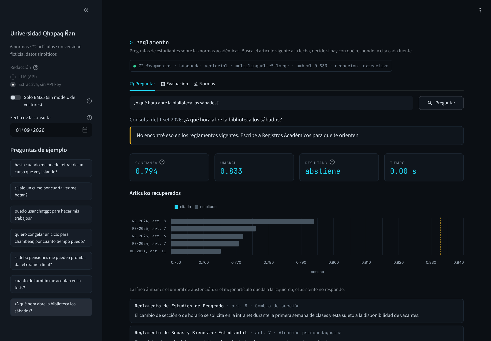
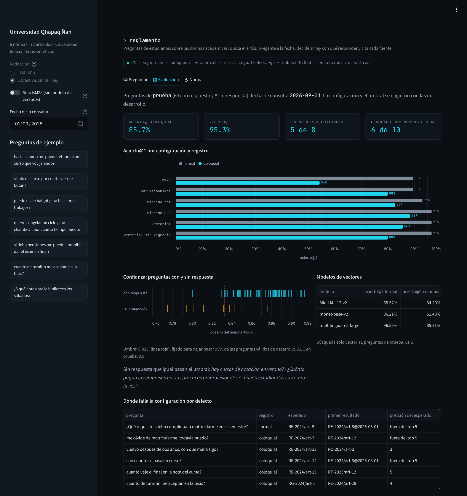
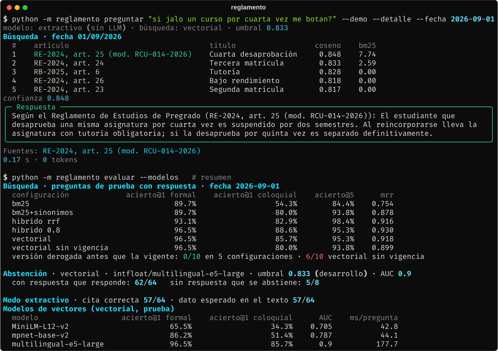
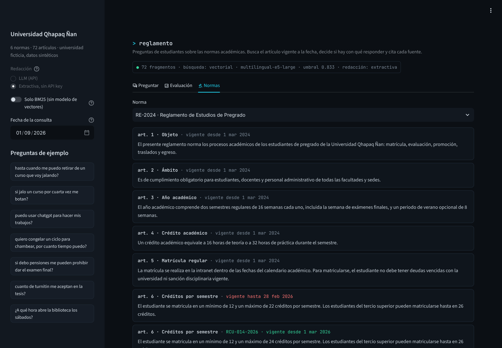

# Asistente del reglamento académico con RAG

Responde preguntas de estudiantes sobre las normas de una universidad: busca el artículo vigente a la fecha de la consulta, decide si hay con qué responder y cita cada fuente. Sin cita no hay respuesta.



## El problema

La Universidad Qhapaq Ñan (ficticia) recibe en Registros Académicos las mismas preguntas cada semestre: hasta cuándo me puedo retirar de un curso, qué pasa si jalo por cuarta vez, cuánto es la mora. Las respuestas están en seis documentos: cuatro reglamentos, un régimen disciplinario y una resolución de 2026 que cambió cinco artículos del reglamento de estudios.

Armar un chatbot que "lea los PDF" es fácil. Lo que me interesaba resolver era otra cosa:

- **Los alumnos no hablan como el reglamento.** Preguntan por "curso", "jalar", "congelar" o "trica"; el reglamento dice "asignatura", "desaprobar", "reserva de matrícula" y "tercera matrícula".
- **El texto viejo sigue ahí.** La resolución 014-2026-CU bajó el plazo de retiro de la semana 10 a la 8, pero el reglamento original todavía dice semana 10. Un buscador que no sabe de fechas puede devolver cualquiera de las dos.
- **Hay preguntas que el corpus no responde**, y varias usan palabras que sí aparecen ("¿hay cursos de natación en verano?", "¿cuánto pagan las empresas por las prácticas?"). Ahí lo correcto es decir que no está.
- **Cada respuesta tiene que poder auditarse:** qué artículo, de qué norma y en qué versión.

## Qué hace



- **Corpus por artículo** ([`corpus.py`](src/reglamento/corpus.py)): quita el pie de página repetido y une las palabras cortadas con guion al final de línea. Cada artículo es un fragmento. Cuando la resolución modifica un artículo, el texto nuevo entra como otro fragmento con su fecha de vigencia y el original queda vigente hasta el día anterior.
- **Búsqueda** ([`recuperador.py`](src/reglamento/recuperador.py)): BM25 propio con raíces en español, vectores con `multilingual-e5-large` (corre local con fastembed, sin API) o ambos con fusión por rangos (RRF). La fecha de la consulta filtra **antes** de rankear: un artículo derogado no compite.
- **Diccionario de jerga** ([`texto.py`](src/reglamento/texto.py)): 28 patrones que agregan a la pregunta el término del reglamento ("jalé" → desaprobar, "congelar" → reserva de matrícula). Solo se aplica a la pregunta y no borra la palabra original.
- **Abstención en dos puntos** ([`asistente.py`](src/reglamento/asistente.py)): antes del LLM, si el artículo más parecido queda bajo el umbral; después, si el modelo dice que no alcanza o no cita ninguno de los artículos que recibió. Las citas fuera de rango se descartan.
- **Redacción** ([`llm.py`](src/reglamento/llm.py)): cualquier API compatible con chat completions, temperatura 0 y salida JSON (`respuesta`, `citas`, `sin_respuesta`). Sin API key funciona en modo extractivo: devuelve el artículo mejor ubicado tal cual, con su cita.



## Datos

Todo es sintético y sale de [`generar_corpus.py`](datos/generar_corpus.py) con semilla fija. Montos, plazos y porcentajes cambian con la semilla, y las respuestas esperadas cambian con ellos.

| Documento | Artículos |
|---|---|
| RE-2024 · Reglamento de Estudios de Pregrado | 35 |
| RCU-014-2026 · Resolución que modifica el RE-2024 (vigente desde el 1 mar 2026) | modifica 6, 10, 17, 18 y 25; incorpora 35-A |
| RP-2025 · Reglamento de Pagos y Pensiones | 13 |
| RG-2024 · Reglamento de Grados y Títulos | 8 |
| RB-2025 · Reglamento de Becas y Bienestar Estudiantil | 7 |
| RD-2024 · Reglamento de Disciplina | 3 |

En total, 72 fragmentos: 66 artículos originales, 5 versiones modificadas y 1 artículo nuevo (uso de IA generativa en trabajos).

| Patrón | En los datos |
|---|---|
| Ruido de PDF | Pie de página cada 4 a 6 artículos y palabras partidas con guion ("estud-iantes") |
| Cambios normativos | 5 artículos con dos versiones: retiro de semana 10 a 8, inasistencias de 30% a 25%, el sustitutorio pasa a reemplazar solo el final, la cuarta desaprobación pasa de separación a suspensión, el tope de créditos sube de 22 a 24 |
| Registro | Cada artículo con preguntas tiene una versión formal y una coloquial; 74 formales y 71 coloquiales |
| Preguntas sin respuesta | 16, varias con palabras del corpus: verano, prácticas, carrera |
| Set de evaluación | 145 preguntas: 117 normales, 10 sobre artículos modificados, 2 sobre el artículo nuevo y 16 sin respuesta, repartidas por tipo entre desarrollo (73) y prueba (72) |

## Resultados

Fecha de consulta 1 de setiembre de 2026, con la resolución ya vigente. La configuración por defecto y el umbral los elegí con las preguntas de desarrollo; las cifras son de las de prueba (64 con respuesta: 29 formales y 35 coloquiales; 8 sin respuesta). Los errores de versión se miden sobre las 10 preguntas de artículos modificados.

| Configuración | Acierto@1 formal | Acierto@1 coloquial | Acierto@5 | MRR |
|---|---|---|---|---|
| BM25 | 89.7% | 54.3% | 84.4% | 0.754 |
| BM25 + diccionario de jerga | 89.7% | 80.0% | 93.8% | 0.878 |
| Híbrido RRF (pesos iguales) | 93.1% | 82.9% | 98.4% | 0.916 |
| Híbrido, 0.8 a vectores | 96.5% | 88.6% | 95.3% | 0.930 |
| **Vectorial (por defecto)** | **96.5%** | **85.7%** | **95.3%** | **0.918** |
| Vectorial sin filtro de vigencia | 96.5% | 80.0% | 93.8% | 0.899 |



Lo que encontré:

- **Con BM25 solo, la mitad de las preguntas coloquiales fallan en el primer resultado.** Las formales aciertan 89.7%; las coloquiales, 54.3%. "Quiero congelar un ciclo para chambear, ¿por cuánto tiempo puedo?" devolvía primero la beca de excelencia. El diccionario de jerga sube las coloquiales a 80.0% sin tocar las formales.
- **El modelo de vectores pesa más que la técnica de fusión.** Con búsqueda solo vectorial, MiniLM-L12 acierta 34.3% de las coloquiales, mpnet-base 51.4% y multilingual-e5-large 85.7%. Los dos primeros quedan por debajo de BM25 con diccionario. Con e5-large el diccionario deja de ser necesario, pero cuesta unos 180 ms por pregunta en CPU contra unos 45 ms de los otros dos, y pesa 2.2 GB.
- **Mezclar BM25 y vectores con pesos iguales empeora al modelo bueno.** El RRF clásico baja el acierto@1 coloquial de 85.7% a 82.9%. Con 0.8 de peso a vectores sale lo mejor en prueba (88.6%), pero en desarrollo fue peor que vectorial solo (87.7% contra 90.8% de acierto@1). La diferencia en prueba es de una pregunta y elegí con desarrollo, así que dejé vectorial.
- **Sin filtro de fecha, en 6 de las 10 preguntas sobre artículos modificados el texto derogado sale antes que el vigente.** "Si jalo un curso por cuarta vez, ¿me botan?" devolvía primero el artículo original, que dice "separado definitivamente"; la versión vigente dice "suspendido por dos semestres". Es una respuesta incorrecta con cita correcta: lo peor que puede hacer este sistema. Con el filtro, 0 de 10.
- **El umbral detecta 5 de las 8 preguntas sin respuesta y deja pasar 62 de 64 válidas.** Las tres que pasan son las trampas: natación en verano, cuánto pagan las prácticas y estudiar dos carreras a la vez. Comparten vocabulario con artículos reales y su coseno se mezcla con el de las preguntas válidas (AUC 0.90). Ahí la decisión le toca al LLM con `sin_respuesta`. Con la confianza de BM25 el AUC es 0.68 (0.77 con diccionario): con BM25 no hay un umbral que sirva.
- **En modo extractivo, 57 de las 64 respuestas citan el artículo correcto y las mismas 57 contienen el dato esperado** (el plazo, el monto o el porcentaje). La primera versión de esa métrica comparaba texto sin signos y daba 58: en "¿cuánto vale el final en la nota del curso?" el "30%" esperado coincidía con la constancia de S/ 30 del reglamento de pagos. Ahora compara con signos.

Las 6 que fallan en el primer resultado de la configuración por defecto tienen un patrón: preguntas cortas y ambiguas ("¿con cuánto se pasa un curso?" devuelve el tope de créditos) o que tocan dos artículos ("¿qué requisitos debo cumplir para matricularme?" se parece tanto al artículo 5 como al 6). Varias se resolverían marcando más de un artículo correcto en el set.

**Lo que no medí:** la calidad de las respuestas redactadas por un LLM. No corrí el modo LLM porque no tenía una API key configurada en esta ejecución. El código está listo (`python -m reglamento preguntar ... ` sin `--demo`) y el flujo completo está probado con el SDK real interceptando el HTTP, pero no tengo cifras de cuántas veces el modelo cita bien o se abstiene cuando debe.

## Decisiones de diseño

- **Un fragmento por artículo, no ventanas de N tokens.** Los artículos tienen entre una y tres oraciones y son la unidad que se cita. Partirlos rompe la cita; juntarlos mezcla plazos de artículos distintos.
- **La vigencia es un metadato, no algo que el modelo tenga que inferir.** El parser lee "Modificar el artículo 10.° del ... (RE-2024)" y arma la versión nueva con su fecha. El LLM nunca ve el texto derogado y la interfaz lo muestra aparte como "versión anterior".
- **Umbral fijado por cobertura, no por exactitud.** Lo elegí para que pase 95% de las preguntas válidas de desarrollo (coseno 0.833). Prefiero perder pocas válidas y dejar que el LLM filtre el resto, a que el asistente diga "no sé" a cada rato.
- **Embeddings locales.** fastembed corre ONNX en CPU: no hay costo por consulta ni se mandan las preguntas de los alumnos a un tercero para buscar. El LLM solo recibe la pregunta y cinco artículos.
- **BM25 propio en vez de una librería.** Son 30 líneas, se testea entero y sirve de modo de respaldo (`--sin-vectores`) cuando no se puede bajar el modelo.
- **Desarrollo y prueba separados.** El diccionario de jerga, la configuración por defecto y el umbral los ajusté mirando desarrollo. Igual, el diccionario y las preguntas los escribí yo: la mejora de BM25 con diccionario es un techo optimista.

## Correrlo

Python 3.10+.

```bash
cd proyectos/06-asistente-reglamento-rag
pip install -e ".[app,dev]"

python -m reglamento generar                  # corpus y preguntas (<1 s)
python -m reglamento evaluar                  # ~30 s; la primera vez baja multilingual-e5-large (~2.2 GB)
python -m reglamento evaluar --modelos        # además compara MiniLM, mpnet y e5-large (~3 min)

# sin API key: respuesta extractiva
python -m reglamento preguntar "si jalo un curso por cuarta vez me botan?" --demo --detalle
python -m reglamento preguntar "hasta cuando me puedo retirar de un curso?" --demo --fecha 2025-10-01
python -m reglamento preguntar "..." --demo --sin-vectores    # solo BM25, sin descargar modelos

# con un LLM
cp .env.example .env                          # LLM_API_KEY, LLM_MODELO y, si aplica, LLM_BASE_URL
python -m reglamento preguntar "puedo usar chatgpt para hacer mis trabajos?"

python -m reglamento corpus                   # normas, artículos y modificaciones
streamlit run app.py
pytest                                        # 52 tests, ~1 s
```

`evaluar` deja el umbral calibrado en `datos/resultados/resumen.json`; la CLI y el tablero lo leen de ahí. Sin ese archivo el asistente no se abstiene por confianza. Para un modelo de vectores más liviano: `EMBEDDINGS_MODELO=sentence-transformers/paraphrase-multilingual-MiniLM-L12-v2`, con la pérdida de calidad que muestra la tabla.

Los tests no descargan modelos: usan vectores por trigramas de caracteres, que no entienden nada pero son deterministas.



## Estructura

```
06-asistente-reglamento-rag/
├── app.py                     tablero: preguntar con fecha, evaluación, normas y versiones
├── datos/generar_corpus.py    reglamentos, resolución y preguntas con respuesta esperada
├── src/reglamento/
│   ├── corpus.py              limpieza del PDF, fragmentos por artículo, resoluciones y vigencia
│   ├── texto.py               normalización, raíces y diccionario de jerga
│   ├── bm25.py                BM25 Okapi
│   ├── embeddings.py          fastembed local, codificador de prueba y caché de vectores
│   ├── recuperador.py         BM25, vectorial e híbrido con filtro por fecha
│   ├── llm.py                 prompt, salida JSON, modo extractivo
│   ├── asistente.py           umbral, verificación de citas y abstención
│   ├── evaluacion.py          acierto@k, MRR, errores de versión, umbral y AUC
│   └── cli.py
└── tests/                     corpus, texto, bm25, búsqueda, asistente, LLM con HTTP interceptado, evaluación, cli
```



## Limitaciones

- El corpus es chico (72 fragmentos) y cada artículo trata un solo tema. Con reglamentos reales de 200 páginas, artículos largos y anexos con tablas, haría falta partir por inciso y la búsqueda sería más difícil.
- Las preguntas las escribí yo, una formal y una coloquial por artículo. Los alumnos reales escriben con faltas, preguntan dos cosas a la vez y dan contexto que no viene al caso.
- Cada pregunta tiene un solo artículo correcto; algunas fallas son en realidad dos respuestas válidas.
- La vigencia solo cubre "modificar" e "incorporar". No maneja derogaciones sin reemplazo ni disposiciones transitorias ("para los ingresantes antes de 2026 rige...").
- Sin cifras del modo LLM, como dije arriba.

## Lo que sigue

- Correr la evaluación de respuestas con dos o tres modelos (uno local con Ollama) y medir citas correctas, dato esperado y abstención en las tres preguntas trampa.
- Un reranker (cross-encoder multilingüe) sobre los 20 primeros, y ver si separa mejor las preguntas sin respuesta que el coseno.
- Disposiciones transitorias: que la vigencia dependa también de la cohorte del alumno.
- Registrar las preguntas sin respuesta en producción: son la lista de lo que falta normar o explicar.
