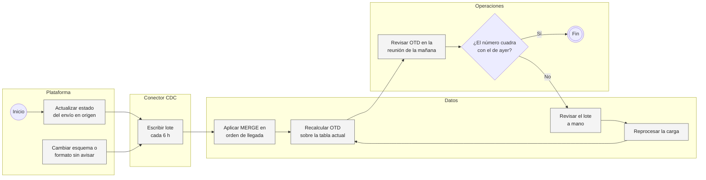
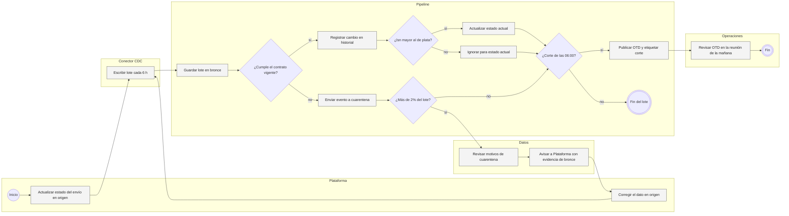
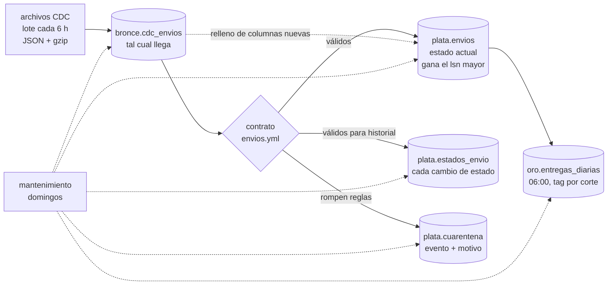
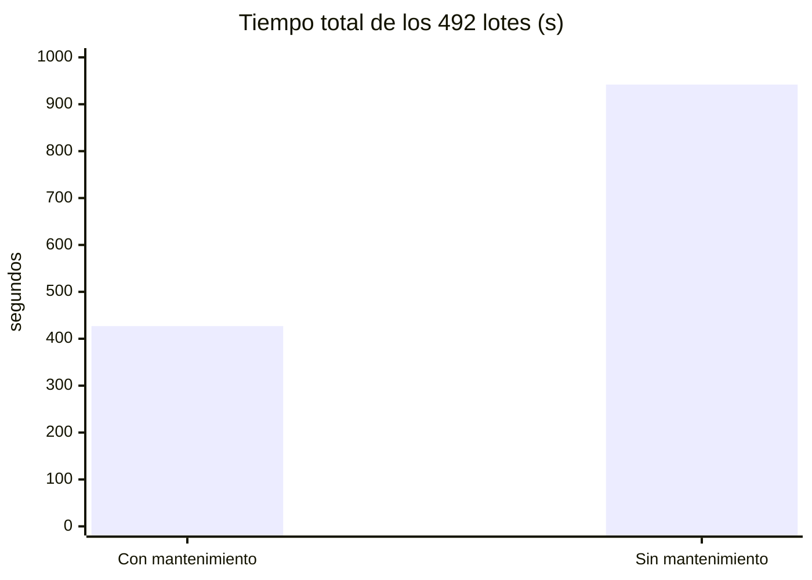

# Lakehouse de envíos con Iceberg y CDC

Kallpa Envíos (empresa ficticia) hace última milla para unas 320 tiendas online en Lima, Callao y siete ciudades de provincia. Cada cambio de estado de un envío es un `UPDATE` en la base transaccional, y a Datos le llega por CDC en formato Debezium, en archivos que el conector deja cada 6 horas. Con eso Operaciones revisa cada mañana el cumplimiento de promesa (OTD) por zona y servicio.

## Problemática

El `MERGE` que cargaba esos archivos aplicaba los eventos en el orden en que llegaban. El conector entrega al menos una vez, así que los duplicados inflaban el historial, y algunos eventos llegan lotes después: si gana lo último que llegó, un envío entregado vuelve a figurar `en_ruta`. En los cuatro meses simulados eso deja 1,096 envíos con el estado equivocado, 1,064 de ellos entregados que figuran como no entregados, casi nueve décimas de punto de OTD que no existían.

A eso se sumaban los cambios en origen que nadie avisaba, como pesos en gramos o estados en mayúsculas, y de los que Datos se enteraba por el tablero. Y como los motorizados sin señal sincronizan la entrega horas después, el OTD se movía de un día para otro y nadie podía decir qué número se había visto el lunes a las 8.

## Solución

Armé un lakehouse en Apache Iceberg con tres capas. Bronce guarda cada lote tal como llegó; plata aplica los cambios ordenados por `lsn` (la posición en el log de la base) y manda a cuarentena lo que rompe un contrato de datos versionado; oro publica el OTD en el corte de las 06:00 y etiqueta ese snapshot para poder volver a él. Con eso Operaciones discute un número estable y Datos le lleva a Plataforma la evidencia de cada problema de origen antes de que llegue al tablero.

El alcance incluye el simulador de la base de origen y del conector, el contrato en YAML, la ingesta incremental con marca de agua, el mantenimiento semanal de las tablas, la conciliación contra origen, los assets de Dagster con chequeos y sensor, la CLI y un tablero en Streamlit. Quedan fuera Kafka y Debezium reales, varios escritores simultáneos y la decisión de normalizar datos que le toca a Plataforma.

## AS IS: cada lote se aplica como llega



Los problemas están en tres puntos. El `MERGE` no conoce el orden real de los cambios, así que los eventos tardíos y duplicados ensucian el estado actual sin que nadie lo note. No hay un control de calidad a la entrada: el error de origen se descubre en la reunión de Operaciones y termina en una revisión manual y un reproceso. Y el OTD se recalcula sobre la tabla viva, de modo que el número de ayer no se puede reconstruir y cada diferencia se vuelve una discusión.

## TO BE: cada lote se valida, se ordena y se etiqueta



El carril del pipeline está completo en el código, incluida la alerta cuando la cuarentena pasa de 2% del lote. La revisión de Datos, el aviso a Plataforma y la reunión de Operaciones son cómo lo usaría el negocio. La corrección de Plataforma vuelve a entrar como un evento más, con `lsn` mayor, y plata la toma sin reprocesar nada.

## Cómo cambian los indicadores

| Indicador | AS IS | TO BE |
|---|---|---|
| Envíos con estado equivocado al cierre | 1,096 (MERGE en orden de llegada) | 0 (guarda de `lsn`) |
| Duplicados del conector en plata | entraban al historial | 2,363 descartados |
| Errores de origen detectados | en el tablero, a mano | en el lote: peso en gramos desde el lote de las 12:00 del 18 de agosto |
| OTD de un día pasado | no se podía reconstruir | 123 cortes etiquetados en oro |
| Envíos de origen que no cuadran con plata | no se conciliaba | 43, todos en cuarentena por distrito mal escrito |

Las cifras salen de correr los 492 lotes con `python -m lakehouse correr`, como se detalla más abajo.

## Las tablas



Bronce ([`ingesta.py`](src/lakehouse/ingesta.py)) agrega cada lote tal como llegó, con archivo y línea, y no corrige nada. El contrato ([`contratos/envios.yml`](contratos/envios.yml), leído por [`contrato.py`](src/lakehouse/contrato.py)) define tipos, dominios, rangos y reglas entre columnas, y de ahí salen el esquema de plata y el SQL que valida cada evento. Cada lote se valida con la versión que regía en su corte.

En plata, el estado actual deduplica por `lsn` y aplica el último evento de cada envío solo si su `lsn` es mayor al que ya está. Es copy-on-write por día de registro, así que solo se reescriben los días que el lote toca. El historial guarda cada cambio de estado con su hora real, y ahí un evento tardío sí entra, porque el cambio ocurrió aunque haya llegado tarde. Lo que rompe el contrato va a cuarentena con la lista de reglas que rompe.

Oro ([`oro.py`](src/lakehouse/oro.py)) recalcula en el corte de las 06:00 el cumplimiento de promesa de los últimos 35 días por zona y servicio y etiqueta el snapshot como `corte-AAAA-MM-DD`. Los domingos, [`mantenimiento.py`](src/lakehouse/mantenimiento.py) compacta, expira snapshots que no tengan tag y borra archivos huérfanos. Todo corre como assets de Dagster en [`definiciones.py`](src/lakehouse/definiciones.py), con chequeos y un sensor por lote nuevo; la CLI usa las mismas funciones sin Dagster.

## Datos simulados

[`generar_datos.py`](datos/generar_datos.py) simula primero la base transaccional, con la vida completa de cada envío, y después el conector que la convierte en archivos. Semilla fija, unos 45 segundos. Del 1 de julio al 31 de octubre de 2026 salen 124,468 envíos y 637,279 eventos de cambio en 492 lotes de 6 horas, 40 MB en archivos.

Hay una campaña de ofertas en julio que satura el reparto, entregas sin señal que sincronizan tarde (18% en provincia) y un conector imperfecto: 10,179 eventos llegan uno o más lotes tarde y 2,363 llegan duplicados.

Y cuatro incidentes de origen que el contrato tiene que encontrar solo.

| Incidente | Qué pasa en origen |
|---|---|
| Peso en gramos, 18 al 20 ago | La app de agencias manda `peso_kg = 1500` en vez de 1.5 para 634 envíos. El 21 a las 11:00 un script lo corrige |
| Estados en mayúsculas, 6 oct 10:00-15:59 | Un deploy escribe `EN_RUTA`, `ENTREGADO`. A las 18:30 se normalizan en origen |
| Distritos mal escritos | "Surco", "SJL", "San Martin de Porres" sin tilde. Nadie los corrige: 43 envíos |
| Columna nueva, 15 set 08:00 | Plataforma agrega `franja_horaria`. El contrato 1.1.0 que la declara rige desde el 17 |

## Qué pasó con los 492 lotes

Los corrí en orden con `python -m lakehouse correr`: 427 segundos en total, 0.87 s por lote contando oro y el mantenimiento de los domingos.

| | eventos |
|---|---|
| Leídos de los archivos | 639,642 |
| Duplicados descartados | 2,363 |
| Ignorados por lsn (plata ya tenía uno más nuevo) | 2,453 |
| En cuarentena | 6,085 |
| Insertados / actualizados / borrados en plata | 124,425 / 358,743 / 363 |
| Cambios de estado en el historial | 631,254 |

Lo que más me importaba era el orden. Aplicar el CDC en el orden en que llega, como hacía el `MERGE` original, deja 1,096 envíos con el estado equivocado; 1,064 son entregados que figuran como no entregados, 973 de ellos `en_ruta`, porque ese evento llegó un lote después del de `entregado`. Con la guarda de `lsn` son 0. Para el tablero de OTD eran casi nueve décimas de punto de cumplimiento que no existían.

Al final hay 124,105 envíos en origen y 124,062 en plata. Los 43 que faltan son los de distrito mal escrito, en cuarentena, y en los demás no difiere ninguna de las 15 columnas. El contrato agarró el peso en gramos en el lote de las 12:00 del 18 de agosto (15 lotes pasaron el umbral de 2%, el peor con 20.3%) y los estados en mayúsculas llegaron a 73.9% del lote de las 18:00 del 6 de octubre. Cuando origen mandó la corrección, plata la tomó sola. Con `franja_horaria` el pipeline avisó en cada lote y la dejó en bronce hasta que rigió la 1.1.0; ese día plata agregó la columna y 2,023 envíos que ya no iban a recibir eventos se rellenaron desde bronce.

El OTD de la mañana siguiente se equivoca menos de lo que esperaba: entre el primer corte y el último, la brecha media es de 0.20 puntos en Lima centro y 0.43 en provincia. El peor día fue el 15 de setiembre, visto con 88.4% y cerrado en 89.2%. Lo que faltaba era saber qué número se vio, y eso lo da el tag.

Contra `Table.upsert` de pyiceberg, escribiendo `plata.envios` en los primeros 124 lotes, mi upsert por partición tardó 34 segundos y el otro 984: busca las claves en toda la tabla y además no sabe de `lsn`. Se reproduce con `python -m lakehouse comparar-upsert`.

El mantenimiento sí pesa. Corrí los mismos lotes otra vez con `correr --sin-mantenimiento` en otra carpeta:



| | con mantenimiento | sin mantenimiento |
|---|---|---|
| Mediana por lote en julio / octubre | 0.41 s / 0.48 s | 0.75 s / 2.62 s |
| Snapshots en plata | 57 | 985 |
| metadata.json de plata | 47 KB | 672 KB |
| Archivos en disco / tamaño del warehouse | 1,611 / 90 MB | 9,978 / 254 MB |

Sin compactar, cada commit reescribe un metadata.json con todos los snapshots y cada lectura abre un manifiesto por lote. Un test confirma que compactar no cambia ni una fila.

## Por qué lo armé así

Usé pyiceberg con un catálogo SQLite para que corra en una laptop sin Spark, y DuckDB para las transformaciones sobre Arrow. Las tablas son Iceberg v2 estándar y se pueden leer desde Trino, Spark o DuckDB.

Bronce guarda todo, incluso duplicados: 2,363 filas de 639,642 a cambio de poder rellenar `franja_horaria` y tener evidencia para Plataforma.

El orden lo da el `lsn` y no la hora. La hora de commit se repite y `entregado_en` no dice en qué orden se escribió la fila; el `lsn` es la posición en el log de la base.

La marca de agua vive en las propiedades de cada tabla, en la misma transacción que los datos. Si el proceso se cae a medio lote, la siguiente corrida retoma cada tabla desde su marca, y repetir un lote ya aplicado no crea ni un snapshot.

Particioné por día de registro porque esa fecha no cambia; un lote toca a lo más 11 días y solo esos se reescriben. Para la historia uso tags en vez de retener por antigüedad, y oro conserva 123 cortes. pyiceberg no borra huérfanos, así que lo hago a mano comparando contra todo lo que referencian los snapshots vivos, lo que solo es seguro con un único escritor.

## Correrlo

Python 3.10+.

```bash
cd proyectos/07-lakehouse-envios-iceberg
pip install -e ".[orquestacion,app,dev]"

python -m lakehouse todo                     # genera, corre los 492 lotes y concilia (~8 min)

python -m lakehouse generar --escala 0.1     # más chico, para probar
python -m lakehouse correr --hasta 2026-08-20T06    # hasta un lote; después sigue desde ahí
python -m lakehouse estado
python -m lakehouse contrato
python -m lakehouse conciliar
python -m lakehouse viaje --promesa 2026-09-15
python -m lakehouse envio 41234
python -m lakehouse comparar-upsert --lotes 124     # ~18 min

dagster dev -m lakehouse.definiciones        # assets, chequeos, sensor y mantenimiento
streamlit run app.py
pytest                                       # 41 tests, ~45 s
```

## Estructura

```
07-lakehouse-envios-iceberg/
├── app.py                      tablero: resumen, CDC, contrato, viaje en el tiempo, mantenimiento
├── contratos/envios.yml        contrato de datos con versiones
├── referencia/distritos.csv    distritos válidos y su zona
├── datos/generar_datos.py      base de origen simulada y archivos del conector
├── src/lakehouse/
│   ├── contrato.py             esquema de plata y SQL de validación desde el YAML
│   ├── catalogo.py             catálogo Iceberg y las cinco tablas
│   ├── cdc.py                  lectura de los lotes
│   ├── ingesta.py              bronce, validación, upsert con lsn, historial, cuarentena, evolución de esquema
│   ├── oro.py                  cumplimiento de promesa y tags por corte
│   ├── viaje.py                lecturas sobre los cortes etiquetados
│   ├── mantenimiento.py        compactar, expirar, borrar huérfanos
│   ├── auditoria.py            conciliación con origen y comparación con el MERGE ingenuo
│   ├── comparar.py             upsert por partición vs Table.upsert
│   ├── pipeline.py             orquestación sin Dagster
│   ├── definiciones.py         assets, checks, sensor y schedule de Dagster
│   ├── bitacora.py             una fila por lote y por mantenimiento (DuckDB)
│   ├── calendario.py           feriados, días hábiles, lotes, etiquetas en español
│   └── cli.py
└── tests/                      contrato, ingesta (tardíos, duplicados, caídas, esquema), pipeline, generador, cli, dagster
```

## Lo que no resuelve

Asume un solo escritor. Con varios haría falta un catálogo con commits atómicos (REST, Glue) y otro manejo de huérfanos.

pyiceberg no reescribe manifiestos, y plata termina con 93 manifiestos para 117 archivos. Con este volumen todavía no pesa; en Spark sería `rewrite_manifests`.

La retención se cuenta en snapshots porque la simulación comprime cuatro meses en minutos; en producción sería `older_than` de 7 días más los tags. Oro recalcula 35 días hacia atrás, y una entrega que sincronice más tarde ya no cuenta; con datos reales habría que medirlo.

Los 43 envíos con distrito mal escrito se quedan en cuarentena. Una regla de normalización en el contrato los recuperaría, pero esa decisión le toca a Plataforma. Y el CDC es simulado, con formato Debezium pero sin Debezium ni Kafka.

## Siguiente

- Leer el CDC directo de Kafka, confirmando el offset en la misma transacción que la marca de agua.
- Pasar el catálogo a REST (Lakekeeper o Polaris) y consultar desde Trino o la extensión de Iceberg de DuckDB.
- Agregar al contrato reglas de transición de estado, como que un envío entregado no vuelve a ruta.
- Que la capa semántica del proyecto 05 lea oro en vez de su propia base.
