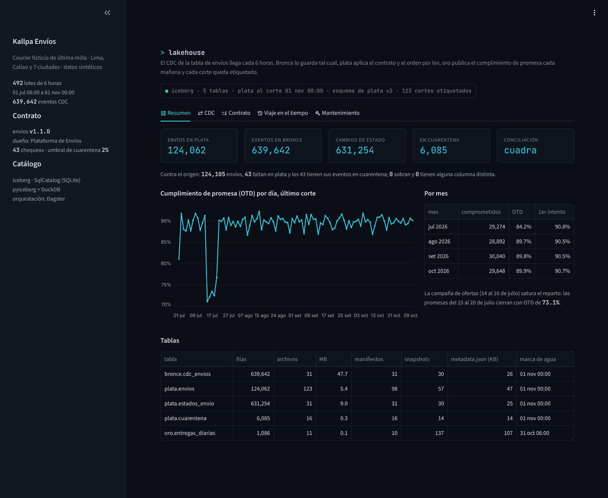
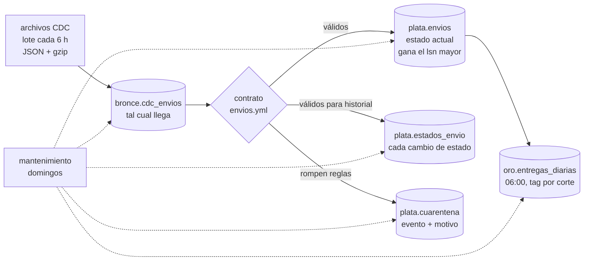
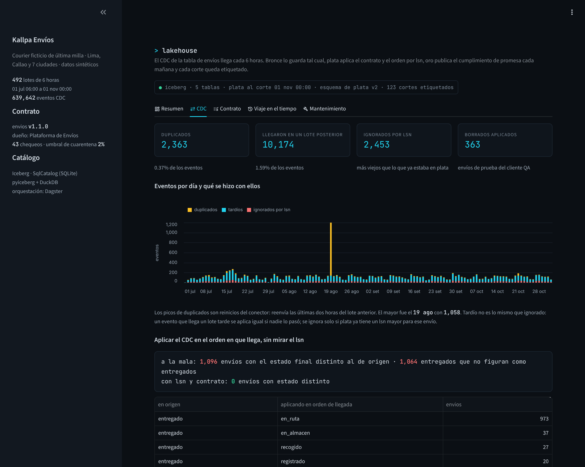
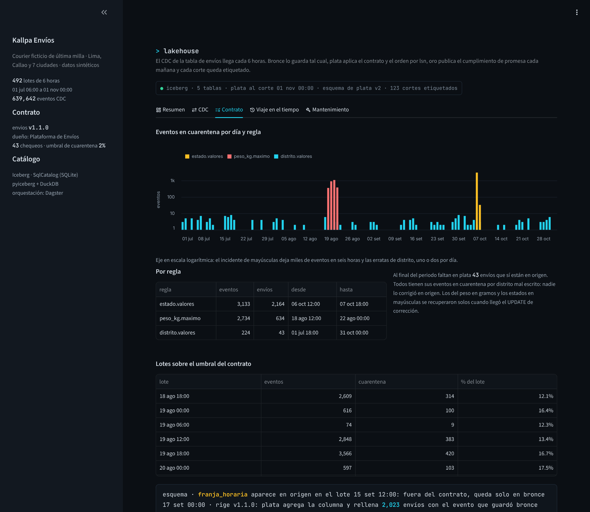
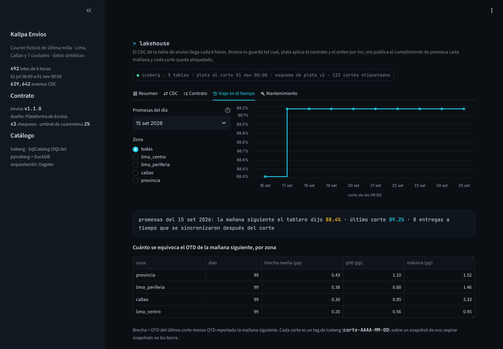
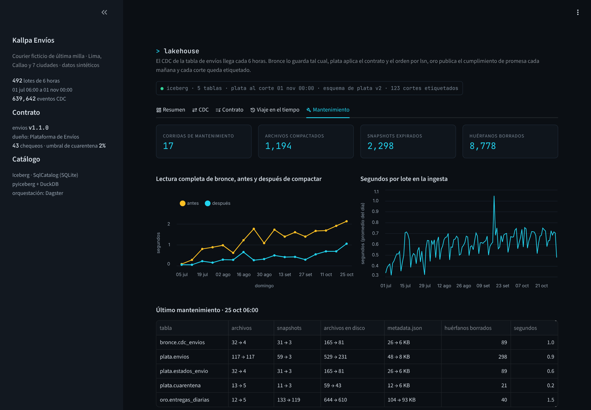
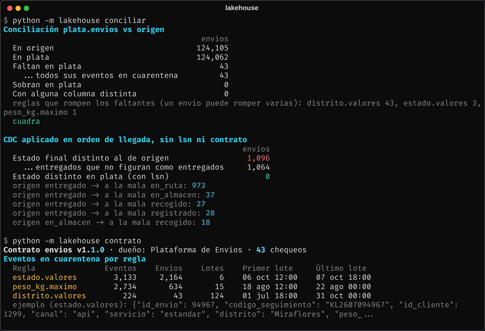

# Lakehouse de envíos con Iceberg y CDC

Los cambios de la tabla de envíos de un courier llegan cada 6 horas como eventos de CDC. Los cargo a tablas Apache Iceberg en tres capas, los valido contra un contrato de datos versionado, mantengo el estado actual y el historial de cada envío, publico el cumplimiento de promesa cada mañana y dejo cada publicación etiquetada para poder volver a ella.



## El problema

Kallpa Envíos (empresa ficticia) hace última milla para unas 320 tiendas online en Lima, Callao y siete ciudades de provincia: registra el envío, lo recoge, lo pasa por almacén y lo reparte. Cada cambio de estado es un `UPDATE` en la base transaccional, y Datos los recibe por CDC (formato Debezium) en archivos que el conector deja cada 6 horas.

Lo que pasaba con el `MERGE` que había:

- **El conector entrega al menos una vez.** Cuando se reinicia, reenvía lo último que mandó. Los duplicados inflaban el historial de estados.
- **No todo llega en orden.** Por reintentos, un evento puede llegar uno o varios lotes después. Si se aplica "lo último que llegó", un envío entregado vuelve a figurar `en_ruta`.
- **Origen cambia sin avisar.** Un día la app de agencias empezó a mandar el peso en gramos; otro, un deploy mandó los estados en mayúsculas; otro, Plataforma agregó una columna. Nos enterábamos por el tablero.
- **El OTD de la reunión de la mañana no era el del día siguiente.** Los motorizados sin señal sincronizan la entrega horas después. Nadie podía decir qué número se vio el lunes a las 8.

Quería un pipeline que se pueda correr de nuevo sin miedo, que no deje pasar datos rotos a las tablas que consume el negocio y que guarde qué se publicó cada día.

## Qué hace



- **Bronce** ([`ingesta.py`](src/lakehouse/ingesta.py)): agrega cada lote tal como llegó, con archivo y línea. Nada se corrige aquí; es la evidencia.
- **Contrato** ([`contratos/envios.yml`](contratos/envios.yml), [`contrato.py`](src/lakehouse/contrato.py)): tipos, obligatorios, dominios, rangos, patrón del código de seguimiento y reglas entre columnas. De ahí sale el esquema de plata y el SQL que valida cada evento. Tiene versiones con fecha de vigencia y cada lote se valida con la que regía en su corte.
- **Plata, estado actual**: deduplica por `lsn`, se queda con el último evento de cada envío y lo aplica solo si su `lsn` es mayor al que ya está en la tabla. Es copy-on-write por día de registro: solo se reescriben los días que el lote toca.
- **Plata, historial**: cada cambio de estado con su hora real (la de entrega, no la de sincronización). Un evento tardío sí entra aquí: el cambio de estado ocurrió, solo llegó tarde.
- **Cuarentena**: los eventos que rompen el contrato, con la lista de reglas que rompen. No se pierden ni bloquean el lote.
- **Oro** ([`oro.py`](src/lakehouse/oro.py)): en el corte de las 06:00 recalcula el cumplimiento de promesa de los últimos 35 días por zona y servicio, y etiqueta el snapshot como `corte-AAAA-MM-DD`.
- **Mantenimiento** ([`mantenimiento.py`](src/lakehouse/mantenimiento.py)): cada domingo compacta particiones con muchos archivos chicos, expira snapshots (menos los etiquetados) y borra los archivos que ya nadie referencia.
- **Orquestación** ([`definiciones.py`](src/lakehouse/definiciones.py)): assets de Dagster con chequeos (clave única, cuarentena bajo el umbral), un sensor que lanza una corrida por cada carpeta de lote nueva y el mantenimiento semanal. La CLI usa las mismas funciones sin Dagster.

## Datos

[`generar_datos.py`](datos/generar_datos.py) simula primero la base transaccional (la vida completa de cada envío) y después el conector que la convierte en archivos. Semilla fija, unos 45 segundos.

Del 1 de julio al 31 de octubre de 2026: **124,468 envíos**, **637,279 eventos** de cambio en **492 lotes** de 6 horas. Los archivos ocupan 40 MB.

| Patrón | En los datos |
|---|---|
| Ciclo del envío | registrado → recogido → en almacén → en ruta → entregado, o intento fallido y vuelta a ruta; al tercer fallo, devuelto. 2.5% se cancela |
| Promesa | mismo día, express (día hábil siguiente) o estándar (2 días hábiles; 3 en provincia). Lo registrado después de las 15:00 cuenta desde el día siguiente. No se reparte domingos ni feriados |
| Campaña de ofertas, 14 al 16 de julio | Los registros se duplican y el reparto no da abasto: las promesas del 15 al 20 de julio cierran con 73.1% a tiempo, contra ~90% el resto del periodo |
| Entregas sin señal | La hora de entrega (`entregado_en`) es la real; el commit llega cuando el celular sincroniza: 3% de las entregas en Lima centro, 10% en la periferia, 18% en provincia |
| Intentos fallidos | Más en la periferia y en envíos contra entrega |
| Borrados | Operaciones borra cada lunes los envíos de prueba del cliente QA: 363 eventos `d` |
| Conector | 10,179 eventos llegan uno o más lotes tarde (1.6%) y 2,363 llegan duplicados; tres reinicios reenvían las últimas dos horas del lote anterior (el del 19 de agosto, 1,048 eventos) |

Y cuatro incidentes de origen con fecha conocida. El pipeline no sabe de ellos; los tiene que encontrar el contrato.

| Incidente | Qué pasa en origen |
|---|---|
| Peso en gramos, 18 al 20 ago | La app de agencias manda `peso_kg = 1500` en vez de 1.5 para 634 envíos. El 21 a las 11:00 un script lo corrige con un `UPDATE` |
| Estados en mayúsculas, 6 oct 10:00-15:59 | Un deploy escribe `EN_RUTA`, `ENTREGADO`. A las 18:30 se normalizan en origen |
| Distritos mal escritos | "Surco", "SJL", "San Martin de Porres" sin tilde, "Miraflores " con espacio. Nadie los corrige: 43 envíos |
| Columna nueva, 15 set 08:00 | Plataforma agrega `franja_horaria`. El contrato 1.1.0 que la declara rige desde el 17 |

## Resultados

Corrí los 492 lotes en orden con `python -m lakehouse correr`: 427 segundos en total, 0.87 s por lote contando oro y el mantenimiento de los domingos.

| | eventos |
|---|---|
| Leídos de los archivos | 639,642 |
| Duplicados descartados | 2,363 |
| Llegaron en un lote posterior | 10,174 |
| Ignorados por lsn (plata ya tenía uno más nuevo) | 2,453 |
| En cuarentena | 6,085 |
| Insertados / actualizados / borrados en plata | 124,425 / 358,743 / 363 |
| Cambios de estado en el historial | 631,254 |



Lo que encontré:

- **Plata cuadra con origen.** Al final hay 124,105 envíos en origen y 124,062 en plata. Los 43 que faltan son exactamente los de distrito mal escrito, con todos sus eventos en cuarentena; ninguno sobra y ninguna columna difiere en los 124,062 que están en los dos lados. La conciliación compara las 15 columnas del contrato además de la clave.
- **Aplicar el CDC en el orden en que llega deja 1,096 envíos con el estado equivocado.** Es lo que hacía el `MERGE` original: la última fila que llegó gana. 1,064 son envíos entregados que figuran como no entregados, 973 de ellos `en_ruta`, porque el evento de `en_ruta` llegó un lote tarde, después del de `entregado`. Con la guarda de `lsn` son 0. Para el tablero de OTD son casi nueve décimas de punto de cumplimiento que no existen.
- **El contrato encontró los tres incidentes de datos en el primer lote afectado.** El peso en gramos aparece en el lote de las 12:00 del 18 de agosto y 15 lotes pasan el umbral de 2% en cuarentena (el peor, 20.3%). Los estados en mayúsculas llegan a 73.9% del lote de las 18:00 del 6 de octubre.
- **Los incidentes que origen corrigió se recuperaron solos.** Cuando llega el `UPDATE` de corrección, es un evento válido con `lsn` mayor y plata toma la imagen completa. No hubo que reprocesar nada. El historial tampoco perdió los cambios de estado de los envíos con peso malo: cada regla declara qué columnas mira, y una regla de peso no invalida que el envío pasó a `en_ruta`.
- **La columna nueva esperó al contrato y después se rellenó desde bronce.** Del 15 al 16 de setiembre `franja_horaria` llega en el JSON pero la versión vigente no la declara: el pipeline avisa en cada lote y la deja solo en bronce. El 17 rige la 1.1.0, plata agrega la columna (Iceberg no reescribe datos para eso) y 2,023 envíos que ya habían recibido su último evento se rellenan con el evento de bronce que los dejó en su estado actual. Sin bronce, esos 2,023 se quedaban en nulo y la conciliación no cuadraba.



- **El OTD de la mañana siguiente se equivoca poco, y casi siempre para abajo.** Comparo cada día de promesa visto en el primer corte (06:00 del día siguiente) contra el último. La brecha media es de 0.20 puntos en Lima centro y 0.43 en provincia; el p90 en provincia, 1.10 puntos. El peor día fue el 15 de setiembre: el tablero dijo 88.4% y terminó en 89.2%. Esperaba más: la mayoría de entregas sin señal sincroniza antes de las 6 de la mañana. Lo que sí importa es poder responder qué número se vio, y eso lo da el tag del corte.



- **`Table.upsert` de pyiceberg no aguanta un lote cada 6 horas.** Con los mismos eventos ya validados, medí solo la escritura de `plata.envios` en los primeros 124 lotes (julio):

| Lotes | Filas en plata al final | Upsert por partición (s/lote) | `Table.upsert` (s/lote) |
|---|---|---|---|
| 1-28 | 6,631 | 0.14 | 1.21 |
| 29-56 | 15,124 | 0.24 | 4.99 |
| 57-84 | 24,709 | 0.31 | 11.21 |
| 85-112 | 30,518 | 0.37 | 10.59 |
| 113-124 | 33,050 | 0.41 | 16.69 |

  En total, 34 segundos contra 984; el lote más pesado de `Table.upsert` tardó 45 segundos. `Table.upsert` busca las claves en toda la tabla y su tiempo crece con ella; el upsert por partición solo lee los días que el lote toca. Además `Table.upsert` no sabe de `lsn`: aplicaría el evento tardío encima del nuevo. Se reproduce con `python -m lakehouse comparar-upsert`.

- **Sin mantenimiento, la ingesta se vuelve 5 veces más lenta en cuatro meses.** Corrí los mismos 492 lotes dos veces, con y sin el mantenimiento de los domingos (`correr --sin-mantenimiento` en otra carpeta de datos):

| | con mantenimiento | sin mantenimiento |
|---|---|---|
| Tiempo total de los 492 lotes | 427 s | 942 s |
| Mediana por lote en julio / octubre | 0.41 s / 0.48 s | 0.75 s / 2.62 s |
| Archivos de datos en bronce / historial | 31 / 31 | 492 / 503 |
| Snapshots en plata | 57 | 985 |
| metadata.json de plata | 47 KB | 672 KB |
| Leer bronce completo (639,642 filas) | 0.59 s | 2.28 s |
| Leer el historial completo (631,254 filas) | 0.11 s | 1.34 s |
| Archivos en disco / tamaño del warehouse | 1,611 / 90 MB | 9,978 / 254 MB |

  Con mantenimiento el tiempo por lote se queda plano desde agosto; sin él crece todos los meses, en todos los pasos: leer bronce para deduplicar, abrir los días de plata, escribir el historial. Cada commit reescribe un metadata.json que lista todos los snapshots, y cada lectura abre un manifiesto por lote. Compactar no cambia los datos: hay un test que lo compara fila por fila.



## Decisiones de diseño

- **Iceberg con pyiceberg y un catálogo SQLite.** Corre en una laptop sin Spark ni servidor. Las tablas son Iceberg v2 estándar: el mismo `warehouse` se puede registrar en un catálogo REST, Glue o Polaris y leerse desde Trino, Spark o DuckDB. DuckDB hace las transformaciones sobre Arrow.
- **Bronce guarda todo, incluso duplicados.** Deduplicar en bronce parece limpio, pero bronce es lo que me dejó rellenar `franja_horaria` y es lo que le muestro a Plataforma cuando hay un reclamo. El costo es 2,363 filas de 639,642.
- **El orden lo da el `lsn`, no la hora.** La hora de commit puede repetirse y la de los eventos de negocio (`entregado_en`) no dice en qué orden se escribió la fila. El `lsn` es la posición en el log de la base: es la única que ordena sin ambigüedad.
- **La marca de agua vive en la tabla.** Cada tabla guarda el último lote aplicado en sus propiedades, en la misma transacción que los datos. Si el proceso se cae entre plata y el historial, la siguiente corrida retoma cada tabla desde su marca; hay un test que simula esa caída. Volver a correr un lote ya aplicado no crea ni un snapshot.
- **Upsert copy-on-write por día de registro, propio.** La fecha de registro no cambia, así que sirve de partición estable: un lote toca a lo más 11 días (la mediana es 7) y se reescriben solo esos. Además de ser más rápido que `Table.upsert`, permite la guarda de `lsn`.
- **Cuarentena por evento y reglas por columna.** Un lote con eventos malos no se detiene: los buenos pasan y los malos quedan con su motivo. El chequeo del lote (umbral de 2%) es el que avisa; en Dagster es un `asset_check` con severidad de advertencia.
- **El contrato en YAML, con fechas de vigencia.** Lo pueden leer y aprobar Plataforma y Datos en un PR. Las fechas permiten reprocesar el pasado con la versión que regía, y que una columna nueva no entre a plata hasta que alguien la declare.
- **Tags en vez de retener snapshots por antigüedad.** Para responder qué decía el tablero el 16 de agosto solo necesito un snapshot por mañana. Expirar respeta los tags, así que oro conserva 123 cortes y el resto se limpia.
- **Huérfanos a mano.** pyiceberg expira snapshots pero no borra los archivos que dejan de usarse. Lo hago en [`mantenimiento.py`](src/lakehouse/mantenimiento.py) comparando contra todos los archivos, manifiestos y metadata que referencian los snapshots vivos. Solo es seguro con un único escritor.

## Correrlo

Python 3.10+.

```bash
cd proyectos/07-lakehouse-envios-iceberg
pip install -e ".[orquestacion,app,dev]"

python -m lakehouse todo                     # genera, corre los 492 lotes y concilia (~8 min)

python -m lakehouse generar --escala 0.1     # más chico, para probar
python -m lakehouse correr --hasta 2026-08-20T06    # hasta un lote; después sigue desde ahí
python -m lakehouse estado
python -m lakehouse contrato
python -m lakehouse conciliar
python -m lakehouse viaje --promesa 2026-09-15
python -m lakehouse envio 41234
python -m lakehouse comparar-upsert --lotes 124     # ~18 min

dagster dev -m lakehouse.definiciones        # assets, chequeos, sensor y mantenimiento
streamlit run app.py
pytest                                       # 41 tests, ~45 s
```



## Estructura

```
07-lakehouse-envios-iceberg/
├── app.py                      tablero: resumen, CDC, contrato, viaje en el tiempo, mantenimiento
├── contratos/envios.yml        contrato de datos con versiones
├── referencia/distritos.csv    distritos válidos y su zona
├── datos/generar_datos.py      base de origen simulada y archivos del conector
├── src/lakehouse/
│   ├── contrato.py             esquema de plata y SQL de validación desde el YAML
│   ├── catalogo.py             catálogo Iceberg y las cinco tablas
│   ├── cdc.py                  lectura de los lotes
│   ├── ingesta.py              bronce, validación, upsert con lsn, historial, cuarentena, evolución de esquema
│   ├── oro.py                  cumplimiento de promesa y tags por corte
│   ├── viaje.py                lecturas sobre los cortes etiquetados
│   ├── mantenimiento.py        compactar, expirar, borrar huérfanos
│   ├── auditoria.py            conciliación con origen y comparación con el MERGE ingenuo
│   ├── comparar.py             upsert por partición vs Table.upsert
│   ├── pipeline.py             orquestación sin Dagster
│   ├── definiciones.py         assets, checks, sensor y schedule de Dagster
│   ├── bitacora.py             una fila por lote y por mantenimiento (DuckDB)
│   ├── calendario.py           feriados, días hábiles, lotes, etiquetas en español
│   └── cli.py
└── tests/                      contrato, ingesta (tardíos, duplicados, caídas, esquema), pipeline, generador, cli, dagster
```

## Limitaciones

- **Un solo escritor.** El catálogo SQLite y el borrado de huérfanos asumen que nadie más escribe. Con escritores concurrentes hace falta un catálogo con commits atómicos de verdad (REST, Glue) y dejar los huérfanos para cuando no haya commits en curso.
- **pyiceberg no reescribe manifiestos.** Plata termina con 93 manifiestos para 117 archivos, porque cada lote reescribe días y deja un manifiesto nuevo. En Spark se resuelve con `rewrite_manifests`; aquí, con este volumen, todavía no pesa.
- **La retención se cuenta en snapshots, no en días.** La simulación comprime cuatro meses en minutos, así que `older_than` no tenía sentido. En producción sería `older_than` de 7 días más los tags.
- **Oro recalcula 35 días hacia atrás.** Una entrega que sincroniza más tarde que eso no cambia el día de su promesa. En los datos no pasa; con datos reales habría que medirlo.
- **Las erratas de distrito se quedan en cuarentena para siempre.** Una regla de normalización (trim, tildes, alias como "SJL") en el contrato recuperaría los 43 envíos, pero eso es decisión de Plataforma, no un arreglo silencioso en Datos.
- **El CDC es simulado.** Los archivos tienen el formato de Debezium pero no salieron de Debezium ni de Kafka.

## Lo que sigue

- Leer el CDC directo de Kafka con un consumidor que confirme el offset en la misma transacción que la marca de agua.
- Pasar el catálogo a REST (Lakekeeper o Polaris) y consultar las tablas desde Trino o desde la extensión de Iceberg de DuckDB.
- Agregar al contrato las reglas de transición de estado (un envío entregado no vuelve a ruta) como chequeo de advertencia.
- Que la capa semántica del proyecto 05 lea oro en vez de su propia base.
