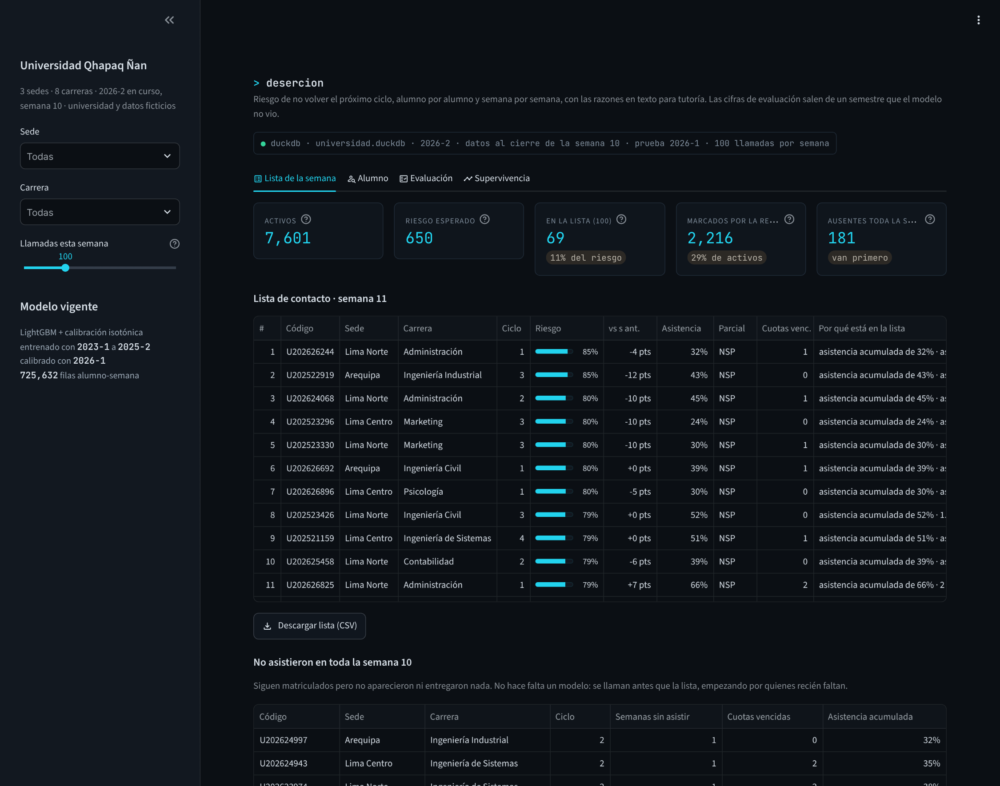
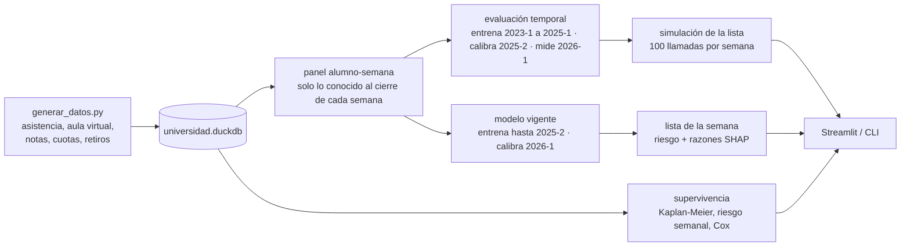
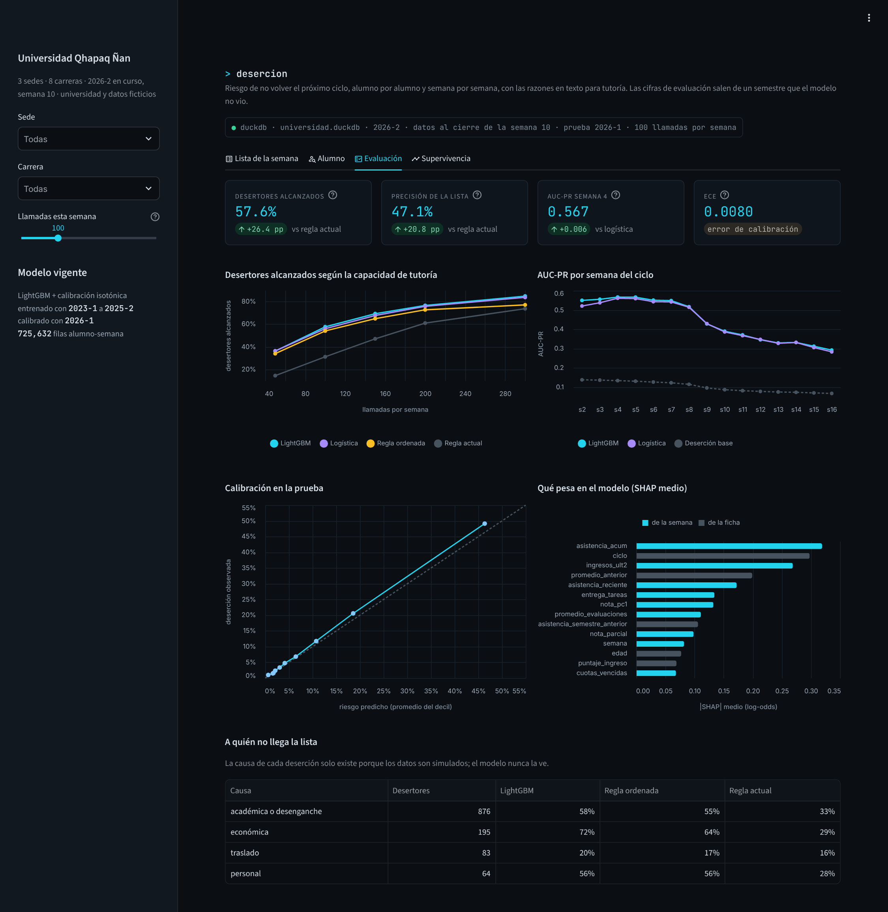
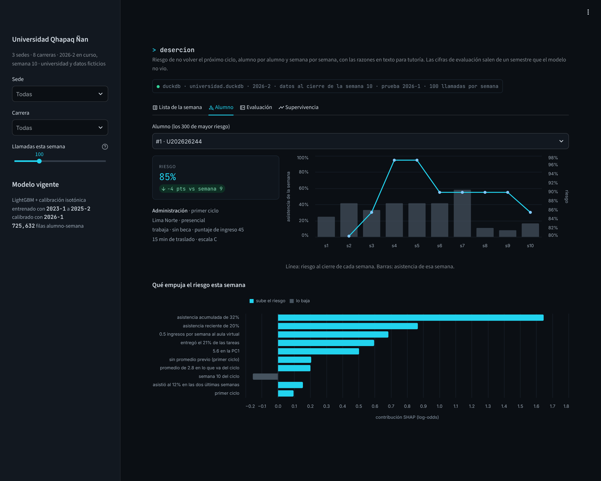
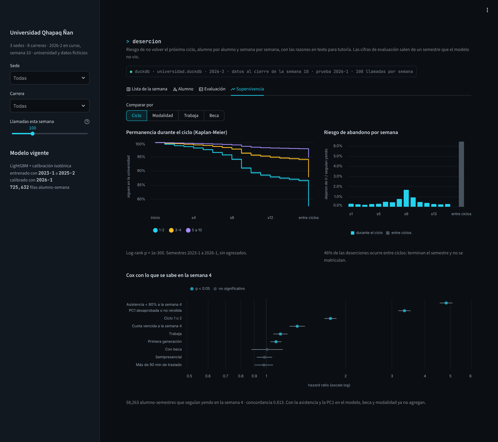
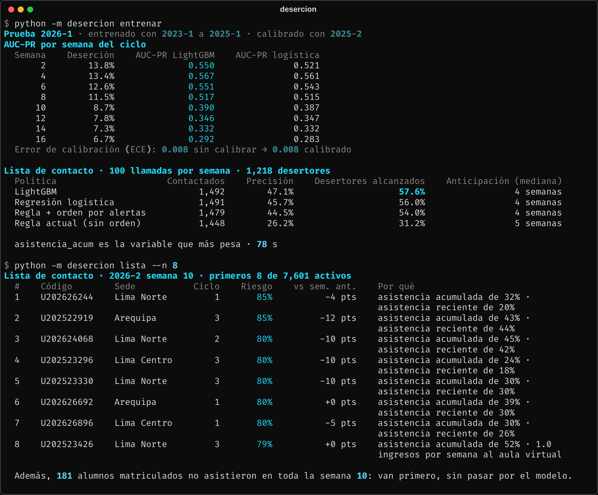

# Alerta temprana de deserción universitaria

Cada lunes, una lista con los alumnos que conviene llamar esa semana: riesgo de no volver el próximo ciclo, calibrado, con las tres razones que lo explican en palabras que un tutor entiende. El modelo es un LightGBM que se reentrena con los semestres cerrados; la evaluación se hace sobre la decisión real, que es a quién llamar con capacidad limitada.



## El problema

La Universidad Qhapaq Ñan (ficticia) tiene tres sedes, ocho carreras y unos 8,000 alumnos por semestre, entre presencial y semipresencial. De los que no egresan, el 13.0% no se vuelve a matricular el ciclo siguiente; en primer ciclo, el 24.1%.

Bienestar Estudiantil tiene seis tutores que pueden hacer unas 100 llamadas por semana. Hoy trabajan con una regla de tres alertas: asistencia acumulada menor a 70%, alguna evaluación desaprobada o dos cuotas vencidas. La regla no está mal pensada, pero desde la semana 4 marca a uno de cada cuatro alumnos (1,949 en la semana 4 de 2026-1, 2,510 en la semana 8) y la lista llega sin orden. Con 100 llamadas por semana, quién recibe la llamada termina dependiendo del orden del reporte.

Lo que quería responder: con la misma capacidad de tutoría, ¿a cuántos de los que se van se les llega antes de que dejen de ir?

## Qué hace



- **Panel alumno-semana.** Una fila por alumno activo y semana (de la 2 a la 16), con 37 variables: 18 de la ficha y la matrícula (ciclo, beca, promedio anterior, asistencia del ciclo anterior, si trabaja, tiempo de traslado, sede, carrera...) y 19 de la semana (asistencia acumulada y reciente, ingresos al aula virtual, tareas entregadas, notas de PC1, parcial y PC2, cuotas vencidas, semanas de atraso). Cada fila usa solo lo registrado hasta el domingo de esa semana.
- **Un solo LightGBM para todas las semanas**, con la semana como variable. Al lado, una regresión logística con las mismas variables como referencia.
- **Calibración isotónica** con un semestre que el modelo no vio. El tablero muestra la probabilidad calibrada, pero la lista se ordena por el puntaje del modelo: la isotónica devuelve escalones y empataría a alumnos que el modelo sí distingue.
- **Razones con SHAP.** Para cada alumno, las tres variables que más suben su riesgo, en texto: "asistencia acumulada de 32%", "no rindió la PC1", "2 cuota(s) vencida(s)".
- **Lista de ausentes aparte.** Quien no asistió ni entregó nada en toda la semana no pasa por el modelo: va primero.
- **Supervivencia.** Curvas de permanencia por grupo, riesgo de abandono semana a semana y un Cox con lo que se sabe en la semana 4.

## Datos

Del 2023-1 al 2026-2, este último en curso con datos hasta la semana 10: 18,884 alumnos, 66,915 matrículas y 1.01 millones de filas de asistencia semanal, más aula virtual, evaluaciones, cuotas y retiros. Los genera [`generar_datos.py`](datos/generar_datos.py) en unos 2 segundos, con semilla fija.

El generador simula un "compromiso" latente por alumno que se mueve cada semana: baja con un choque económico, un problema personal o un parcial desaprobado, y de él salen la asistencia, los ingresos al aula virtual, si rinde las evaluaciones y si abandona. Lo que se exporta es solo lo que dejaría un sistema académico real. El alumno que deja de ir sigue matriculado y figura con asistencia 0, salvo que haga el retiro de ciclo. La causa de cada deserción se guarda en una tabla aparte (`aux_causas`) que el modelo no lee.

| Patrón | En los datos (2023-1 a 2026-1, sin egresados) |
|---|---|
| Primeros ciclos | Deserción de 24.1% en primer ciclo, 20.4% en segundo, 12.3% en tercero y cuarto, 5.3% del quinto en adelante |
| Trabajo y modalidad | 17.3% entre quienes trabajan vs 10.9%; 18.0% en semipresencial vs 11.5% en presencial |
| Beca | 7.9% con beca vs 13.2% sin beca |
| Traslado | 15.2% con más de 90 minutos de viaje vs 12.7% |
| Inhabilitación por faltas | En la semana 6, quien lleva menos de 70% de asistencia deserta en 66.0% de los casos; el resto, 7.9% |
| Deuda | En la semana 8, con 2 o más cuotas vencidas desertan 32.3% (8.9% sin deuda). La intranet bloquea la evaluación: 62.5% de ellos no rindió el parcial, contra 3.8% sin deuda |
| Después del parcial | El riesgo semanal de abandono sube de 0.77% en la semana 8 a 1.68% en la 9 |
| Entre ciclos | El 46% de las deserciones no pasa dentro del semestre: terminan el ciclo y no se matriculan |
| Semipresencial | La asistencia en vivo dice menos: en la semana 8 separa a los que se van con AUC de 0.785 en semipresencial y 0.841 en presencial. Los ingresos al aula virtual, al revés: 0.831 vs 0.790 |
| Alza de pensión 2026 | 2026-1 cierra con 15.0% de deserción; los semestres anteriores, entre 12.1% y 13.3% |
| Traslados sin aviso | 8.0% de las deserciones son alumnos que se van a otra universidad sin dar ninguna señal |

## Resultados

Prueba en 2026-1: el modelo se entrenó con 2023-1 a 2025-1 (605 mil filas), se calibró con 2025-2 y no vio nada de 2026-1. De 8,100 alumnos que no egresaban, 1,218 no volvieron.

### La lista con 100 llamadas por semana

Simulé lo que habría pasado en 2026-1: cada semana, con los datos al cierre del domingo, tutoría llama durante la semana siguiente a los 100 primeros de la lista que no haya llamado antes en el ciclo. Un desertor cuenta como alcanzado si la llamada llegó antes de que dejara de ir.

| Política | Llamadas | Precisión | Desertores alcanzados | Anticipación (mediana) |
|---|---:|---:|---:|---:|
| Regla actual, en el orden del reporte | 1,448 | 26.2% | 31.2% | 5 semanas |
| Regla actual, ordenada por número de alertas y asistencia | 1,479 | 44.5% | 54.0% | 4 semanas |
| Regresión logística | 1,491 | 45.7% | 56.0% | 4 semanas |
| **LightGBM** | **1,492** | **47.1%** | **57.6%** | **4 semanas** |



Lo que encontré:

- **La mayor ganancia no viene del modelo, viene de ordenar la lista.** Pasar de la regla sin orden a la regla ordenada sube los desertores alcanzados de 31.2% a 54.0%. El LightGBM agrega 3.6 puntos más. Si mañana hubiera que hacer un solo cambio, sería ese: entregarle a tutoría la lista ordenada.
- **El LightGBM le gana a la logística, pero por poco.** AUC-PR de 0.550 contra 0.521 en la semana 2 y de 0.567 contra 0.561 en la semana 4; desde la semana 8 están prácticamente empatados. Las relaciones en estos datos son casi aditivas. Me quedo con el LightGBM porque maneja solo los faltantes (no es lo mismo "todavía no hay PC2" que "no rindió la PC2") y porque SHAP sobre árboles da contribuciones exactas por alumno, pero una logística bien armada es una alternativa razonable.
- **Con la misma cantidad de marcados, el modelo encuentra más.** En la semana 4 la regla marca a 1,949 alumnos con 36.9% de precisión y 63.7% de recall; los 1,949 de mayor riesgo según el modelo dan 41.1% y 70.9%. En la semana 12, 16.3%/72.4% contra 18.4%/81.8%.
- **El modelo funciona mejor temprano que tarde.** La AUC-PR cae de 0.567 en la semana 4 a 0.292 en la 16. En parte es porque los fáciles ya se fueron, y en parte porque casi la mitad se va entre ciclos, con menos señales en clase.
- **Donde más gana es en la deserción por plata.** Llega al 72.3% de los que se fueron por un choque económico (64.1% la regla ordenada, 28.7% la regla sin orden): el atraso en cuotas aparece semanas antes que la caída en asistencia. A los traslados no les llega casi nadie (20.5% el modelo, 16.9% la regla ordenada): un buen alumno que se cambia de universidad no deja rastro en estos datos.
- **La calibración ya venía bien de fábrica.** El ECE es 0.0078 sin calibrar y 0.0080 con la isotónica: no mejora. En el decil de más riesgo, la isotónica incluso se queda algo corta (46.3% predicho vs 49.1% observado), porque 2026-1 tuvo más deserción que 2025-2, el semestre con el que se calibró. La mantengo para el modelo vigente porque se recalibra con el semestre más reciente: con 2026-1, el riesgo medio de los activos en la semana 10 de 2026-2 pasa de 7.8% a 8.6%.

### Lo que pesa en el modelo

Por SHAP medio, las cinco variables que más pesan son la asistencia acumulada, el ciclo, los ingresos al aula virtual de las últimas dos semanas, el promedio del ciclo anterior y la asistencia reciente. Siete de las diez primeras son de la semana; de la ficha solo entran el ciclo, el promedio anterior y la asistencia del ciclo anterior. Lo socioeconómico (trabajo, escala de pensión, primera generación) pesa menos de lo que uno esperaría, porque su efecto ya se ve en cómo asiste y rinde el alumno.



### Supervivencia



- **El primer año define casi todo.** Al cerrar el semestre siguen en la universidad el 77.5% de los alumnos de primer o segundo ciclo, el 87.7% de tercero y cuarto y el 94.7% del quinto en adelante.
- **Dentro del ciclo hay un pico claro en la semana 9**, justo después del parcial: 1.68% de los que seguían yendo dejan de ir esa semana, contra menos de 1% en cualquier otra semana. Entre ciclos, el 6.4% de los que terminaron no se matricula.
- **Cox en la semana 4** (58,263 alumno-semestres que seguían yendo, concordancia 0.813): tener menos de 80% de asistencia multiplica el riesgo por 4.82 (IC 95%: 4.56 - 5.10), desaprobar o no rendir la PC1 por 3.35, estar en primer año por 1.75 y tener una cuota vencida por 1.31. Beca (HR 1.01), semipresencial (0.99) y traslado largo (0.98) dejan de ser significativos: su efecto ya está en la asistencia y en la PC1. Visto solo por Kaplan-Meier, la beca sí separa (92.1% de permanencia contra 86.8%), pero una vez que se sabe cómo le va al alumno en las primeras semanas, no agrega.

## Decisiones

- **Evaluar con la decisión, no solo con la métrica.** La AUC-PR sirve para comparar modelos, pero la pregunta de Bienestar es cuántos desertores se alcanzan con 100 llamadas por semana. Esa simulación es la que dice que el orden importa más que el algoritmo.
- **Corte temporal estricto.** Entrena con semestres viejos, calibra con el siguiente y mide en el último cerrado. Las filas de un mismo alumno en distintas semanas están correlacionadas: una partición aleatoria las mezclaría entre entrenamiento y prueba e inflaría todo.
- **Sin fuga del futuro.** Cada variable de la semana w usa solo datos hasta w. Hay un test que borra la asistencia, las notas y los pagos posteriores a w y verifica que las variables de esa semana no cambien.
- **La deserción incluye a quien termina el ciclo y no vuelve.** Si solo se contara a quien deja de ir a mitad de ciclo, el modelo ignoraría casi la mitad del problema.
- **"Activo" significa que asistió o entregó algo esa semana.** El que no apareció en toda la semana ya no necesita un modelo, necesita una llamada; y si se queda en el panel, el modelo aprende a encontrar a quienes ya se fueron, que es fácil y no sirve.
- **La regla actual se simula sin orden.** Así llega hoy el reporte. La versión ordenada es la referencia justa para medir cuánto aporta el modelo.
- **Razones en texto, no gráficos SHAP.** Un tutor no lee log-odds. El texto sale del valor real de la variable ("entregó el 21% de las tareas"), y distingue "aún sin nota de parcial" de "no rindió el parcial".

## Correrlo

Python 3.10+.

```bash
cd proyectos/08-alerta-desercion-universitaria
pip install -e ".[app,dev]"

python -m desercion generar        # ~2 s, base de 12 MB
python -m desercion entrenar       # evaluación + modelo vigente, ~80 s con 2 núcleos
python -m desercion supervivencia  # ~5 s
python -m desercion lista --sede "Lima Norte" --n 20
python -m desercion todo           # generar, entrenar y supervivencia

streamlit run app.py
pytest                             # 26 tests, ~11 s
```

`entrenar --rondas 100` sirve para una corrida rápida. Los resultados quedan en `datos/resultados.duckdb`, que es lo que lee el tablero.



## Estructura

```
08-alerta-desercion-universitaria/
├── app.py                     tablero (lista, alumno, evaluación, supervivencia)
├── datos/generar_datos.py     universidad, compromiso latente y exports del sistema académico
├── src/desercion/
│   ├── datos.py               carga y definición de deserción y semana de abandono
│   ├── features.py            panel alumno-semana sin fuga del futuro
│   ├── modelos.py             LightGBM, logística, regla actual y calibración
│   ├── evaluacion.py          métricas por semana, calibración y simulación de la lista
│   ├── explicacion.py         SHAP y razones en texto
│   ├── supervivencia.py       Kaplan-Meier, riesgo semanal y Cox landmark
│   ├── entrenamiento.py       evaluación temporal y modelo vigente
│   ├── resultados.py          lectura y escritura en resultados.duckdb
│   └── cli.py
└── tests/                     generador, desenlaces, features, modelos, evaluación, SHAP, supervivencia, cli
```

## Limitaciones

- **Los datos son simulados**, y la estructura que les puse (un compromiso latente que se ve en la asistencia y el aula virtual) le favorece a cualquier modelo que mire esas señales. Con datos reales la AUC-PR probablemente sería menor, y el orden de importancia podría cambiar.
- **"Alcanzado" no es "retenido".** La simulación cuenta a quién se llama a tiempo, no si la llamada sirve. Para eso hace falta un experimento: sortear una parte de la lista que no se llama y comparar.
- **Cuando la tutoría funcione, el modelo se va a ensuciar.** Si a los de alto riesgo se les llama y algunos se quedan, en el siguiente entrenamiento esos casos parecen falsas alarmas. Hay que registrar quién fue contactado y tenerlo en cuenta al reentrenar.
- **Los traslados son invisibles** con estos datos. Encuestas de satisfacción o pedidos de constancias de notas serían señales mejores.
- No hay reincorporaciones (alumnos que dejan uno o dos ciclos y vuelven): en este proyecto cuentan como desertores.
- El supuesto de riesgos proporcionales del Cox no se revisó a fondo; el pico de la semana 9 y el salto entre ciclos sugieren que algunos efectos cambian con el tiempo.

## Lo que sigue

- Diseño de un experimento de tutoría con grupo de control para medir el efecto real de la llamada.
- Modelo de uplift sobre ese experimento: llamar a quien la llamada le cambia algo, no solo a quien tiene más riesgo.
- Reparto de la lista por sede y tutor, con la carga de cada uno.
- Monitoreo del modelo vigente: tasa observada vs predicha al cierre de cada semestre y alerta si se desvía.
