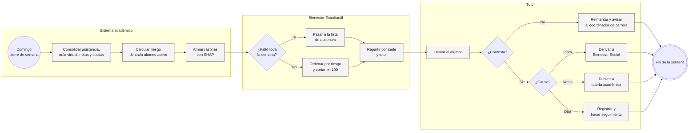
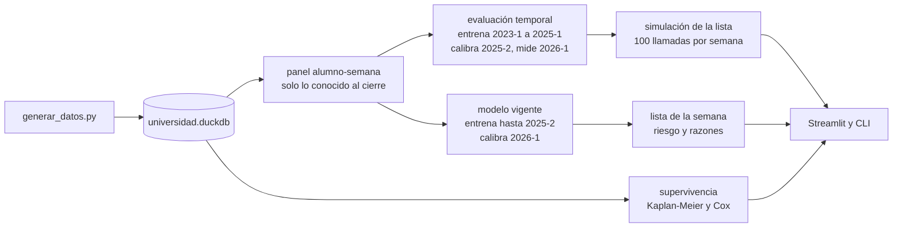
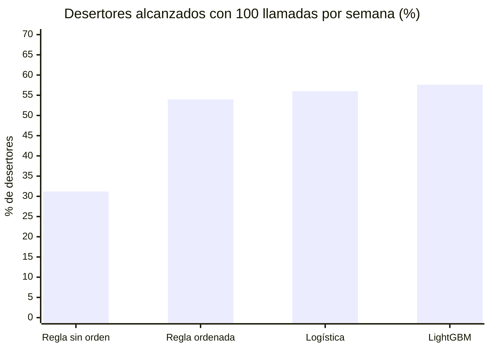

# Alerta temprana de deserción universitaria

La Universidad Qhapaq Ñan (ficticia) tiene tres sedes, ocho carreras y unos 8,000 alumnos por semestre entre presencial y semipresencial. De los que no egresan, el 13.0% no se vuelve a matricular el ciclo siguiente. En primer ciclo es el 24.1%.

Bienestar Estudiantil tiene seis tutores y le alcanza para unas 100 llamadas por semana. Hoy trabajan con una regla de tres alertas: asistencia acumulada menor a 70%, alguna evaluación desaprobada o dos cuotas vencidas. La regla tiene sentido, el problema es el volumen. Desde la semana 4 marca a uno de cada cuatro alumnos (1,949 en la semana 4 de 2026-1, 2,510 en la semana 8) y el reporte llega sin orden, así que a quién se llama termina dependiendo de en qué fila cayó cada uno.

Lo que quería saber es simple: con las mismas 100 llamadas, ¿a cuántos de los que se van se les llega antes de que dejen de ir?

## El proceso con la lista



La parte de Bienestar y del tutor no está en el código; es cómo usaría la lista una oficina real. El código cubre hasta la lista ordenada con razones y la lista de ausentes.

## Por dentro



El panel tiene una fila por alumno activo y semana, de la 2 a la 16, con 37 variables: 18 de la ficha y la matrícula (ciclo, beca, promedio anterior, asistencia del ciclo anterior, si trabaja, tiempo de traslado, sede, carrera) y 19 de la semana (asistencia acumulada y reciente, ingresos al aula virtual, tareas, notas de PC1, parcial y PC2, cuotas vencidas). Cada fila usa solo lo registrado hasta el domingo de esa semana, y [`test_features.py`](tests/test_features.py) lo comprueba borrando todo lo posterior y verificando que nada cambie.

Hay un solo LightGBM para todas las semanas, con la semana como variable, y una regresión logística con las mismas variables como referencia. La probabilidad que ve el tutor está calibrada con isotónica sobre un semestre que el modelo no vio, pero la lista se ordena por el puntaje crudo: la isotónica devuelve escalones y empataría a alumnos que el modelo sí distingue. Las razones salen de SHAP y se escriben con el valor real ("asistencia acumulada de 32%", "no rindió la PC1").

## Los datos

Van del 2023-1 al 2026-2, este último en curso con datos hasta la semana 10: 18,884 alumnos, 66,915 matrículas y 1.01 millones de filas de asistencia semanal, además de aula virtual, evaluaciones, cuotas y retiros. Los genera [`generar_datos.py`](datos/generar_datos.py) con semilla fija en unos 2 segundos.

Por debajo hay un "compromiso" por alumno que se mueve cada semana y baja con un choque económico, un problema personal o un parcial desaprobado. De ahí salen la asistencia, el aula virtual, si rinde las evaluaciones y si abandona. Lo que se exporta es lo que dejaría un sistema académico de verdad: quien deja de ir sigue matriculado con asistencia 0, salvo que haga el retiro de ciclo. La causa de cada deserción queda en `aux_causas`, que el modelo no lee.

Algunas cosas que trae la base, medidas sobre 2023-1 a 2026-1 sin egresados: trabajar sube la deserción de 10.9% a 17.3% y la semipresencial de 11.5% a 18.0%. En la semana 6, quien lleva menos de 70% de asistencia termina desertando en 66.0% de los casos. Con dos o más cuotas vencidas en la semana 8, el 62.5% no rindió el parcial porque la intranet lo bloquea. Y 2026-1 cerró con 15.0% de deserción tras el alza de pensión, cuando los semestres anteriores estaban entre 12.1% y 13.3%.

## Qué salió en 2026-1

El modelo se entrenó con 2023-1 a 2025-1, se calibró con 2025-2 y se midió en 2026-1, donde de 8,100 alumnos que no egresaban 1,218 no volvieron. Simulé el semestre: cada semana, con los datos del domingo, tutoría llama a los 100 primeros de la lista que no haya llamado antes. Un desertor cuenta como alcanzado si la llamada le llegó antes de que dejara de ir.

| Política | Llamadas | Precisión | Desertores alcanzados | Anticipación (mediana) |
|---|---:|---:|---:|---:|
| Regla actual, en el orden del reporte | 1,448 | 26.2% | 31.2% | 5 semanas |
| Regla actual ordenada por alertas y asistencia | 1,479 | 44.5% | 54.0% | 4 semanas |
| Regresión logística | 1,491 | 45.7% | 56.0% | 4 semanas |
| LightGBM | 1,492 | 47.1% | 57.6% | 4 semanas |



Lo que más mueve el resultado es ordenar la lista. Solo con eso la regla pasa de 31.2% a 54.0%, y el LightGBM le suma 3.6 puntos encima. Si mañana hubiera que cambiar una sola cosa en Bienestar, sería entregar el reporte ordenado.

El LightGBM le gana a la logística, pero por poco: AUC-PR de 0.550 contra 0.521 en la semana 2, 0.567 contra 0.561 en la semana 4, y desde la semana 8 están casi empatados. Lo dejé porque maneja los faltantes sin imputar ("todavía no hay PC2" no es lo mismo que "no rindió la PC2") y porque las contribuciones SHAP sobre árboles son exactas por alumno. Una logística bien armada sería una alternativa razonable.

Donde más ayuda es con la deserción por plata. Llega al 72.3% de los que se fueron por un choque económico (la regla ordenada, 64.1%), porque el atraso en cuotas aparece antes que la caída en asistencia. A los traslados no les llega casi nadie, 20.5%: el buen alumno que se cambia de universidad no deja rastro en estos datos.

Sobre la calibración: el LightGBM ya venía bien calibrado. El ECE es 0.0078 sin calibrar y 0.0080 con la isotónica, y en el decil de más riesgo la isotónica se queda algo corta (46.3% predicho contra 49.1% observado) porque 2026-1 tuvo más deserción que 2025-2. La mantengo en el modelo vigente porque se recalibra con el semestre más reciente; con 2026-1, el riesgo medio de los activos en la semana 10 de 2026-2 sube de 7.8% a 8.6%.

En importancia SHAP, siete de las diez primeras variables son de la semana. De la ficha solo aparecen el ciclo, el promedio anterior y la asistencia del ciclo anterior; lo socioeconómico pesa poco porque su efecto ya se ve en cómo asiste y rinde el alumno.

## Cuándo se van

El primer año define casi todo. Al cerrar el semestre siguen en la universidad el 77.5% de los de primer o segundo ciclo, el 87.7% de tercero y cuarto y el 94.7% del quinto en adelante. Dentro del ciclo hay un pico en la semana 9, justo después del parcial, donde deja de ir el 1.68% de los que seguían, contra menos de 1% en cualquier otra semana. Pero el 46% de las deserciones pasa entre ciclos: terminan el semestre y no se matriculan.

El Cox con lo que se sabe en la semana 4 (58,263 alumno-semestres, concordancia 0.813) da un hazard ratio de 4.82 para asistencia menor a 80%, 3.35 para PC1 desaprobada o no rendida, 1.75 para primer año y 1.31 para una cuota vencida. Beca, semipresencial y traslado largo dejan de ser significativos. Por Kaplan-Meier la beca sí separa (92.1% de permanencia contra 86.8%), pero una vez que se sabe cómo le va al alumno en las primeras semanas no agrega nada.

## Por qué lo armé así

Evalúo con la decisión y no solo con la AUC, porque la pregunta de Bienestar es cuántos desertores se alcanzan con 100 llamadas. El corte es temporal: entrena con semestres viejos, calibra con el siguiente y mide en el último cerrado. Las filas de un mismo alumno en distintas semanas están correlacionadas y una partición aleatoria inflaría todo.

La deserción incluye a quien termina el ciclo y no vuelve; si no, el modelo ignoraría casi la mitad del problema. "Activo" es haber asistido o entregado algo esa semana. El que no apareció en toda la semana va a una lista aparte y se llama primero; si lo dejaba en el panel, el modelo aprendía a encontrar a los que ya se fueron, que es fácil y no sirve.

## Correrlo

Python 3.10+.

```bash
cd proyectos/08-alerta-desercion-universitaria
pip install -e ".[app,dev]"

python -m desercion generar        # ~2 s, base de 12 MB
python -m desercion entrenar       # ~80 s con 2 núcleos
python -m desercion supervivencia  # ~5 s
python -m desercion lista --sede "Lima Norte" --n 20
python -m desercion todo

streamlit run app.py
pytest                             # 26 tests, ~11 s
```

`entrenar --rondas 100` sirve para una corrida rápida. Los resultados quedan en `datos/resultados.duckdb`.

```
08-alerta-desercion-universitaria/
├── app.py
├── datos/generar_datos.py
├── src/desercion/
│   ├── datos.py            deserción y semana de abandono
│   ├── features.py         panel alumno-semana
│   ├── modelos.py          LightGBM, logística, regla y calibración
│   ├── evaluacion.py       métricas y simulación de la lista
│   ├── explicacion.py      SHAP y razones en texto
│   ├── supervivencia.py    Kaplan-Meier, riesgo semanal y Cox
│   ├── entrenamiento.py    evaluación temporal y modelo vigente
│   └── cli.py
└── tests/
```

## Lo que no resuelve

Los datos son simulados y la forma en que los armé, con un compromiso que se ve en la asistencia y el aula virtual, favorece a cualquier modelo que mire esas señales. Con datos reales la AUC-PR sería probablemente menor.

Alcanzar no es retener. La simulación cuenta a quién se llama a tiempo, no si la llamada sirve; para eso hace falta sortear una parte de la lista que no se llama y comparar. Y cuando la tutoría funcione, el modelo se va a ensuciar: los que se quedaron gracias a la llamada parecerán falsas alarmas en el siguiente entrenamiento, así que hay que registrar quién fue contactado.

Tampoco hay reincorporaciones (alumnos que dejan un ciclo y vuelven) y no revisé a fondo el supuesto de riesgos proporcionales del Cox; el pico de la semana 9 sugiere que algunos efectos cambian en el tiempo.

Lo siguiente sería el experimento de tutoría con grupo de control, después un modelo de uplift sobre ese experimento, y el reparto de la lista por tutor según su carga.
