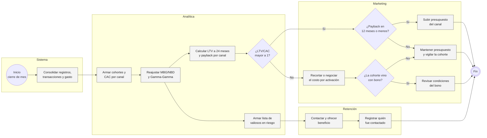
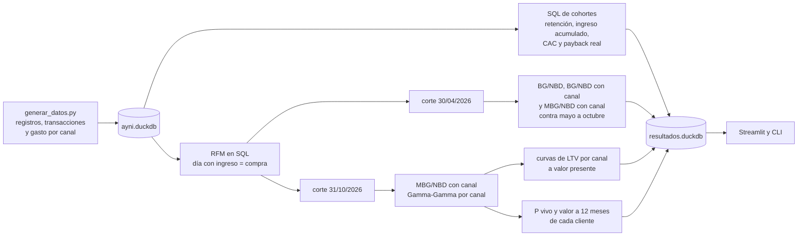
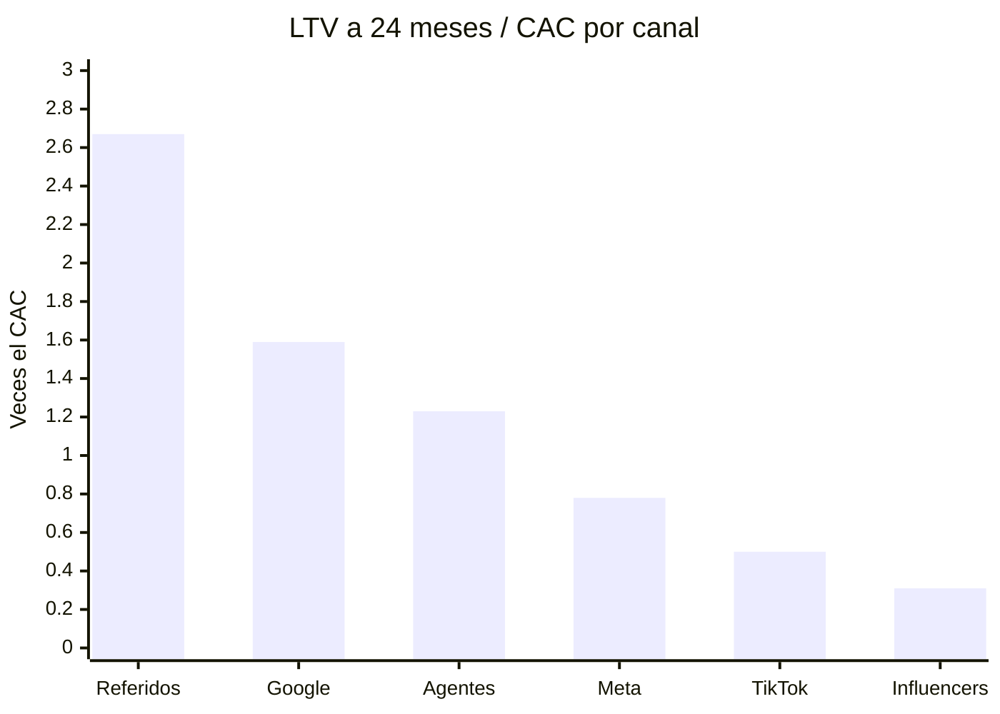

# Cohortes y valor de vida en una billetera digital

Ayni es una billetera ficticia con tarjeta prepago Visa: la gente recarga, compra con la tarjeta, recarga el celular, paga servicios y se transfiere plata. Gana por la comisión de intercambio de cada compra, por las recargas y por cada pago de servicio; las transferencias son gratis. Entre enero de 2025 y setiembre de 2026 gastó S/ 1.67 millones en conseguir clientes por seis canales pagados.

Marketing medía cada canal por su costo por cuenta activada (CAC). Con ese número TikTok era el canal más barato, entre S/ 13.50 y S/ 18.28 por cuenta en los meses sin campaña, y en 2026 se le pasó presupuesto: de 17.7% del gasto en 2025 a 27.4% entre enero y setiembre de 2026. Finanzas preguntaba otra cosa: cuánto deja cada cuenta después de activarse y en qué mes se recupera lo que costó traerla. Ninguno de los dos números existía, porque nadie había armado las cohortes por canal ni tenía una forma de proyectar el ingreso de clientes que llevan pocos meses.

Este proyecto arma las dos cosas. Las cohortes salen de SQL sobre DuckDB, y el valor futuro, de un MBG/NBD (con el canal como covariable) y un Gamma-Gamma ajustados con pymc-marketing. Antes de usar el modelo para decidir presupuesto, lo puse a predecir seis meses que no vio.

## Cómo se usaría cada cierre de mes



El código cubre el carril de Analítica completo y deja la lista de valiosos en riesgo en el tablero; lo que hacen Marketing y Retención con eso es cómo lo usaría el negocio, no está programado.

## De las transacciones al LTV



La cohorte de una cuenta es el mes en que hizo su primera transacción, y el mes de vida se cuenta en meses calendario desde ahí. En [`consultas.py`](src/cohortes/consultas.py) están la matriz cohorte por mes de vida con retención e ingreso neto acumulado por cuenta activada, el CAC de cada cohorte (gasto de medios más bonos entre activaciones) y el primer mes en que cada cohorte cubrió su CAC con lo que de verdad dejó.

Para los modelos, una compra es un día con ingreso neto positivo. Un día en que la persona solo transfirió no cuenta, porque no deja nada. El RFM se calcula en SQL ([`rfm.py`](src/cohortes/rfm.py)) y un test comprueba que da lo mismo que `rfm_summary` de pymc-marketing. El LTV de una cuenta nueva de cada canal se arma mes a mes con las compras esperadas del MBG/NBD por el ingreso por compra del Gamma-Gamma de su canal, descontado al 1% mensual (unos 12.7% al año), más lo que deja el primer día. Como el CAC se paga por cuenta activada, se multiplica por la parte de activados que llega a tener ingreso en su primer mes, entre 95.3% (TikTok) y 98.0% (Google).

## La base

[`generar_datos.py`](datos/generar_datos.py) arma con semilla fija, en unos 5 segundos, 126,146 registros, 71,030 cuentas activadas y 2.69 millones de transacciones entre el 1 de enero de 2025 y el 31 de octubre de 2026. Hay siete canales: orgánico, referidos (S/ 10 de bono a cada uno), Meta, TikTok, búsqueda en Google, influencers y agentes en tienda, que activan cuentas en bodegas y pesan más en provincia.

Cada cliente tiene una frecuencia y una probabilidad de irse propias, que dependen del canal y comparten algo de señal (el que usa más la tarjeta se va menos). Encima hay cosas que un BG/NBD no sabe modelar: el primer mes es más duro que los siguientes, julio y diciembre tienen más uso, la quincena y el fin de mes también, y desde marzo de 2026 existe el pago de servicios, que hace que quien lo adopta se vaya menos. En noviembre de 2025 y abril de 2026 hubo una campaña de S/ 20 de bono en TikTok e influencers que atrajo a gente que solo quería el bono. Los parámetros verdaderos quedan en `aux_clientes`; el análisis no la usa, salvo la validación de P(vivo), que con datos reales no se podría hacer.

El 61.6% del ingreso neto viene de compras con tarjeta, 24.8% de recargas y 13.6% de pago de servicios. La tasa de activación va de 42.1% en TikTok a 82.1% en agentes en tienda.

## Lo que salió

| Canal | CAC (últimos 6 meses) | LTV 24 meses | LTV/CAC | Recupera el CAC | % del gasto |
|---|---:|---:|---:|---|---:|
| Referidos | S/ 21.09 | S/ 56.40 | 2.67 | mes 8 | 9% |
| Google Search | S/ 48.15 | S/ 76.42 | 1.59 | mes 13 | 13% |
| Agentes en tienda | S/ 26.38 | S/ 32.52 | 1.23 | mes 18 | 13% |
| Meta Ads | S/ 33.46 | S/ 26.12 | 0.78 | después del mes 24 | 20% |
| TikTok Ads | S/ 22.05 | S/ 11.11 | 0.50 | después del mes 24 | 31% |
| Influencers | S/ 31.55 | S/ 9.79 | 0.31 | después del mes 24 | 15% |



El 66% del gasto de los últimos seis meses (S/ 620 mil) se fue a canales que no recuperan su CAC en dos años, y el LTV/CAC ponderado de todo lo pagado es 0.96. TikTok es el caso más claro. Su CAC parece bueno, pero solo el 18% de sus cuentas sigue usando la billetera al mes 12 (60% en referidos) y en el primer año cada cuenta deja S/ 7.22, una tercera parte de lo que costó. Las cohortes lo confirman sin modelo: ninguna de las 21 cohortes de TikTok, Meta o influencers ha cubierto su CAC, mientras que 16 de las 21 de referidos ya lo hicieron, con una mediana de 7 meses.

Google Search tiene el CAC más caro, S/ 48.15, y aun así recupera en el mes 13, porque sus clientes compran con tarjeta y dejan S/ 1.18 por día con ingreso contra S/ 0.63 en TikTok. Mirando solo el CAC se le quitó presupuesto en 2026 (de 16.3% a 13.6% del gasto), que es justo al revés de lo que dicen estos números.

Las campañas de bono se ven en el triángulo de cohortes. La de TikTok de noviembre de 2025 trajo 1,458 cuentas contra 621 en octubre, pero con el bono el CAC de ese mes subió a S/ 36.02 y al sexto mes seguía activo el 16.1% (27.1% la cohorte de octubre). A los seis meses había recuperado el 11% de lo que costó; la de octubre, el 30%. Abril de 2026 repite el patrón. Si la campaña se juzga por activaciones, fue un éxito.

En la base al 31 de octubre hay 498 clientes del 20% que más ingreso dejó a los que el modelo ya no da por seguros: llevan una mediana de 31 días sin comprar y suman S/ 24,429 de ingreso histórico. Es una lista corta, de las que se pueden llamar en una semana, y sale del tablero en CSV.

## Cuánto se equivoca el modelo

Ajusté con lo conocido hasta el 30 de abril de 2026 (48,772 clientes con al menos una compra) y predije sus compras de mayo a octubre.

| Predicción | Compras predichas | Reales | Error total | Error medio por cliente |
|---|---:|---:|---:|---:|
| Ritmo histórico, sin abandono | 769,847 | 571,019 | +34.8% | 7.22 |
| BG/NBD sin canal | 573,357 | 571,019 | +0.4% | 4.75 |
| BG/NBD con canal | 562,016 | 571,019 | -1.6% | 4.50 |
| MBG/NBD con canal | 558,304 | 571,019 | -2.2% | 4.43 |

El BG/NBD sin canal parece el mejor en el total, pero es porque sus errores se cancelan: sobreestima TikTok en 42.1% e influencers en 45.4%, y subestima referidos en 9.9%. Para comparar canales eso no sirve. Con el canal como covariable el peor error por canal baja a 8.9%, y con el MBG/NBD a 3.8%.

La diferencia entre BG/NBD y MBG/NBD está en quien compró una sola vez. El BG/NBD supone que nadie se va antes de su segunda compra, así que les da P(vivo) de 100%; en los datos solo seguían activos el 26%. El MBG/NBD les da 21%. Contra lo que de verdad pasó, el error de Brier de P(vivo) baja de 0.162 a 0.058, y eso es lo que decide quién entra en la lista de riesgo.

Por mes, el modelo se queda 8.5% abajo en las semanas de julio, porque no sabe de la gratificación, y el resto del semestre está dentro de 3%. En ingreso el error es mayor, -6.0% en el total, porque el Gamma-Gamma vio solo dos meses de pago de servicios antes del corte y subestima cuánto deja cada compra después. Como referencia, el LTV a 12 meses del modelo ajustado con toda la historia queda entre 1% y 13% por encima de lo que dejaron de verdad las cohortes de 2025 que ya cumplieron un año. Esas cohortes vivieron casi todo su primer año antes del pago de servicios, y el modelo ya incorpora que la gente se va menos desde marzo.

## Por qué lo armé así

Usé el MBG/NBD porque en una billetera mucha gente activa, prueba una vez y no vuelve, y el BG/NBD los da por vivos para siempre. El canal entra como covariable de la frecuencia y del abandono en un solo modelo, en vez de siete modelos separados, para que los canales chicos no queden con estimaciones sueltas. El Gamma-Gamma sí va por canal: el ticket de Google es casi el doble del de TikTok y un solo modelo jala a todos hacia el promedio.

Ajusto por MAP. Con unos 50 mil clientes tarda segundos y alcanza para ordenar canales; probé MCMC y con dos núcleos no terminó en ocho minutos, así que no hay intervalos de credibilidad en esta versión. El CAC es el de las últimas seis cohortes, porque es el que se está pagando hoy, y la comparación es a 24 meses porque la historia no da para más sin extrapolar demasiado.

## Para correrlo

Python 3.11+.

```bash
cd proyectos/09-cohortes-ltv-fintech
pip install -e ".[app,dev]"

python -m cohortes generar      # ~5 s, base de 126 mil registros
python -m cohortes cohortes     # matriz de cohortes, CAC y payback real (SQL)
python -m cohortes validar      # ajuste hasta abril 2026 y holdout de mayo a octubre, ~12 s
python -m cohortes ltv          # LTV por canal, segmentos de la base, ~18 s
python -m cohortes todo         # todo lo anterior, ~40 s
python -m cohortes resumen      # vuelve a mostrar la tabla de LTV sin recalcular

streamlit run app.py
pytest                          # 28 tests, ~30 s
```

`generar --escala 0.1` arma una base chica. Los resultados quedan en `datos/resultados.duckdb`, que es lo que lee el tablero.

```
09-cohortes-ltv-fintech/
├── app.py                    tablero: retorno por canal, cohortes, validación y base actual
├── datos/generar_datos.py    registros, transacciones, gasto de marketing y parámetros verdaderos
├── src/cohortes/
│   ├── consultas.py          cohortes, CAC, payback real y LTV observado en SQL
│   ├── rfm.py                RFM por día con ingreso y compras en una ventana
│   ├── modelos.py            BG/NBD y MBG/NBD con canal, Gamma-Gamma por canal
│   ├── validacion.py         holdout de seis meses y calibración de P(vivo)
│   ├── ltv.py                curvas de LTV, CAC reciente, payback y segmentos
│   ├── resultados.py         resultados.duckdb
│   └── cli.py
└── tests/                    generador, SQL, RFM contra pymc-marketing, modelos con datos simulados, cli
```

## Lo que no cubre

Los datos son simulados y los armé con patrones que el modelo puede captar. Con datos reales el error del holdout sería mayor y la diferencia entre canales, menos limpia. Tampoco hay atribución: cada cuenta tiene un solo canal, cuando en la práctica alguien ve un anuncio de TikTok, busca en Google y entra por un referido.

El ingreso es solo el de transacciones. Una billetera real también gana con el saldo que la gente deja y tiene costos que aquí no están, como fraude, contracargos, emisión de la tarjeta y atención. El LTV debería ser margen de contribución y no ingreso neto. El modelo no tiene estacionalidad y supone que el comportamiento no cambia en el tiempo, algo que el lanzamiento del pago de servicios ya rompió.

Lo siguiente sería poner intervalos con MCMC sobre una muestra o con bootstrap, agregar la región y el tipo de primera transacción como covariables, y probar la lista de valiosos en riesgo con un grupo de control antes de darle un beneficio a todos.
