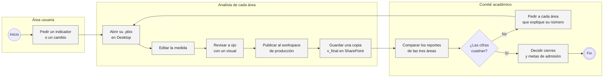
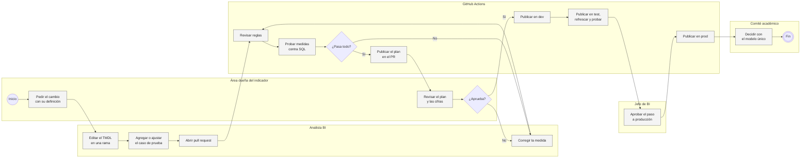
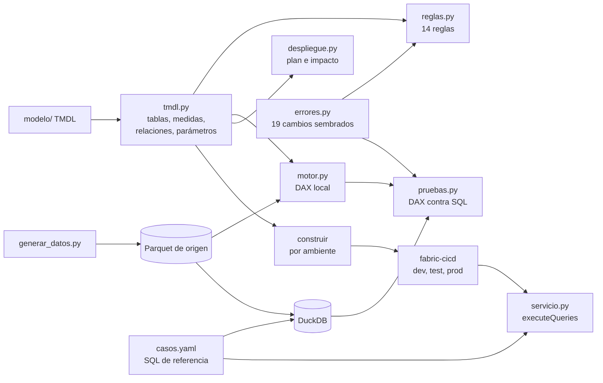
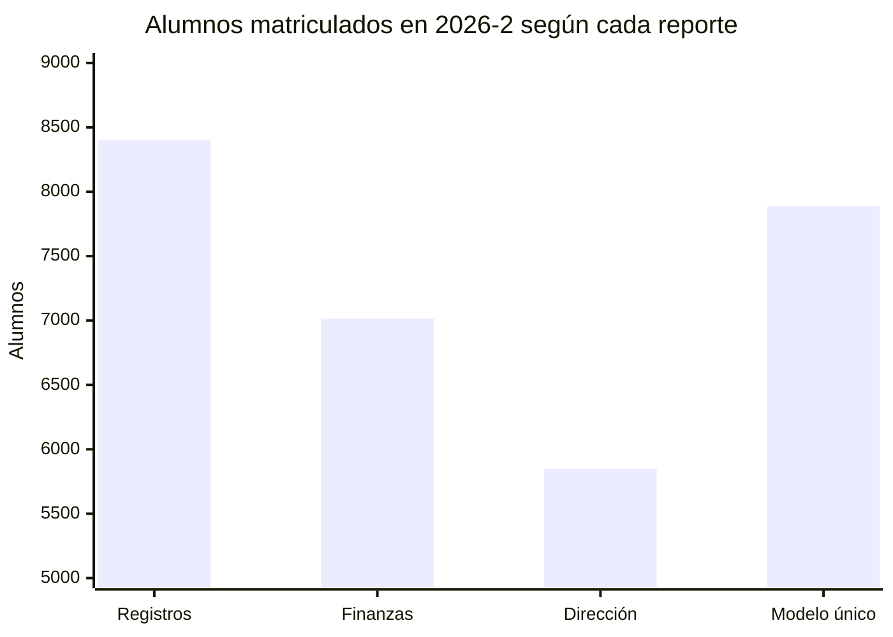

# Modelo de Power BI como código

La Universidad Mirasol es una universidad privada ficticia con sedes en Lima Norte, Lima Centro y Arequipa, ocho carreras y unos 8 mil alumnos matriculados por semestre. Registros Académicos, Finanzas y Dirección Académica reportan la matrícula al comité académico cada semestre, y cada área lo hacía desde su propio archivo de Power BI. Este proyecto reemplaza esos tres archivos por un solo modelo semántico guardado como texto (TMDL) en git, con pruebas de cada medida y un camino de publicación por ambientes.

## Problemática

Los tres reportes leen las mismas tablas del sistema académico, pero cada analista escribió su medida de "Matriculados". Para 2026-2, Registros Académicos reporta 8,400, Finanzas 7,014 y Dirección Académica 5,850. Ninguno se equivoca al sumar: Registros cuenta a todo el que tuvo una inscripción, incluidos los 512 que se retiraron de todos sus cursos; Finanzas cuenta solo a quien pagó la primera cuota; Dirección cuenta solo a los alumnos regulares, con 12 créditos o más. Las tres medidas se llaman igual y ninguna dice qué cuenta, así que en el comité se discute el número en vez de la decisión.

Con las secciones pasa lo mismo. El reglamento pide evaluar el cierre de las secciones con menos de 40% de ocupación, pero la medida de Dirección usa 30% y marca 242 secciones en 2026-2; con el umbral del reglamento son 372. La ocupación que muestra Registros (74.3%) también es más alta que la real (66.2%), porque cuenta las inscripciones que se retiraron.

El origen está en cómo se trabaja el archivo. Cada cambio se hace en Power BI Desktop sobre un .pbix que no se puede comparar línea por línea, se revisa mirando un visual y se publica directo al workspace de producción. No hay pruebas, no queda registro de qué cambió ni quién lo aprobó, y cuando una medida se rompe lo descubre alguien del comité.

## Solución

Armé el modelo de matrícula en formato PBIP con su definición en TMDL: ocho tablas, diez relaciones y 18 medidas con descripción, formato y carpeta. Cada medida tiene al menos un caso de prueba que la compara contra una consulta SQL escrita aparte con la definición del área dueña del indicador. Las pruebas corren en Python sin Power BI, con un motor local que evalúa el subconjunto de DAX que usa el modelo, así que caben en el CI de GitHub y terminan en segundos.

La decisión que habilita es de proceso: ningún cambio a una medida llega a producción sin pasar por un pull request con reglas, pruebas y un plan que muestra cuánto se mueven los números. El alcance incluye el generador de datos, el modelo TMDL, el lector de TMDL y el motor DAX local, 14 reglas de buenas prácticas, 24 casos de prueba, las medidas de los tres reportes anteriores para comparar, 19 errores sembrados para medir si los controles funcionan, la construcción por ambiente, la publicación con fabric-cicd, el workflow de GitHub Actions, una CLI y un tablero en Streamlit. Quedan fuera los reportes en sí (se conectan en vivo al modelo), la seguridad por sede (RLS) y la publicación contra un tenant real, que no ejecuté.

## AS IS: tres archivos y publicación directa



El proceso tiene el control en el lugar equivocado: la única revisión es la del comité, cuando el número ya está publicado, y el reproceso vuelve a cada analista por separado. No hay una definición escrita de cada indicador ni prueba que la verifique, el umbral de cierre vive dentro de una medida que nadie más lee, y el paso a producción no tiene aprobación ni historial. Si una medida deja de funcionar al cambiar de semestre, como la variación de Finanzas que tiene "2025-2" escrito a mano, se descubre en la reunión.

## TO BE: un modelo, un pull request y tres ambientes



El carril de GitHub Actions está en el código: reglas, pruebas, plan, construcción por ambiente, publicación, refresco y pruebas contra el modelo publicado. Quién es dueño de cada indicador, quién aprueba el paso a prod y cómo se registra el pedido es la forma en que la universidad lo usaría y no está programado.

## Cómo cambian los indicadores

| Indicador | AS IS | TO BE |
|---|---|---|
| Definiciones de alumnos matriculados en uso | 3, de 5,850 a 8,400 en 2026-2 | 1, con 7,888 en 2026-2 |
| Medidas con prueba automática | ninguna | 18 de 18, con 24 casos contra SQL |
| Errores típicos detenidos antes de publicar | no había revisión | 18 de 19 errores sembrados |
| Hallazgos de las reglas con severidad de error | 16 en las 9 medidas de los tres reportes | 0 en 18 medidas |
| Paso a producción | publicar desde Desktop, sin revisión ni historial | pull request revisado, dev y test automáticos, prod con aprobación |

## Cómo funciona



El modelo está en [`modelo/Matricula.SemanticModel`](modelo/Matricula.SemanticModel), con un archivo por tabla. [`tmdl.py`](src/semantico/tmdl.py) lee esa carpeta: tablas, columnas con su `sourceColumn`, medidas con su descripción (`///`), formato y carpeta, particiones en M, relaciones y el parámetro `RutaDatos`. [`dax.py`](src/semantico/dax.py) convierte cada medida en un árbol que usan el motor y las reglas.

[`motor.py`](src/semantico/motor.py) evalúa una medida como lo haría un visual: arma el contexto de filtro, lo propaga de las dimensiones a los hechos por las relaciones (también en cadena, como Carrera a Curso a Sección a Inscripción), aplica CALCULATE con filtros booleanos, KEEPFILTERS y REMOVEFILTERS, hace la transición de contexto al iterar con FILTER o SUMX y respeta las reglas de BLANK. Esas reglas importan: en DAX `BLANK < 0.4` es verdadero, así que una sección sin inscritos vigentes entra en "Secciones bajo 40%", y el SQL de referencia tiene que contarla igual. Si una medida usa una función que el motor no conoce, la prueba falla con el nombre de la función en vez de dar un número.

Cada caso de [`casos.yaml`](pruebas_dax/casos.yaml) dice qué medida, con qué filtros y agrupada por qué columna, y trae la consulta SQL que debería dar lo mismo. [`reglas.py`](src/semantico/reglas.py) revisa el TMDL: medidas sin descripción, formato o prueba, divisiones con `/`, referencias a columnas que no existen, relaciones bidireccionales, relaciones hacia columnas sin `isKey`, particiones con ruta fija y periodos escritos a mano dentro de una medida.

Para publicar, [`despliegue.py`](src/semantico/despliegue.py) copia el modelo, reemplaza `RutaDatos` con el valor del ambiente que está en [`ambientes.yaml`](ambientes.yaml), verifica que no quede ningún valor de otro ambiente y lo sube al workspace con fabric-cicd. El mismo módulo arma el plan del pull request: lee el modelo de la rama base con `git show`, lista lo que cambió y evalúa antes y después todas las medidas tocadas y las que dependen de ellas. El [workflow](../../.github/workflows/11-modelo-powerbi.yml) corre reglas, pruebas y plan en cada PR; en main publica en dev, luego en test (refresca y corre los mismos casos contra el modelo publicado por la API executeQueries) y al final en prod, que requiere aprobación en el environment de GitHub.

## Los datos

[`generar_datos.py`](datos/generar_datos.py) arma con semilla fija, en menos de dos segundos, las tablas que el modelo importa como Parquet: 16,835 alumnos, 51,297 matrículas (una por alumno y periodo), 12,133 secciones y 226,420 inscripciones entre 2024-1 y 2026-2, más periodos, sedes, ocho carreras y 400 cursos. Son las mismas sedes y carreras del [pipeline de matrícula](../02-pipeline-matricula-dbt), que en la universidad sería la fuente de estas tablas.

Los datos traen lo que hace interesante la comparación. El primer semestre del año ingresa casi el doble que el segundo, y en 2026-2 ingresan 8.6% menos alumnos que en 2025-2 aunque la matrícula total sube 1.5%. Quien no paga la primera cuota se retira de todos sus cursos más seguido, y en 2026-2 baja el pago (86.2% frente a 89.9% un año antes). Las secciones se programan con lo inscrito un año antes en el mismo semestre, así que cuando la demanda de un curso cae quedan secciones con poca ocupación. En [`legado/`](legado) están las medidas de los tres reportes anteriores tal como estaban escritas.

## Lo que salió

| Reporte | Medida | Alumnos matriculados 2026-2 | Diferencia con el modelo |
|---|---|---:|---:|
| Registros Académicos | Matriculados | 8,400 | +512 |
| Finanzas | Matriculados | 7,014 | -874 |
| Dirección Académica | Total alumnos | 5,850 | -2,038 |
| Modelo único | Alumnos matriculados | 7,888 | |



La distancia entre el reporte más alto y el más bajo es de 2,550 alumnos, un tercio del número oficial. El modelo deja una sola medida con ese nombre, la que acordé con Registros (alumnos con al menos un curso vigente), y las otras dos ideas siguen disponibles con su propio nombre: "Alumnos regulares" y "% pagó primera cuota". Las tres reglas que más saltan en los reportes anteriores son medidas sin descripción (las 9), sin carpeta (las 9) y sin formato (4 de 9); hay además dos divisiones con `/` y el periodo fijo de Finanzas.

De los 19 errores sembrados, 18 bloquean el merge. Las pruebas atrapan 13 sin ayuda de las reglas, las reglas atrapan 4 sin ayuda de las pruebas y uno lo ven las dos. Los cuatro que solo ven las reglas no cambian ningún número hoy: la ocupación con `/`, la relación bidireccional, la ruta de producción escrita en una partición y una medida nueva sin descripción ni prueba. Son los que se rompen después, cuando una sección queda con 0 vacantes, cuando entra otra tabla de hechos o cuando el ambiente de desarrollo empieza a leer datos de producción. El único que pasa es cambiar el formato de "% pagó primera cuota" a número: la regla lo reporta como aviso y decidí que un formato no bloquee el merge.

Un caso me hizo cambiar cómo escribo las pruebas. Cambiar DISTINCTCOUNT por COUNTROWS en "Alumnos matriculados" da el mismo resultado en cualquier visual filtrado por periodo, porque hay una fila por alumno y periodo; solo lo delata el caso sin filtro, donde un alumno que estudió seis semestres cuenta una vez. Por eso la medida base de matrícula tiene un caso sin ningún filtro, que parece redundante y es el único que ve ese error.

El plan del pull request muestra por qué no basta con revisar el diff del DAX. Si alguien cambia "Ingresantes" para incluir a los reincorporados, el diff es una línea y el plan muestra que los ingresantes de 2026-2 pasan de 1,067 a 1,369 y que la variación contra el año anterior pasa de -8.6% a +1.1%. La caída de ingresantes, que es lo que el comité tiene que discutir este semestre, desaparece con un cambio de una línea.

## Por qué lo armé así

Guardo el modelo en TMDL y no en .pbix porque es texto: un cambio en una medida se ve como una línea en el diff y se puede revisar, comentar y revertir como cualquier código. El motor local existe porque las pruebas tienen que correr en cada PR, en Linux y en segundos, sin una instancia de Analysis Services. A cambio cubre solo el DAX que usa este modelo, y por eso el workflow vuelve a correr los mismos casos contra el modelo publicado en test, donde quien responde es el motor de Power BI.

La referencia de cada prueba es SQL escrito aparte, sin mirar el DAX. Si probara el DAX contra otro DAX solo sabría que las dos versiones coinciden; con SQL tengo dos definiciones independientes del mismo indicador, y si discrepan una de las dos está mal. Los errores sembrados son la prueba de las pruebas: un porcentaje de cobertura no dice si los controles atrapan los errores que de verdad se cometen, y esta lista sí.

Las reglas son propias y en Python para que corran en el mismo job que las pruebas. Las del Best Practice Analyzer de Tabular Editor se pueden sumar después. El reemplazo de parámetros lo hago antes de fabric-cicd y no con su archivo de parámetros, porque así el TMDL del repositorio siempre apunta a dev y puedo verificar que el modelo de prod no tenga ninguna ruta de otro ambiente.

## Para correrlo

Python 3.11+.

```bash
cd proyectos/11-modelo-powerbi-como-codigo
pip install -e ".[app,dev]"

python -m semantico generar           # Parquet de origen, ~2 s
python -m semantico revisar           # reglas sobre el TMDL
python -m semantico probar            # 24 casos, ~1.5 s
python -m semantico errores           # 19 errores sembrados, ~25 s
python -m semantico legado            # los tres reportes anteriores contra el modelo
python -m semantico plan --base main  # qué cambia frente a otra rama y cuánto se mueven los números
python -m semantico construir --ambiente prod
python -m semantico todo              # generar si falta, revisar, probar, errores y legado, ~30 s

streamlit run app.py
pytest                                # 53 tests, ~11 s
```

Para publicar hace falta `pip install -e ".[publicar]"`, un service principal con acceso a los workspaces y las variables de [`.env.example`](.env.example). Luego `python -m semantico publicar --ambiente dev`, `refrescar` y `probar --servicio <id del modelo>`.

```
11-modelo-powerbi-como-codigo/
├── modelo/Matricula.SemanticModel/   PBIP: definition/ con el TMDL, .platform y definition.pbism
├── pruebas_dax/casos.yaml            24 casos: medida, filtros, agrupación y SQL de referencia
├── legado/                           medidas de los tres reportes anteriores
├── ambientes.yaml                    parámetros y workspace de dev, test y prod
├── datos/generar_datos.py            tablas de origen con semilla fija
├── src/semantico/
│   ├── tmdl.py                       lector de TMDL
│   ├── dax.py                        parser de DAX
│   ├── motor.py                      evaluación local de medidas
│   ├── pruebas.py                    DAX contra SQL
│   ├── reglas.py                     14 reglas de buenas prácticas
│   ├── errores.py                    errores sembrados
│   ├── legado.py                     comparación con los reportes anteriores
│   ├── despliegue.py                 construir, plan y publicar con fabric-cicd
│   ├── servicio.py                   executeQueries y refresco en el servicio
│   └── cli.py
├── app.py                            tablero: antes y ahora, pruebas, errores, medidas y cambios
└── tests/                            53 tests
```

## Límites

El motor local no es VertiPaq. Cubre filtros por relaciones de muchos a uno, CALCULATE, FILTER, SUMX, DIVIDE, SELECTEDVALUE y las reglas de BLANK, pero no tiene funciones de inteligencia de tiempo, USERELATIONSHIP, relaciones de muchos a muchos, columnas calculadas ni seguridad por filas. Por eso la comparación año contra año usa la columna `orden` del periodo y no SAMEPERIODLASTYEAR, que además no sirve para semestres académicos.

Los jobs de publicación, refresco y pruebas contra el servicio están escritos y probados con el HTTP interceptado, pero no los corrí contra un workspace real; en el repositorio quedan apagados hasta que exista la variable `FABRIC_HABILITADO`. Tampoco abrí el TMDL en Power BI Desktop desde aquí: lo validan mi lector y las reglas, y antes de usarlo con datos reales lo abriría en Desktop o Tabular Editor. La primera publicación en cada workspace necesita configurar a mano las credenciales del origen de datos.

Las pruebas del CI corren sobre datos sintéticos generados con semilla. Con datos reales convendría fijar una muestra anonimizada como base de pruebas, para que un cambio en los datos no se confunda con un cambio en una medida. Lo siguiente sería agregar seguridad por sede, los reportes en formato PBIR y una prueba de rendimiento de las medidas con el volumen real.
