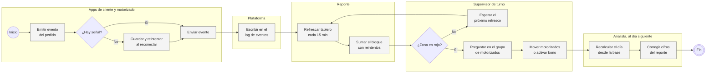
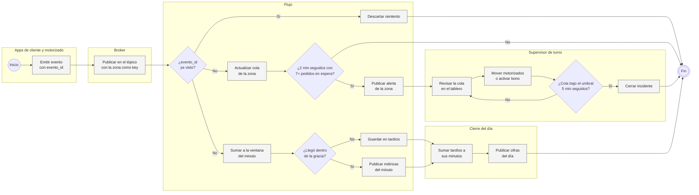
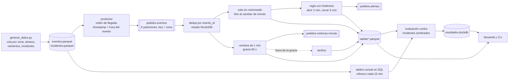
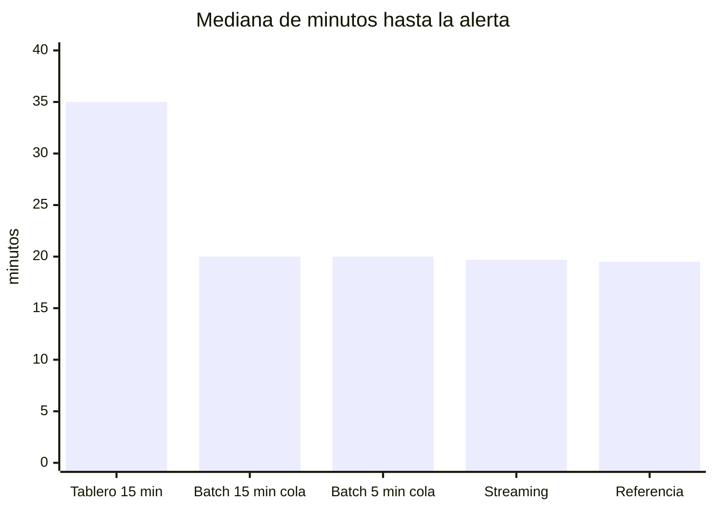

# Pedidos en tiempo real con Kafka

Wayki es una app de delivery ficticia que opera en 12 zonas de Lima, de 10:00 a medianoche. En la semana simulada, del 5 al 11 de octubre de 2026, entraron 66,061 pedidos. Una torre de control con supervisores de turno decide cuándo mover motorizados de una zona a otra, activar un bono por hora punta o alargar el tiempo prometido en la app, y para eso mira un tablero por zona.

## Problemática

Cuando una zona se satura, con pocos motorizados conectados, un cierre de vía o una promoción que dispara la demanda, los pedidos se quedan esperando quién los recoja y los clientes empiezan a cancelar. El tablero de la torre se refresca cada 15 minutos desde el log de eventos y pinta una zona en rojo cuando más de 35% de las asignaciones del bloque esperó más de 6 minutos. En la semana hubo 11 incidentes de saturación: el tablero tardó una mediana de 35 minutos en marcarlos desde que empezaron, cuatro nunca se pusieron en rojo y, mientras tanto, entraron 1,045 pedidos a esas zonas, 265 de los cuales terminaron cancelados.

El retraso lo causa el propio proceso. La métrica mira asignaciones que ya pasaron, así que un pedido demorado solo cuenta cuando por fin le asignan motorizado, seis minutos o más después. El refresco suma hasta 15 minutos encima. Y cuando la app de motorizados se cae no hay asignaciones, el bloque no llega al mínimo de 10 y la zona sigue en verde. Las cifras tampoco cuadran: el tablero suma los reintentos de la app y lo que llega tarde no vuelve a su bloque, así que el lunes se discute un número que el cierre del día corrige.

## Solución

Armé un flujo en streaming sobre Redpanda (API de Kafka) con Quix Streams que lleva por zona la cola de pedidos sin motorizado y abre una alerta cuando 7 o más pedidos llevan más de 3 minutos esperando durante dos minutos seguidos. La alerta se cierra sola tras cinco minutos por debajo del umbral, así el supervisor recibe un aviso por incidente y no uno por minuto. En paralelo, el flujo publica las métricas por minuto de cada zona en ventanas con 60 segundos de gracia, descarta los reintentos por `evento_id` y guarda aparte lo que llega fuera de la gracia para que el cierre del día lo concilie.

El alcance incluye el generador de la semana de eventos con incidentes sembrados, el productor que repite los eventos en el orden en que llegaron, el procesador, un sumidero a Parquet, la simulación del tablero actual en SQL, la evaluación que compara ambos procesos contra los incidentes, una CLI, un tablero en Streamlit con vista en vivo y el `docker-compose.yml` del broker. Queda fuera lo que hace el supervisor con la alerta: el generador no simula que mover motorizados acorte el incidente, así que lo que mido es cuánto antes se entera, no cuánto se recupera.

## AS IS: la torre mira un tablero de 15 minutos



El cuello de botella es el refresco: nada de lo que pase en la zona llega al supervisor antes del próximo bloque, y la decisión se toma con una métrica que llega tarde por diseño. El umbral de 10 asignaciones que evita falsas alarmas en zonas chicas es el mismo que esconde el caso más grave, cuando nadie está asignando. No hay control de duplicados ni de eventos atrasados, así que el reproceso del día siguiente es parte del proceso y no una excepción.

## TO BE: alerta por zona en cuanto se forma la cola



El código cubre los carriles del broker y del flujo, y la conciliación del cierre está en la evaluación; lo que hace el supervisor con la alerta es cómo lo usaría el negocio y no está programado.

## Cómo cambian los indicadores

| Indicador | AS IS | TO BE |
|---|---|---|
| Mediana desde que empieza el incidente hasta la alerta | 35 min | 19.7 min |
| Incidentes detectados (de 11) | 7 | 8 |
| Alertas sin incidente en la semana | 6 | 2 |
| Pedidos que entraron a la zona antes de la alerta | 1,045 (265 cancelados) | 503 (74 cancelados) |
| Asignaciones mal contadas en el día | 2,862 (1,406 repetidas, 1,456 fuera de su bloque) | 0 tras sumar los 3,308 tardíos |

Todas las cifras salen de repetir la semana completa contra el broker con `python -m pedidos_rt todo`.

## Del evento a la alerta



El productor publica los eventos en el orden en que llegaron al servidor y les pone como timestamp de Kafka la hora en que ocurrieron. Así, un `asignado` que la app guardó diez minutos sin señal entra al tópico detrás de eventos más nuevos, igual que en producción, y las ventanas trabajan con la hora del evento. La `key` del mensaje es la zona: todos los eventos de una zona caen en la misma partición, en orden, y el estado (ids vistos, cola, rachas de la regla) vive por zona.

En [`procesador.py`](src/pedidos_rt/procesador.py) el flujo se abre en dos ramas después del dedup. La alerta no pasa por la ventana. La cola es estado: un `creado` entra, un `asignado` o `cancelado` sale, y en cada cambio de minuto se cuenta cuántos pedidos llevan más de 3 minutos esperando. Esa foto se evalúa al momento, así que la gracia de la ventana no la retrasa. La otra rama suma creados, asignados, demoradas y cancelados por minuto en una ventana `tumbling` con 60 s de gracia y la emite cuando cierra; los eventos que llegan después pasan por el callback `on_late` a una carpeta de tardíos en vez de perderse.

La lógica (agregado, cola, regla) está en [`agregados.py`](src/pedidos_rt/agregados.py) como funciones puras sobre diccionarios, y la usan igual el procesador, la simulación del tablero actual y los tests. El tablero actual está en [`as_is.py`](src/pedidos_rt/as_is.py), en SQL sobre DuckDB: cada refresco toma lo que había llegado al log hasta ese momento, sin quitar reintentos.

## Los datos

[`generar_datos.py`](datos/generar_datos.py) arma con semilla fija, en menos de 2 segundos, 201,285 mensajes de 66,061 pedidos. Cada zona es una cola: los motorizados se liberan con 35% a 45% de holgura sobre la demanda esperada, un motorizado libre espera unos minutos y se va a otra zona, y un pedido que espera más que la paciencia del cliente se cancela. La espera mediana de asignación es 1.6 minutos y se cancela el 2.7% de los pedidos. El sábado es el día más cargado, con 12,098 pedidos, y el lunes el más tranquilo, con 7,957.

Los eventos llegan con los problemas de una app real. El 2.5% se repite con el mismo `evento_id` porque la app reintentó. De lo que manda la app del motorizado, el 6.8% llega con más de un minuto de atraso y el 1.2% con más de cinco; en Los Olivos, SJL y Ate, donde la señal es peor, pasa del 11% el atraso de más de un minuto, contra menos de 4% en San Borja o Miraflores.

Encima hay 11 incidentes sembrados de 25 a 55 minutos: motorizados que se desconectan, cierres de vía, una caída de la app de motorizados, un concierto en el estadio y promociones 2x1. Quedan en `incidentes.parquet` como verdad para medir la detección; el flujo no los lee.

## Lo que salió

| Forma de vigilar | Detectados | Mediana (min) | Alertas sin incidente | Pedidos antes de la alerta |
|---|---:|---:|---:|---:|
| Tablero cada 15 min, % demoradas (AS IS) | 7/11 | 35.0 | 6 | 1,045 |
| Batch cada 15 min, cola sin motorizado | 7/11 | 20.0 | 3 | 586 |
| Batch cada 5 min, cola sin motorizado | 8/11 | 20.0 | 5 | 509 |
| Streaming, cola al minuto (TO BE) | 8/11 | 19.7 | 2 | 503 |
| Referencia: cola con datos completos al minuto | 8/11 | 19.5 | 4 | 590 |



El cambio que más pesa es la métrica. Pasar de % de asignaciones demoradas a la cola de pedidos sin motorizado, aun con el mismo refresco de 15 minutos, baja la mediana de 35 a 20 minutos y los pedidos que entran a una zona saturada sin que nadie lo sepa de 1,045 a 586. La cadencia por minuto agrega el resto: baja a 503 pedidos y detecta Miraflores, que el batch de 15 minutos no ve. El streaming queda en 19.7 minutos contra 19.5 de la referencia, que aplica la misma regla con la hora real de cada evento, así que el flujo no pierde nada por los atrasos en lo que importa para la alerta. Los 19 minutos que quedan los pone el propio incidente: en los primeros minutos los motorizados libres que había en la zona absorben la demanda y la cola todavía no existe.

El caso que mejor muestra la falla del tablero es la caída de la app de motorizados en Ate, el jueves a las 21:00. En los bloques de 21:30 y 21:45 el 67% y el 88% de las asignaciones esperó más de 6 minutos y hubo 10 y 12 cancelaciones, pero solo hubo 6 y 8 asignaciones, debajo del mínimo de 10, y la zona nunca se puso en rojo. La cola llegó a 10 pedidos y el flujo abrió la alerta a los 24 minutos.

Tres incidentes no los detecta nadie: SJL, San Borja y San Isidro. En los tres la cola no pasó de 5, 1 y 3 pedidos porque los motorizados libres alcanzaron, y en operación normal la cola pasa de 6 pedidos solo en el 0.05% de los minutos, así que bajar el umbral para verlos trae falsas alarmas. Al revés, en Los Olivos el flujo alertó a los 5 minutos y la referencia a los 17: es la zona con peor señal, y una asignación que llega tarde hace que el pedido parezca en espera. Ahí la alerta temprana fue en parte suerte, y el mismo efecto puede producir una falsa alarma en otra semana.

La gracia de la ventana solo afecta a las métricas por minuto. Con 0 s el minuto se publica a los 17.6 s de cerrar (mediana) y deja fuera el 7.0% de las asignaciones; con 60 s, a los 77.5 s y 5.1%; con 300 s, a los 317.9 s y 1.2%. Elegí 60 s. Lo que queda fuera va a tardíos y, sumado en el cierre, creados y asignados cuadran exacto con el total en las cinco gracias probadas. El tablero de 15 minutos, en cambio, mostró 67,137 pedidos creados contra 66,061 reales.

## Por qué lo armé así

Redpanda porque habla el protocolo de Kafka, levanta en un solo contenedor y el código no cambia si mañana el broker es Kafka o un servicio administrado. Quix Streams porque es Python puro, guarda el estado en RocksDB por partición y trae ventanas con gracia y callback para los tardíos, que es justo lo que necesitaba sin montar Flink.

La decisión de diseño más importante fue sacar la alerta de la ventana. Mi primera versión evaluaba la cola al cierre de cada minuto ya emitido, y con 300 s de gracia detectaba solo 3 de los 11 incidentes, porque contaba la cola de hace cinco minutos con la información de ahora. La cola es estado y se puede leer en el momento; la ventana con gracia queda para lo que de verdad necesita el minuto completo.

El umbral de 7 pedidos y 3 minutos salió de calibrar con la cola calculada en SQL al minuto, con la hora de llegada: con 6 pedidos había 18 alertas sin incidente en la semana, con 7 bajaban a 5 y con 8 a 3, pero la mediana de detección subía a 21 minutos. Pedir dos minutos seguidos para abrir y cinco para cerrar evita que una zona se prenda y apague con cada pedido.

Para comparar procesos no basta con poner el AS IS y el TO BE lado a lado, porque cambian dos cosas a la vez. Por eso la evaluación incluye las variantes intermedias (misma métrica nueva con batch de 15 y de 5 minutos) y una referencia con datos completos, que dice cuánto se podría ganar todavía con la misma regla.

## Para correrlo

Python 3.11+ y Docker.

```bash
cd proyectos/12-pedidos-tiempo-real-kafka
docker compose up -d                 # Redpanda en localhost:19092, consola en :8080
pip install -e ".[app,dev]"

python -m pedidos_rt todo            # genera, publica y evalúa, unos 3 min
python -m pedidos_rt resumen         # vuelve a mostrar la comparación

streamlit run app.py
python -m pedidos_rt en-vivo         # en otra terminal: repite la semana a 60x para la pestaña En vivo
pytest                               # 22 tests, ~11 s; los 4 de Kafka se saltan si no hay broker
```

`todo` corre el procesador cinco veces, una por gracia (0, 30, 60, 120 y 300 s), unos 30 segundos cada una. `evaluar --sin-procesar` reusa lo ya procesado. `procesar` corre el flujo sin límite, como lo haría en producción, y `KAFKA_BROKER` apunta a otro broker.

```
12-pedidos-tiempo-real-kafka/
├── app.py                     tablero: antes y después, incidente por incidente, gracia, en vivo
├── docker-compose.yml         Redpanda y su consola
├── datos/generar_datos.py     colas por zona, atrasos, reintentos e incidentes
├── src/pedidos_rt/
│   ├── config.py              broker, tópicos, ventana y regla
│   ├── agregados.py           agregado por minuto, dedup, cola y regla con histéresis
│   ├── productor.py           tópicos y repetición en orden de llegada
│   ├── procesador.py          aplicación de Quix Streams
│   ├── sumideros.py           Parquet por lote y registro de tardíos
│   ├── as_is.py               tablero de 15 minutos y referencia en SQL
│   ├── evaluacion.py          detección, falsas alarmas y conciliación
│   └── cli.py
└── tests/                     generador, lógica pura, SQL del tablero, evaluación, flujo contra el broker
```

## Lo que no cubre

Los datos son simulados y los incidentes están sembrados, así que la detección se mide contra una verdad que en la vida real no existe: un supervisor tendría que etiquetar los incidentes de unas semanas para calibrar el umbral con datos propios. Es una sola semana con una sola semilla, y con 11 incidentes una diferencia de uno o dos detectados no es concluyente.

El flujo corre con garantía al menos una vez, que es la de Quix por defecto; si el procesador se cae, al reiniciar puede repetir mensajes en las salidas, aunque no en la cola, porque el estado se confirma junto con los offsets. El dedup guarda los ids para siempre; en producción necesita un vencimiento, por ejemplo una hora, que es más que el peor atraso de la simulación. No hay schema registry ni varias instancias del procesador.

Lo siguiente sería medir el efecto de la alerta, simulando que el supervisor mueve motorizados de la zona vecina cuando la recibe, y probar una regla relativa al tamaño de la zona en vez de un umbral fijo para todas.
