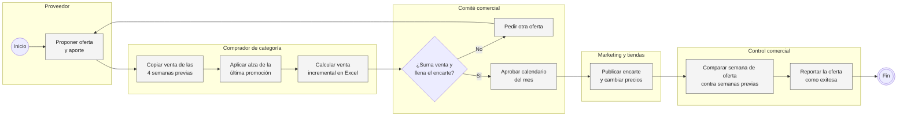
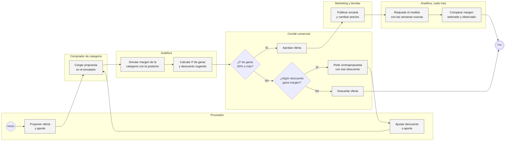
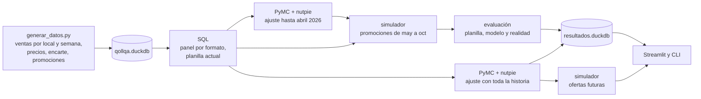
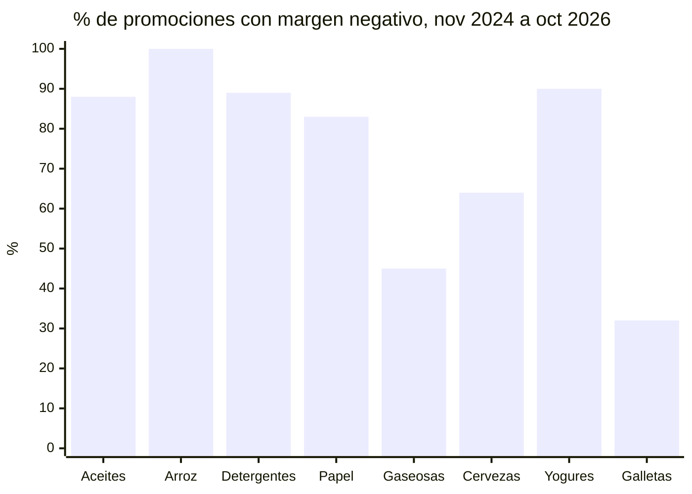

# Elasticidad de precios y promociones en un supermercado

Supermercados Qollqa es una cadena ficticia con 15 locales en Lima y Callao: tres hipermercados, siete supermercados y cinco tiendas express. Cada semana sale un encarte con ofertas y cada categoría tiene una promoción a la vez, que el comprador de la categoría negocia con el proveedor. Entre noviembre de 2024 y octubre de 2026 hubo 153 promociones en las ocho categorías que tomé para este proyecto: aceites, arroz, detergentes, papel higiénico, gaseosas, cervezas, yogures y galletas.

## Problemática

Las promociones suman venta, pero en estos dos años le quitaron margen a la cadena. En conjunto dejaron S/ 1.88 millones de venta incremental y S/ 488 mil menos de margen bruto, y 112 de las 153 terminaron con margen incremental negativo. Cuando el proveedor no puso nada, perdieron 66 de 70. Esas cifras salen de la verdad que guarda el generador; el modelo, que es lo que tendría el negocio, estima 118 promociones con pérdida y S/ 508 mil menos de margen.

Nadie lo veía porque el proceso mide otra cosa. El comprador estima cada oferta en una planilla: toma la venta promedio de las cuatro semanas previas y le aplica el alza que tuvo la última promoción del mismo producto. El comité aprueba si la oferta suma venta y llena el encarte. Después se mira la semana de la promoción contra las anteriores y se da por buena. En esa cuenta no aparece lo que dejan de vender las otras marcas de la categoría, tampoco la caída de las semanas siguientes cuando la gente ya se abasteció de detergente o de arroz, y el alza de la promoción anterior arrastra la temporada en que se hizo. En la evaluación de mayo a octubre de 2026 la planilla se equivocó en S/ 3,695 de margen por promoción, en promedio.

## Solución

Armé un modelo bayesiano jerárquico de la demanda semanal en PyMC que estima, por producto, cuánto responde la venta al descuento, cuánto le quita la oferta a las otras marcas de la categoría, cuánto pesa el encarte y cuánto cae la venta las dos semanas siguientes. Encima va un simulador: el comprador elige producto, semana, descuento, duración, encarte y aporte del proveedor, y recibe el margen incremental de toda la categoría con su intervalo, la probabilidad de que gane margen y el descuento que más deja. Con eso la aprobación pasa de mirar venta a mirar margen.

El alcance incluye el generador de datos, la estimación de la planilla actual en SQL para tener la línea base, el modelo con su diagnóstico, el simulador, una evaluación fuera de muestra contra las 38 promociones de mayo a octubre de 2026, una CLI y un tablero en Streamlit. Quedan fuera el efecto de la oferta en el tráfico y en el ticket de otras categorías, los quiebres de stock y la negociación con el proveedor, que se explican al final.

## AS IS: el comité aprueba por venta



El cuello de botella está en la estimación: todo depende de una sola promoción anterior, que pudo caer en verano o en gratificación, y de una regla de tres con el descuento. La decisión se toma sin el dato que importa, porque el margen no está en la planilla y la venta que la oferta le quita a las otras marcas no está en ningún lado. El control posterior repite el mismo error con datos reales: compara contra las semanas previas, así que la caída de las semanas siguientes nunca entra en la cuenta. Tampoco hay un registro de cuánto se esperaba y cuánto salió, de modo que el método no se corrige.

## TO BE: el comité aprueba por margen de la categoría



El código cubre el carril de Analítica (el ajuste, la simulación, la probabilidad y el descuento sugerido) y la comparación de lo estimado con lo real. La regla del 60%, la contrapropuesta al proveedor y el reajuste mensual son cómo lo usaría el negocio y no están automatizados.

## Cómo cambian los indicadores

Medido sobre las 38 promociones que empezaron entre el 4 de mayo y el 12 de octubre de 2026, con el modelo ajustado solo con las semanas anteriores.

| Indicador | AS IS | TO BE |
|---|---|---|
| Error medio del margen estimado por promoción | S/ 3,695 | S/ 588 |
| Promociones aprobadas que perdieron margen | 26 de 38 | 0 de 10 |
| Margen incremental real del calendario | -S/ 81,331 | S/ 58,606 (S/ 108,502 con el descuento sugerido) |
| Canibalización y caída posterior | no se medían | se estiman por oferta |
| Criterio de aprobación | venta incremental de la semana | margen de la categoría con P de ganar de 60% o más |

## Cómo funciona



El panel se arma en SQL sumando la venta de los locales por formato (hiper, super y express), así que el modelo trabaja sobre 3 formatos, 40 productos y 104 semanas. La demanda esperada de un producto en un formato y una semana es log-lineal: un intercepto por formato y producto, tendencia y calendario por categoría (Fourier anual y banderas de gratificación, Fiestas Patrias y fin de año), la elasticidad al descuento del producto, la elasticidad al precio regular de su categoría, el descuento promedio de las otras marcas de la categoría ponderado por su venta, el encarte y la profundidad del descuento de una y dos semanas antes. La sensibilidad al precio se multiplica por un factor de formato. La verosimilitud es binomial negativa.

La jerarquía está en la elasticidad al descuento: la de cada producto sale de una normal con media y dispersión de su categoría, con parametrización no centrada. Un producto con dos o tres promociones en dos años se apoya en las otras marcas de su categoría, en vez de quedar con una estimación suelta.

El simulador ([`simulador.py`](src/elasticidad/simulador.py)) arma dos escenarios con las mismas semanas, el producto en oferta y el producto a precio regular, y con 400 draws de la posterior calcula las unidades de todas las marcas de la categoría en los tres formatos. La diferencia de margen, con el aporte del proveedor sumado al margen unitario de la oferta, se cuenta durante la promoción y las dos semanas siguientes. Para no muestrear de nuevo cada vez, la predicción se hace en numpy con la misma fórmula del modelo, y un test comprueba que da lo mismo que el grafo de PyMC.

La planilla actual está en [`asis.py`](src/elasticidad/asis.py), escrita en SQL con funciones de ventana: base de cuatro semanas, alza de la última promoción del producto escalada por el descuento y, si el producto no tiene historia, el alza promedio por punto de descuento de la categoría hasta ese momento.

## Los datos

[`generar_datos.py`](datos/generar_datos.py) arma con semilla fija, en un par de segundos, 62,400 filas de venta semanal por local y producto (7.85 millones de unidades), los precios de cada semana con dos o tres alzas de lista por producto, y el calendario de 153 promociones. Las marcas son inventadas y cada categoría tiene una marca propia, salvo cervezas.

La demanda verdadera sigue la misma familia que el modelo, pero con cosas que el modelo no tiene: una deriva lenta de cada marca, estacionalidades que no son sinusoides (verano para gaseosas y cervezas, vacaciones escolares para galletas), una sensibilidad distinta en cada local y un choque semanal común a todos los locales. El calendario imita la práctica actual: una promoción por categoría a la vez, más seguidas en temporada alta, con preferencia por las marcas líderes, descuento promedio de 21%, aporte del proveedor en 54% de las ofertas y encarte en 63%.

Como los datos son simulados, el generador guarda en tablas `aux_*` el margen incremental real de cada promoción con su descuento y con otros seis descuentos. El análisis no las lee; solo la evaluación las usa para comparar. Con datos reales esa comparación no existe y habría que hacerla con pruebas por local.

## Resultados

Dos de cada tres ofertas del calendario perdieron plata. De las 38 promociones de mayo a octubre, 26 perdieron margen y el calendario completo dejó -S/ 81,331. Con la regla de aprobar solo lo que gana margen con 60% de probabilidad, el modelo habría dejado pasar 10, ninguna con margen negativo, y el calendario habría dejado S/ 58,606. Si además cada oferta se lanza con el descuento que sugiere el simulador, llega a S/ 108,502: 23 ofertas no salen, 7 se lanzan al 10% y 8 al 35%. El costo es venta: lo aprobado suma S/ 302,812 de venta incremental contra S/ 377,542 del calendario completo.

Lo que separa a las ofertas que ganan es el aporte del proveedor y la categoría. En los dos años, 66 de las 70 ofertas sin aporte perdieron margen, y 9 de las 10 que aprobaría el modelo en la evaluación tenían aporte. Gaseosas y galletas, las categorías más elásticas (-2.93 y -2.82 en la media del modelo), fueron las únicas que terminaron con margen incremental positivo en el total. El arroz perdió en las 18 promociones: con una elasticidad media de -0.63 el descuento casi no mueve unidades, y lo que mueve sale de las semanas siguientes, que pierden el equivalente a 52% de las unidades extra. En yogures, las otras marcas pierden el equivalente a 39% de lo que gana la marca en oferta. En toda la base, la canibalización se come el 17% de las unidades extra y la caída posterior otro 9%.



La planilla falla en las dos direcciones. Para Kola Dorada 3 L con 20% de descuento y 80% de aporte (P138) estimó -S/ 8,278 y en realidad dejó S/ 25,815. La promoción anterior del producto, al 10% y sin encarte a inicios de marzo, se comparó contra cuatro semanas de pleno verano y quedó registrada con 8% menos unidades; la planilla escaló esa caída al 20%. El modelo estimó S/ 24,900, y con 35% habría dejado S/ 58,558. Para Vaquita 1 L con 30% y 60% de aporte (P140) estimó S/ 7,603 y terminó en -S/ 4,307: las otras cuatro marcas de yogur perdieron 2,144 unidades, la mitad de lo que ganó Vaquita. Tampoco bastaría con agregarle el margen a la planilla: si el comité hubiera aprobado solo lo que la planilla estimaba con margen positivo, habrían salido 18 ofertas, 7 de ellas con pérdida, y el calendario habría dejado S/ 14,786.

Para una oferta que todavía no sale, el simulador responde en menos de un segundo. Brillex 2.6 kg al 25% sin aporte en la semana del 2 de noviembre suma S/ 488 de venta y resta S/ 17,437 de margen: de 1,538 unidades extra, 287 se las quita a las otras marcas y 564 se dejan de vender en las dos semanas siguientes.

## Qué tan bien recupera el modelo lo que puse en los datos

Con toda la historia, la elasticidad al descuento estimada tiene una correlación de 0.92 con la verdadera, un error absoluto medio de 0.19 y el intervalo de 90% contiene la verdadera en 33 de los 40 productos. El multiplicador de formato salió en 1.12 para hiper y 0.77 para express; en los datos, el promedio de los locales es 1.13 y 0.76. El muestreo con nutpie (2 cadenas de 1,000 draws) terminó sin divergencias, con r_hat máximo de 1.041 y ESS mínimo de 137 en el modelo final.

Sobre las 38 promociones de la evaluación, el modelo acierta el signo del margen en 94.7% (la planilla en 78.9%) y el error en las unidades extra del producto en oferta baja de 43.4% a 7.8% (WAPE). Estimó que la canibalización se come el 18% de las unidades extra y la caída posterior el 10%; en los datos fueron 17% y 9%.

El muestreo no da exactamente lo mismo en cada corrida: en otra corrida idéntica el error medio del modelo fue S/ 577 en vez de S/ 588 y el margen con el descuento sugerido, S/ 108,289. Las decisiones de aprobar no cambiaron.

Hay que leer estas cifras con cuidado: el modelo tiene la misma forma que el generador, así que es el mejor caso. Con datos reales el error sería mayor y la ventaja sobre la planilla, menor.

## Por qué lo armé así

La primera versión tenía una sola elasticidad sobre el precio total. Las alzas de lista coincidían con la deriva lenta de algunas marcas y el modelo las confundía con sensibilidad al precio: el intervalo de 90% cubría la elasticidad verdadera en solo 57% de los productos. Separé la elasticidad al descuento, por producto, de la elasticidad al precio regular, por categoría, y la cobertura subió a 82%. Para decidir promociones lo que importa es la primera.

Modelé por formato y no por local porque la promoción es la misma en toda la cadena y lo que cambia entre locales es el volumen. Con 15 locales el ajuste tendría cinco veces más filas sin aportar información sobre el descuento. El factor de formato sí entra, porque un hiper responde más a la oferta que un express.

La regla de aprobación usa la probabilidad de ganar margen y no solo el margen esperado, para que el comité vea el riesgo. El 60% es un punto de partida; el comité puede pedir más en categorías donde una mala oferta cuesta mucho. La ventana de dos semanas después de la oferta es un supuesto: el modelo tiene rezagos de una y dos semanas, y si con datos reales la caída durara más habría que alargarla.

Probé primero el modelo escrito con índices por fila y con nutpie no terminó en diez minutos. Reescrito con tensores de (formato, semana, producto) y con los precios centrados, cada ajuste toma entre uno y dos minutos con dos núcleos.

## Para correrlo

Python 3.11+.

```bash
cd proyectos/13-elasticidad-promociones-super
pip install -e ".[app,dev]"

python -m elasticidad generar     # ~2 s, base de 15 locales y 104 semanas
python -m elasticidad ajustar     # modelo hasta abril 2026 y modelo final, ~3.5 min con 2 núcleos
python -m elasticidad evaluar     # promociones de may a oct: planilla, modelo y realidad, ~5 s
python -m elasticidad todo        # todo lo anterior
python -m elasticidad resumen     # vuelve a mostrar la tabla sin recalcular
python -m elasticidad simular --sku 301 --inicio 2026-11-02 --descuento 0.25 --encarte

streamlit run app.py
pytest                            # 23 tests, ~30 s
```

`generar --escala 0.2` arma una base con un local por formato. Los modelos quedan en `datos/modelos/` y los resultados en `datos/resultados.duckdb`, que es lo que lee el tablero.

```
13-elasticidad-promociones-super/
├── app.py                     tablero: simulador, calendario evaluado, elasticidades y ventas
├── datos/generar_datos.py     ventas por local, precios, calendario de promociones y verdad
├── src/elasticidad/
│   ├── consultas.py           panel por formato y matrices de precios (SQL)
│   ├── asis.py                estimación de la planilla actual (SQL con ventanas)
│   ├── modelo.py              modelo jerárquico en PyMC y predicción en numpy
│   ├── simulador.py           margen incremental de la categoría y descuento sugerido
│   ├── evaluacion.py          comparación fuera de muestra y recuperación de elasticidades
│   ├── resultados.py          resultados.duckdb
│   └── cli.py
└── tests/                     generador, planilla, modelo contra PyMC, simulador, evaluación, cli
```

## Límites

El margen que mido es el de las ocho categorías. Una oferta de gaseosa puede traer gente que compra otras cosas, y ese efecto en el ticket no está en el modelo; con datos de boletas se podría agregar como un término por categoría. Tampoco hay quiebres de stock: si la oferta agota el producto, la venta observada subestima la demanda y la elasticidad sale más baja.

El modelo supone que la elasticidad no cambia en el tiempo ni con la profundidad del descuento, y que la competencia no reacciona. El calendario de los datos tiene una sola promoción por categoría a la vez, así que el modelo no aprendió qué pasa cuando dos marcas de la misma categoría salen juntas.

Lo siguiente sería probar el simulador en un grupo de locales antes de usarlo en toda la cadena, agregar el ticket promedio y, con datos reales, reemplazar la comparación contra la verdad por pruebas con locales de control.
