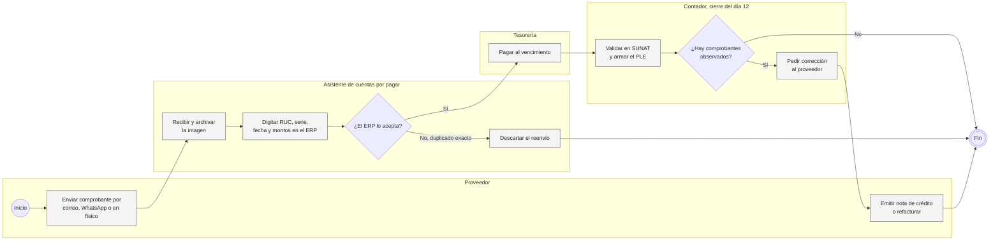
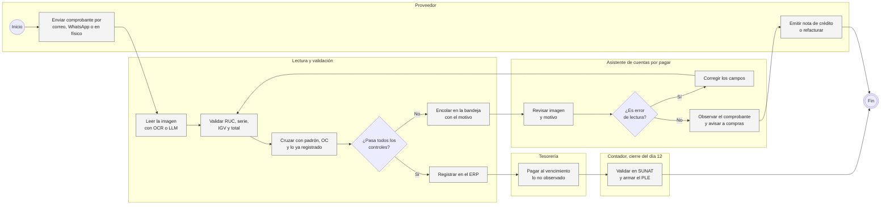
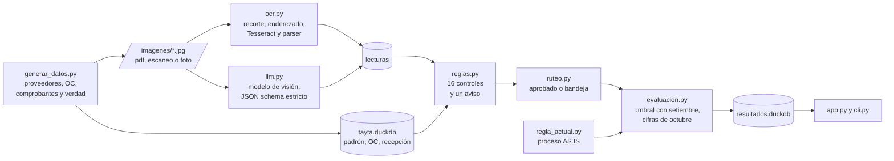
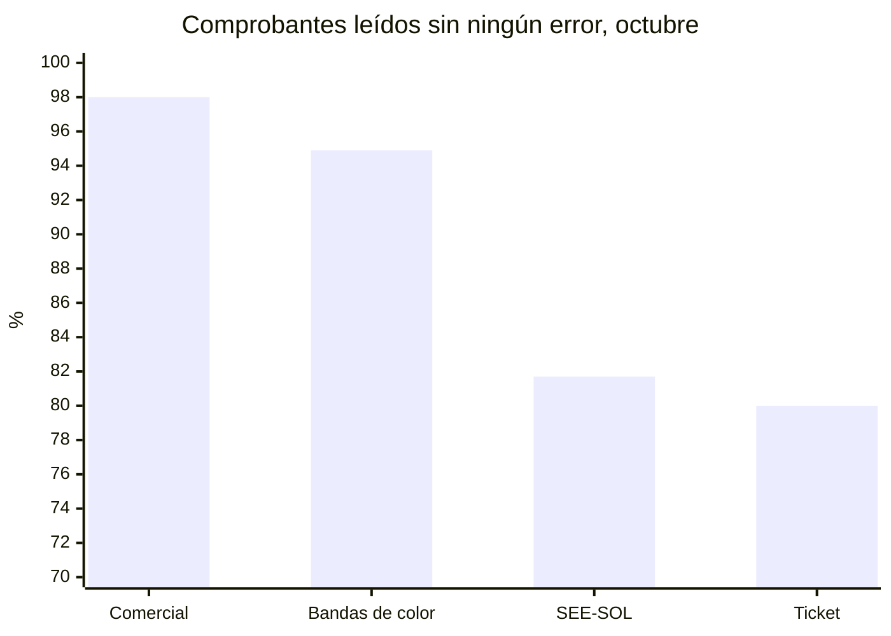

# Lectura de comprobantes de compra con validación tributaria

Comercial Tayta es una distribuidora ficticia de abarrotes, bebidas y artículos de limpieza con almacén en Independencia, Lima Norte. Le compra a 79 proveedores: fabricantes y distribuidores grandes, transportistas y servicios, y personas con negocio que venden ferretería o abarrotes al paso. Los proveedores grandes mandan el XML de la factura electrónica y ese flujo no entra aquí. Este proyecto trata el resto, los comprobantes que llegan solo como imagen: el PDF impreso por correo, el escaneo que hace mesa de partes cuando la factura viene con la mercadería y la foto que manda el proveedor por WhatsApp. En setiembre y octubre de 2026 fueron 1,003.

## Problemática

Una asistente de cuentas por pagar digita cada comprobante en el ERP: RUC, serie, número, fecha, base, IGV y total. El ERP solo rechaza un duplicado exacto. Tesorería paga al vencimiento y recién al cierre, el día 12 del mes siguiente, el contador valida los comprobantes en SUNAT y arma el PLE. Recién ahí aparecen el IGV mal calculado, el total que no cuadra, la factura emitida a otro RUC y el proveedor no habido, que no da derecho a crédito fiscal. Nadie compara la factura contra la orden de compra.

En octubre llegaron 524 comprobantes y 77 traían un error del proveedor. Con el proceso actual solo 25 se habrían visto antes de pagar: los 11 reenvíos que bloquea el ERP y 14 que vencían después del cierre. Otros 52 se habrían pagado antes de que alguien los notara, comprobantes que suman S/ 295,736. De esos, 28 facturas pasaban el monto de su orden de compra y no las habría visto nadie, ni siquiera al cierre: S/ 12,366 por encima de lo aprobado en un solo mes, con una mediana de 16.6% de exceso. Lo que sí se ve al cierre se ve tarde, 26.5 días en promedio después de recibir el comprobante, cuando ya hay que pedir nota de crédito. Digitar a mano cuesta horas, pero lo que deja pasar el dinero es que todos los controles están al final y ninguno antes de pagar.

## Solución

Construí una bandeja de entrada para cuentas por pagar. Cada imagen se lee (con Tesseract y un parser de reglas, o con un modelo de visión por API), se valida con 16 controles de formato, aritmética y negocio, y se decide si se registra sola o pasa a revisión con el motivo escrito. Los controles cruzan contra el padrón de proveedores, las órdenes de compra y lo ya registrado, así que el error del proveedor se ve el día que llega el comprobante y no al cierre. La asistente deja de digitar todo y revisa solo lo que la bandeja le manda.

El alcance incluye el generador de comprobantes con sus imágenes degradadas como llegan en la práctica, el extractor con Tesseract, el extractor con LLM multimodal y salida en JSON schema estricto, los controles, el ruteo con un umbral de confianza calibrado en setiembre, la regla del proceso actual para medirlo sobre los mismos datos, la evaluación en octubre, una CLI y un tablero en Streamlit. Quedan fuera los comprobantes con XML, las notas de crédito, las detracciones y retenciones, y la medición del extractor con LLM, que no corrí por no tener una API key en este entorno.

## AS IS: se digita todo y se controla al cierre



El cuello de botella es la digitación: cada comprobante pasa por una persona aunque esté perfecto. Pero el problema mayor es el orden. El pago ocurre antes que el único control serio, así que los errores se corrigen con nota de crédito y no antes de pagar. La decisión de pagar no mira la orden de compra y el padrón de SUNAT se consulta una vez al mes. Tampoco queda registro de qué comprobantes se observaron ni por qué, con lo que no hay forma de saber qué proveedores fallan más.

## TO BE: se controla al recibir y se revisa lo dudoso



El carril de lectura y validación está en el código, incluida la vuelta a los controles después de corregir. La revisión de la asistente, el aviso a compras y la regla de tesorería de pagar solo lo no observado son cómo lo usaría el negocio; en la simulación supongo que quien revisa corrige bien lo que lee mal.

## Cómo cambian los indicadores

| Indicador | AS IS | TO BE |
|---|---|---|
| Comprobantes que pasan por una persona | 100% (se digitan) | 19.8% (104 de 524 van a la bandeja) |
| Errores del proveedor vistos antes de pagar | 25 de 77 | 77 de 77 |
| Días de la recepción a la detección | 20.6 en promedio | el mismo día |
| Comprobantes con error pagados sin detectar | 52, por S/ 295,736 | 0 |
| Registrados con algún campo mal | no se medía | 1 de 420 que se registraron solos (0.24%) |

Todas las cifras son de octubre de 2026. El AS IS es la regla del proceso actual aplicada a los mismos 524 comprobantes ([`regla_actual.py`](src/comprobantes/regla_actual.py)); el TO BE es la corrida con Tesseract y el umbral calibrado en setiembre.

## Cómo funciona



Leer es lo caro y se hace una vez; validar y rutear es barato y se repite para probar umbrales. El extractor con Tesseract ([`ocr.py`](src/comprobantes/ocr.py)) primero prepara la imagen: busca el papel como la región clara más grande, lo endereza con el rectángulo mínimo que lo contiene, lo recorta y divide por el fondo estimado para quitar la sombra de las fotos. Después lee con Tesseract en español y un parser de expresiones regulares saca cada campo con la menor confianza de las palabras de donde salió. El parser corrige las confusiones típicas dentro de los números (O por 0, I por 1) y la serie que Tesseract lee como `FO001` o `FOO0O1`, pero no calcula nada: si no encuentra el IGV, lo deja vacío en lugar de sacarlo de total menos base, porque completar con aritmética escondería justo lo que los controles tienen que ver.

El extractor con LLM ([`llm.py`](src/comprobantes/llm.py)) manda la imagen reducida a 1,600 px en base64 a cualquier API compatible con chat completions y pide la respuesta con un JSON schema estricto que sale del mismo modelo de pydantic que valida todo lo demás ([`esquema.py`](src/comprobantes/esquema.py)). Si la respuesta no es válida, el comprobante queda vacío y va a la bandeja por campos faltantes.

Los controles están en [`reglas.py`](src/comprobantes/reglas.py). Los de formato y aritmética son el dígito verificador del RUC (módulo 11), la serie que corresponde al tipo, la fecha de emisión que no puede ser posterior a la recepción, el IGV al 18% de la base con S/ 0.10 de tolerancia y el total igual a base más IGV. Sirven igual para un error del proveedor que para un error de lectura. Los de negocio cruzan contra las tablas de la empresa: que la factura esté emitida al RUC de Tayta, que el proveedor esté en el padrón y figure como activo y habido, que la orden de compra exista, sea de ese proveedor y el total no la pase en más de 1%, que la llave RUC, tipo, serie y número no esté registrada (el número como entero, así `F001-245` y `F001-00000245` son el mismo) y que el correlativo esté cerca del último registrado de esa serie. La boleta solo genera un aviso de que no da crédito fiscal.

El ruteo ([`ruteo.py`](src/comprobantes/ruteo.py)) manda a la bandeja todo lo que falla un control y, con Tesseract, lo que tenga un campo leído con confianza bajo el umbral de ese campo. Cuando la asistente corrige la lectura, los controles vuelven a correr sobre lo corregido; un proveedor no habido cuyo RUC se leyó mal sale primero como "proveedor no registrado" y después de corregir, con su motivo real.

## Los datos

[`generar_datos.py`](datos/generar_datos.py) arma con semilla fija, en unos 110 segundos, 1,003 comprobantes recibidos entre el 1 de setiembre y el 31 de octubre de 2026 (479 en setiembre y 524 en octubre), de 76 de los 79 proveedores del padrón, con 830 órdenes de compra. Hay 27 boletas, 61 comprobantes en dólares y 846 que citan una OC. Cada uno se dibuja con una de cuatro plantillas ([`plantillas.py`](datos/plantillas.py)): un sistema de facturación comercial (370), uno con bandas de color (423), el formato de SEE-SOL, el emisor gratuito de SUNAT (132), y el ticket de impresora térmica (78). Después se degrada según cómo llegó: 57.6% escaneado, con leve giro, ruido y compresión; 25.7% como foto, con más giro, sombra, desenfoque, menos resolución y la mesa alrededor; y 16.7% como PDF limpio. Las imágenes se generan en la máquina y no están en el repo.

Los errores de los proveedores se siembran a propósito: 48 facturas pasan su OC, 25 son de tres proveedores no habidos, 22 son reenvíos del mismo comprobante días después y por otro canal, 21 están emitidas a otro RUC, 19 tienen el IGV mal (calculado sobre el total, con la tasa de 10.5% o con un redondeo que se va lejos) y en 15 el total no cuadra. La verdad de cada campo queda en `aux_verdad`, que el extractor no ve.

## Lo que salió

En octubre, los 77 comprobantes con error del proveedor fueron a la bandeja el mismo día en que llegaron. En 73 el motivo salió con la primera lectura; en los otros cuatro la lectura tuvo un problema que tapó el error real (el RUC del emisor o el tipo mal leídos, la serie o un monto que no se encontraron) y el motivo apareció al corregir y volver a validar. Con el proceso actual, 52 de esos 77 se habrían pagado sin que nadie los viera. Más de la mitad de esa diferencia son las 28 facturas que pasan su OC, que hoy nadie revisa en ningún momento.

La carga de la asistente baja de 524 comprobantes a 104. Los otros 420 (80.2%) se registraron solos y solo uno tenía un campo mal: una foto en formato SEE-SOL en la que no se leyó la orden de compra; como la OC no es obligatoria, ningún control lo notó. Ninguno de los 104 que fueron a revisión estaba ahí por gusto: 35 tenían un error de lectura, 77 un error del proveedor y 8 ambos. De los 27 que fueron solo por un error de lectura, 18 tenían un campo que el parser no encontró; los demás cayeron por la aritmética, la serie, el RUC, el correlativo o la fecha.

Tesseract leyó bien el 93.1% de los comprobantes completos. El campo más débil es el IGV, con 95.8%, porque su etiqueta sale como `1.6.V.` o `16.V` y el parser no siempre la reconoce. La forma de llegada pesa menos que el formato: las fotos tienen 90.0% de comprobantes sin error contra 95.0% de los PDF, pero el ticket y SEE-SOL bajan a 80.0% y 81.7%, contra 98.0% del formato comercial.



El resultado que más me sorprendió es que la confianza de Tesseract no aporta. Calibré el umbral por campo en setiembre: el umbral es el percentil q de la confianza de las lecturas correctas de cada campo, y elegí el q más bajo que dejara menos de 1% de error entre los aprobados. Salió q = 0, es decir, sin umbral: las validaciones solas ya dejaban un solo error en 377 aprobados. Para llegar a cero errores en setiembre había que subir a q = 25%, y ahí se registraba solo el 18.2%. Eso importa para el modelo de visión, que no entrega una confianza por campo comparable: en estos datos el ruteo depende de los controles, y los controles no cambian con el extractor.

## Por qué lo armé así

Puse los controles antes que el extractor porque son los que protegen el dinero y funcionan igual con Tesseract, con un LLM o con la digitación de una persona. Cambiar de modelo no debería cambiar qué se paga. Por la misma razón el extractor no completa campos con aritmética y el LLM tiene la instrucción de copiar los montos aunque no cuadren: la diferencia entre lo leído y lo esperado es justamente la señal.

Tesseract queda como modo demo y como línea base. Corre sin red ni costo, toma 0.55 segundos por comprobante con dos procesos y deja la vara que un modelo de visión tiene que superar en los formatos difíciles, el ticket y SEE-SOL. El umbral se calibra con setiembre y las cifras se miden en octubre para no elegir el umbral mirando el resultado que se reporta. Y los controles vuelven a correr después de la corrección humana porque, si no, un campo ilegible esconde el error del proveedor que está detrás.

## Para correrlo

Python 3.11+ y Tesseract con el idioma español (`apt install tesseract-ocr tesseract-ocr-spa` o `brew install tesseract tesseract-lang`).

```bash
cd proyectos/14-lectura-comprobantes-vision
pip install -e ".[app,dev]"

python -m comprobantes generar        # ~110 s, 1,003 comprobantes con sus imágenes
python -m comprobantes leer --demo    # Tesseract sobre todos, ~5 min con dos procesos
python -m comprobantes evaluar        # calibra en setiembre y mide octubre, ~3 s
python -m comprobantes todo           # los tres pasos, ~7 min
python -m comprobantes resumen
python -m comprobantes ver 787 --demo # lee uno en vivo: campos, confianza, controles y destino

# con un modelo de visión
cp .env.example .env                  # LLM_API_KEY, LLM_MODELO y, si aplica, LLM_BASE_URL
python -m comprobantes leer --n 60    # muestra de octubre estratificada por forma de llegada
python -m comprobantes evaluar --corrida llm_gpt_4_1_mini

streamlit run app.py
pytest                                # 51 tests, ~40 s
```

`generar --escala 0.1` arma una base chica. Los resultados quedan en `datos/resultados.duckdb`, que es lo que lee el tablero: la bandeja de octubre con la imagen y los motivos, la calidad de lectura por campo y por formato, la curva de calibración y la comparación AS IS contra TO BE.

```
14-lectura-comprobantes-vision/
├── app.py                    tablero: bandeja, calidad de lectura, AS IS vs TO BE y lectura en vivo
├── datos/
│   ├── generar_datos.py      proveedores, padrón, OC, comprobantes, errores sembrados y verdad
│   └── plantillas.py         cuatro formatos impresos y la degradación por escaneo o foto
├── src/comprobantes/
│   ├── esquema.py            modelo pydantic, JSON schema estricto y comparación por campo
│   ├── ocr.py                preparación de la imagen, Tesseract y parser
│   ├── llm.py                extractor con modelo de visión por chat completions
│   ├── reglas.py             controles de formato, aritmética y negocio
│   ├── ruteo.py              aprobado o bandeja, con umbral por campo
│   ├── procesar.py           lectura en lote y ruteo en orden de llegada
│   ├── regla_actual.py       el proceso AS IS como regla
│   ├── evaluacion.py         exactitud, calibración del umbral e indicadores del proceso
│   └── cli.py
└── tests/                    generador, controles, parser, SDK interceptado, ruteo, AS IS y cli
```

## Límites

No medí el extractor con un modelo de visión. El código está probado con el SDK de OpenAI interceptando el HTTP (la imagen en el request, el JSON schema estricto, la respuesta inválida) y `leer --n 60` lo mide en cuanto haya una API key, pero todas las cifras de este README son de Tesseract.

Las imágenes son sintéticas: no hay sellos, firmas, papel arrugado, escritura a mano ni comprobantes de varias páginas, y el ruido es más parejo que el de una foto real. Con comprobantes reales la exactitud bajaría y el parser de reglas necesitaría más ajustes por formato, que es justo donde un modelo de visión debería rendir más. Los errores de los proveedores también están sembrados con tasas que puse en el generador, y todos son de un tipo que algún control puede ver por construcción. El 77 de 77 muestra que los controles hacen lo que deben con estos errores; con datos reales aparecerán errores que ningún control anticipa.

El AS IS es una regla: cierre el día 12, pago exacto al vencimiento, ERP que solo bloquea el duplicado exacto. Los montos de los indicadores son el total de los comprobantes afectados, no la pérdida, que depende de si el proveedor emite la nota de crédito. En el TO BE supongo que quien revisa corrige bien y el mismo día, antes de cualquier pago al contado. El padrón es una foto fija; en la práctica la condición de habido cambia y habría que consultarla con la fecha del comprobante. Lo siguiente sería medir un modelo de visión en la muestra de octubre, sumar el XML de los proveedores grandes a la misma bandeja, y agregar detracciones y notas de crédito.
