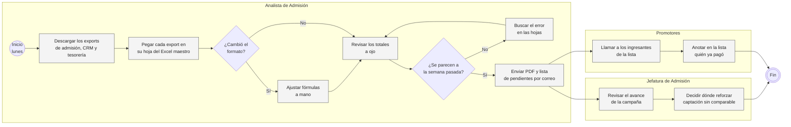
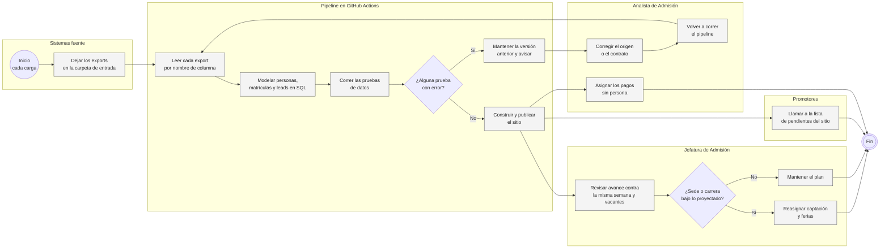
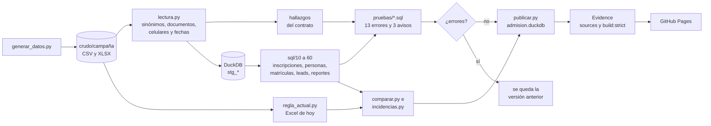

# Reportes de admisión como código

La Universidad Mirasol es una universidad privada ficticia con sedes en Lima Norte, Lima Centro y Arequipa y ocho carreras. Tiene dos campañas de admisión al año: la de marzo, que va de agosto a marzo y en 2026-1 trajo 3,084 postulantes, y la de agosto, que es la mitad de grande. La Oficina de Admisión reporta cada lunes el avance de la campaña a la jefatura, a Marketing y a los promotores que llaman a los ingresantes para que paguen la matrícula. Este proyecto reemplaza ese reporte semanal en Excel por consultas SQL y páginas en Markdown versionadas en git, con pruebas de datos que deciden si una carga se publica, y un sitio estático que se construye en cada push.

## Problemática

El reporte de los lunes se arma pegando tres exports en un Excel maestro: el del sistema de admisión, el del CRM de Marketing y el de tesorería. Las fórmulas cuentan filas y cruzan documentos con BUSCARV, y eso da cifras que no son las de la campaña. En 2026-2, ya cerrada, el Excel reportó 1,688 postulantes cuando fueron 1,586 personas, porque cuenta cada inscripción, cada versión que el sistema exporta cuando se edita una inscripción y los registros de prueba de sistemas. Con la matrícula el error va al revés: reportó 805 matriculados de 1,001, un 19.6% menos. Tesorería guarda el documento del pagador y no el del alumno, y en 2026-1 345 de los 1,900 pagos de matrícula (18.2%) los hizo alguien con otro documento, por lo general el apoderado.

Ese mismo cruce arma la lista de ingresantes pendientes de pago que reciben los promotores. Al corte del 15 de noviembre de 2026, de las 170 personas de la lista de la campaña 2027-1, 49 ya habían pagado, 3 eran registros de prueba y una estaba repetida: 31.2% de llamadas que no debían hacerse.

Además el proceso no tiene ningún control antes de enviar. Si el sistema agrega una columna, si cambia el nombre de una carrera o si el export llega cortado, el Excel publica igual y nadie lo nota salvo que el número salga muy raro. La jefatura tampoco tiene contra qué comparar: el reporte dice cuántos postulantes hay, no si son más o menos que el año pasado a la misma altura de la campaña.

## Solución

Armé un pipeline que lee los tres exports por nombre de columna, los modela en DuckDB con SQL (una persona por campaña, la matrícula asignada por código de postulante o por documento, los leads unidos a quien postuló) y corre 16 pruebas de datos escritas en SQL. Si alguna de las 13 con severidad de error falla, no se publica nada y el sitio se queda con la versión anterior. Si pasan, se construye un sitio en Evidence con el avance contra la misma semana de la campaña anterior, el embudo por modalidad, las vacantes con una proyección al cierre, la conversión por canal, la lista de ingresantes sin matrícula y una página de calidad de datos. GitHub Actions corre todo en cada push y publica en GitHub Pages.

La decisión que habilita es de proceso: lo que se reporta a la jefatura y la lista que llaman los promotores salen de una sola definición revisable en un pull request, y una carga con problemas se detiene antes de llegar a ellos. El alcance incluye el generador de exports sintéticos de tres campañas, la lectura, los modelos SQL, las pruebas, el reporte actual reproducido para compararlo, 15 incidencias sembradas en los exports, el sitio en Evidence, el workflow y los tests. Queda fuera la descarga automática de los exports desde los sistemas (aquí se generan) y el control de acceso al sitio, que con datos reales sería obligatorio y explico al final.

## AS IS: un Excel maestro que se arma cada lunes



El cuello de botella es el analista, que cada semana repite a mano la misma descarga y el mismo pegado, y absorbe en silencio los cambios de formato. El único control es comparar a ojo con la semana anterior, así que un error que mueve el total en 8% pasa. Las definiciones viven en fórmulas de una hoja que nadie más revisa: postulante es una fila, matriculado es un documento que aparece en tesorería. El reproceso cae en los promotores, que descubren en la llamada que el ingresante ya pagó, y la jefatura decide sin una referencia de cómo iba la campaña anterior a la misma fecha.

## TO BE: el reporte se publica solo si pasa las pruebas



El carril del pipeline está en el código, desde la lectura hasta el sitio publicado. Cómo llegan los exports a la carpeta, quién asigna los pagos sin persona y lo que hacen la jefatura y los promotores con el sitio es la forma en que la oficina lo usaría y no está programado.

## Cómo cambian los indicadores

| Indicador | AS IS | TO BE |
|---|---|---|
| Error en matriculados de 2026-2, campaña cerrada | -19.6% (805 de 1,001) | -2.9% (972) |
| Error en postulantes de 2026-2 | +6.4% (cuenta filas) | 0% (1,586 personas) |
| Llamadas inútiles en la lista de pendientes de 2027-1 | 31.2% (53 de 170) | 9.3% (12 de 129) |
| Incidencias de los exports que llegan publicadas con cifras distintas | 11 de 15 | 1 de 15 |
| Conversión de lead a postulante por canal | no se medía | medida en cada carga, de 5.3% a 31.2% en 2026-1 |

Las cifras de las dos columnas salen de correr el Excel reproducido y el pipeline sobre los mismos exports, y se comparan contra la verdad que deja el generador.

## Cómo funciona



[`lectura.py`](src/admision/lectura.py) lee cada archivo por nombre de columna, con una lista de sinónimos por columna en [`catalogos.py`](src/admision/catalogos.py), porque el sistema de admisión cambió en abril de 2026: el export de 2026-1 sale en CSV con punto y coma, cp1252 y fechas dd/mm/aaaa, y el de 2026-2 en adelante en UTF-8, con coma, otros encabezados, fechas ISO y textos en mayúsculas sin tildes. Una columna nueva queda como aviso; una obligatoria que falta, una fecha que no se puede leer o fechas con el mes primero quedan como hallazgo de error. Los documentos se guardan como texto y recuperan los ceros que Excel se come, los celulares quedan en sus nueve dígitos y de la glosa de tesorería se saca el código de postulante aunque venga con espacios o con "COD" delante.

Los modelos están en [`sql/`](sql) y corren en orden. [`10_inscripciones.sql`](sql/10_inscripciones.sql) se queda con la última versión de cada inscripción y saca los registros de prueba. [`20_personas.sql`](sql/20_personas.sql) junta por documento: postulante es quien tiene al menos una inscripción no anulada e ingresante quien ingresó por cualquiera de ellas. [`30_matriculas.sql`](sql/30_matriculas.sql) asigna cada pago primero por el código de la referencia y luego por documento, y deja lo que no cruza en `pagos_sin_asignar`. [`50_interesados.sql`](sql/50_interesados.sql) quita los leads repetidos del CRM y los une a los postulantes por documento o celular. [`60_reportes.sql`](sql/60_reportes.sql) arma las tablas que lee el sitio.

Cada prueba de [`pruebas/`](pruebas) es una consulta que devuelve las filas que rompen la regla, con su severidad en el encabezado. Las de error cubren el contrato de los archivos, los catálogos de modalidad, carrera, sede y canal, estados conocidos, fechas dentro de la campaña, un documento por código, ingresos con resultado y puntaje, frescura de los tres exports, volumen de la última semana contra las cuatro anteriores, pagos sin asignar por encima de 8% y vacantes cargadas. Las de aviso no detienen la publicación: pagos asignados a alguien que no ingresó, carreras que ya pasaron sus vacantes y registros de prueba por encima de lo normal.

[`publicar.py`](src/admision/publicar.py) escribe `reportes/sources/admision/admision.duckdb` solo si no hay errores, con las etiquetas de fecha armadas en Python ("15 nov") para que el eje no dependa del navegador. Evidence lee esa base, la pasa a Parquet con `npm run sources` y `build:strict` falla si alguna consulta de las páginas se rompe. El sitio tiene seis páginas: campaña en curso, embudo, vacantes, canales, pendientes y calidad.

## Los datos

[`generar_datos.py`](datos/generar_datos.py) arma con semilla fija, en unos 8 segundos, los exports de tres campañas: 2026-1 y 2026-2 cerradas y 2027-1 al 15 de noviembre de 2026, en su semana 15. Son 5,928 filas de inscripciones, 36,750 leads y 8,931 pagos. Cada campaña tiene además el archivo de vacantes por carrera y sede que mantiene Admisión.

Los exports traen lo que hace fallar al Excel. Hay personas que vuelven a dar el examen o pasan de quinto superior al examen (152 en 2026-1), inscripciones que salen repetidas porque se editaron, 12 registros de prueba por campaña, documentos con espacios, pasaportes y carnés de extranjería, pagos hechos por el apoderado y, en 2026-1, 14.5% de pagos de matrícula sin referencia. El CRM trae leads sin documento, celulares en cinco formatos y personas registradas dos veces.

En 2027-1 la campaña cambia: aparece la modalidad Beca Mirasol, cae la demanda en Lima Norte por un competidor nuevo, crecen los convenios con colegios y Marketing sube el presupuesto en redes sociales, que traen muchos leads y pocos postulantes. Las vacantes de Lima Norte se fijaron con la campaña anterior y quedaron altas. La verdad de cada campaña (quién es persona real, quién ingresó, quién se matriculó, por qué canal llegó) queda en `datos/verdad/`; el pipeline no la lee, solo la usan la comparación y la revisión de la proyección.

## Lo que salió

El Excel se equivoca siempre en la misma dirección y por razones distintas. Infla postulantes entre 6.4% y 8.8% en las tres campañas porque cuenta filas, y se queda corto en matriculados entre 18.8% y 19.6% porque busca el documento del alumno en una columna que tiene el del pagador. El pipeline da exactamente los postulantes e ingresantes reales. En matriculados queda entre 2.6% y 5.1% abajo: son los pagos que llegaron sin referencia y con el documento del apoderado, que no hay cómo asignar sin mirar el voucher. Esos pagos no se pierden, quedan en una lista aparte (50 en 2026-1) para que el analista los asigne, y la prueba de pagos sin asignar bloquea la publicación si pasan de 8%.

De las 15 incidencias sembradas en los exports de 2027-1, el Excel publica cifras distintas en 11. En seis el desvío es tan grande (una carrera en cero, matriculados en cero, el doble de leads) que alguien lo notaría; las otras cinco mueven alguna cifra entre 6.9% y 18.3%, que es justo lo que se escapa al revisar a ojo. El pipeline bloquea 9 y absorbe 5 sin cambiar ninguna cifra: la columna nueva, el DNI sin ceros, la tilde en "MATRÍCULA", el CRM duplicado y las 300 inscripciones de una prueba de carga. La que se le escapa es una actualización masiva que cambia 25 ingresos a "no ingresó": ninguna regla la distingue de un resultado real y solo deja un aviso, porque hay pagos de matrícula de personas que ya no figuran como ingresantes. También hay un costo: en cuatro incidencias el Excel no se mueve (el encabezado renombrado, el DNI sin ceros, las fechas con el mes primero y la referencia vacía en tesorería) y el pipeline detiene la publicación en tres de ellas hasta que alguien corrija el contrato o el origen.

Al corte de 2027-1 la campaña va 9.0% abajo de 2026-1 a la misma semana (671 postulantes contra 737), y casi toda la caída es de Lima Norte, 257 contra 337 (-23.7%); Lima Centro sube 4.7% y Arequipa 1.4%. Beca Mirasol ya trae 34 postulantes. La proyección de vacantes, que multiplica los matriculados de hoy por lo que creció cada sede en 2026-1 desde esta semana hasta el cierre, deja a Lima Norte con 54% de sus 1,180 vacantes cubiertas, contra 66% en Lima Centro y 69% en Arequipa. Como el generador sabe cómo termina 2027-1, pude revisarla: subestima entre 9.2% y 14.3% el cierre de cada sede, pero ordena bien las sedes, y Lima Norte termina con 59.7% de cobertura frente a 76.9% y 76.5% de las otras dos. Es la señal que la jefatura necesita en noviembre para mover ferias y presupuesto.

Por canal, en 2026-1 redes sociales trajo 7,379 leads, el 38% del CRM, y solo 5.3% llegó a postular. Referidos trajo 721 y postuló el 31.2%, y colegios en convenio el 27.8%. Con el Excel no se podía ver porque el CRM y el sistema de admisión no se cruzaban.

## Por qué lo armé así

Usé Evidence porque el reporte es SQL y texto: cada página es un Markdown con sus consultas, se revisa en un pull request como cualquier código y el resultado es un sitio estático que no necesita licencias ni un servidor. Para este caso, un reporte semanal que lee una oficina, alcanza; si la oficina necesitara explorar con filtros libres, Power BI sobre el mismo modelo sería la opción. Las pruebas son consultas SQL con severidad en el encabezado, al estilo de las pruebas singulares de dbt, sin traer dbt: son seis modelos y el equipo ya sabe SQL. Si se suman más fuentes, pasar `sql/` y `pruebas/` a un proyecto dbt es casi directo.

Que una prueba sea error o aviso es una decisión de negocio. Bloqueo lo que cambia una cifra que alguien va a usar para decidir o para llamar a una persona, y dejo como aviso lo que conviene mirar pero no invalida el resto, como una carrera que ya pasó sus vacantes. Preferí que el pipeline se detenga ante un encabezado renombrado aunque el Excel lo hubiera tolerado: con lectura por nombre, un encabezado desconocido es una columna que falta, y prefiero que un humano agregue el sinónimo a que el sistema adivine.

El Excel actual lo reproduje en [`regla_actual.py`](src/admision/regla_actual.py) leyendo columnas por posición y con CONTAR.SI.CONJUNTO sobre listas fijas, como las fórmulas. Le di el beneficio de la duda: sus criterios ya incluyen la escritura vieja y la nueva de cada modalidad y estado, y la lista de modalidades ya tiene a Beca Mirasol. Sin eso, el error sería mayor. La base que lee Evidence se escribe en el formato de almacenamiento de DuckDB 1.1, porque el conector de Evidence trae una versión anterior a la que instala pip hoy.

## Para correrlo

Python 3.11+ y Node 18+.

```bash
cd proyectos/15-reportes-admision-como-codigo
pip install -e ".[dev]"

python -m admision generar        # exports de tres campañas, ~8 s
python -m admision incidencias    # 15 incidencias sembradas, ~55 s
python -m admision comparar       # Excel actual y pipeline contra la verdad
python -m admision procesar       # lee, modela, prueba y publica la base del sitio, ~3 s
python -m admision probar         # solo las pruebas; sale con 1 si alguna bloquea
python -m admision todo           # todo lo anterior, ~70 s

cd reportes
npm ci
npm run sources
npm run dev                       # sitio local en modo desarrollo
npm run build:strict              # sitio estático en build/, ~40 s

pytest                            # 37 tests, ~25 s
```

El workflow [`15-reportes-admision.yml`](../../.github/workflows/15-reportes-admision.yml) corre los tests, genera los datos, procesa y construye el sitio en cada pull request y en cada push a main. El paso de publicación en Pages corre solo si el repositorio tiene Pages activado con GitHub Actions como origen y la variable `PAGES_HABILITADO` en `true`.

```
15-reportes-admision-como-codigo/
├── datos/generar_datos.py      exports de admisión, CRM, tesorería y vacantes de tres campañas
├── src/admision/
│   ├── catalogos.py            campañas, catálogos y sinónimos de encabezados
│   ├── normalizar.py           documentos, celulares, fechas y textos
│   ├── lectura.py              lectura por nombre de columna y hallazgos del contrato
│   ├── modelo.py               carga en DuckDB y corre sql/
│   ├── pruebas.py              corre pruebas/ y decide si bloquea
│   ├── regla_actual.py         el Excel maestro reproducido
│   ├── comparar.py             Excel y pipeline contra la verdad, lista de llamadas, proyección
│   ├── incidencias.py          15 incidencias sembradas
│   ├── publicar.py             base del sitio con etiquetas en español
│   └── cli.py
├── sql/                        modelos: inscripciones, personas, matrículas, postulantes, leads, reportes
├── pruebas/                    16 pruebas de datos en SQL
├── reportes/                   proyecto Evidence: páginas, fuente DuckDB, tema oscuro
└── tests/                      37 tests
```

## Límites

Los datos son sintéticos y los fallos del Excel los sembré yo, a partir de los que suelen tener estos exports. Con datos reales aparecerían otros, y la lista de sinónimos y de pruebas tendría que crecer con cada uno. La reproducción del Excel es mi versión de cómo se arma; otro analista podría tener otras fórmulas y otros errores.

El sitio publicado tiene la lista de ingresantes con nombre, documento y celular. Con datos sintéticos se puede dejar en GitHub Pages; con datos reales tendría que ir detrás de un inicio de sesión (Evidence Cloud, Azure Static Web Apps con Entra ID o un servidor interno) y la página de pendientes, separada de la que ve Marketing. Tampoco está resuelto cómo llegan los exports: aquí los genera el workflow, y en la universidad haría falta un paso que los baje de SharePoint o del sistema, y un horario.

La proyección de vacantes es una regla de tres por sede y en esta corrida subestimó el cierre de las tres sedes. Sirve para ordenar sedes, no para prometer una cifra. Lo siguiente sería proyectar por modalidad, que tiene ritmos muy distintos, y medir cuántas llamadas de la lista terminan en matrícula para saber si la lista corta de verdad cambia algo.
