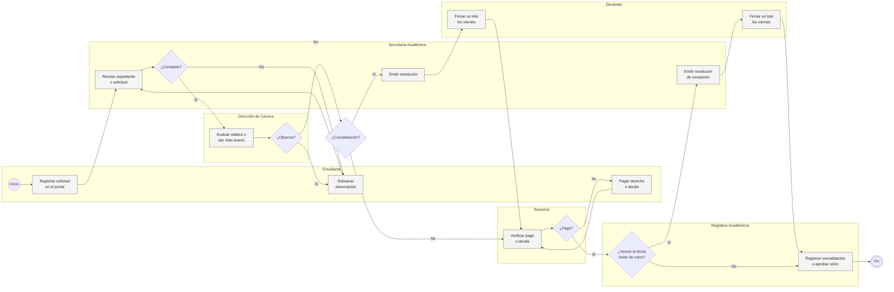
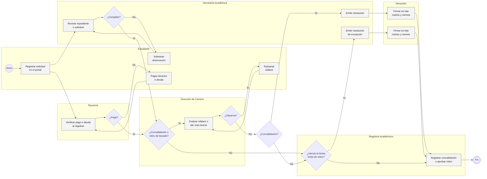
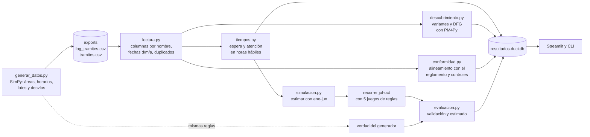
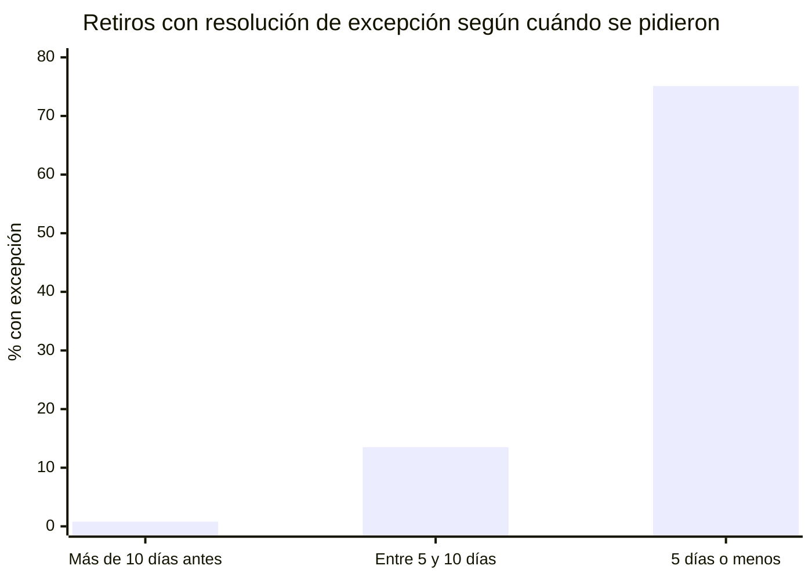

# Minería de procesos en trámites académicos

La Universidad Mirasol es una universidad privada ficticia con sedes en Lima Centro, Lima Norte y Arequipa y ocho carreras. Sus trámites académicos pasan por un sistema que deja registro de cada paso: quién lo atendió, cuándo y en qué área. Este proyecto toma ese registro para las convalidaciones de cursos y los retiros de curso de 2026 (5,600 trámites), reconstruye cómo fluyen de verdad, encuentra dónde se pierde el tiempo y mide qué pasaría si se cambia el orden de las aprobaciones.

## Problemática

Los dos trámites tienen plazos en el reglamento: 15 días hábiles para una convalidación y 7 para un retiro. En 2026 el 25.9% de las convalidaciones atendidas y el 22.3% de los retiros pasaron ese plazo. En los retiros el costo es concreto: si Registros Académicos aprueba el retiro después de la fecha límite del semestre, aunque el alumno lo haya pedido a tiempo, el trámite vuelve a Secretaría para una resolución de excepción que tiene que firmar el decano. Eso le pasó a 790 retiros, el 23.9%.

Nadie veía el proceso completo. Cada área reporta su tiempo de atención y todos los números se ven bien: Dirección de Carrera tarda en promedio 0.8 horas hábiles en evaluar los sílabos de una convalidación y 0.2 horas en dar el visto bueno a un retiro. Lo que no aparece en ningún reporte es cuánto espera el trámite en cada bandeja, cuántas veces vuelve atrás por una observación y cuánto trabajo se hace en expedientes que el alumno termina abandonando porque no pagó el derecho de convalidación, algo que hoy se revisa al final.

## Solución

Armé un análisis de minería de procesos sobre el export del sistema de trámites. Lee el log por nombre de columna, separa el tiempo de atención del tiempo de espera en horas hábiles, descubre el proceso real con PM4Py (variantes y grafo de seguimiento directo), lo alinea contra el modelo del reglamento y revisa cuatro controles que hoy nadie mira. Con los tiempos y probabilidades del primer semestre, una simulación por remuestreo recorre los trámites del segundo semestre con cinco juegos de reglas y estima cuántos días se ganan con cada cambio.

La decisión que habilita es qué reordenar en el reglamento y en el sistema: verificar el pago y la deuda al registrar, devolver las observaciones de Dirección a Dirección, pedir el visto bueno de Dirección solo para retiros de becados y pasar la firma del decano a dos turnos por semana. El alcance incluye el generador del log sintético, la lectura del export, el análisis del proceso, la conformidad, la simulación con su validación, la CLI, un tablero en Streamlit y la lista de trámites con desvío de control con código y nombre del alumno. Queda fuera la conexión directa al sistema de trámites (aquí se lee un CSV) y la implementación de los cambios en el sistema, que es trabajo de TI.

## AS IS: aprobaciones en fila y el pago al final



El proceso tiene cuatro problemas. Las aprobaciones van en fila aunque no dependen entre sí: Tesorería recién mira el pago cuando Dirección ya evaluó y el decano ya firmó, así que 69 de las 126 convalidaciones archivadas en el año se cayeron en el pago con la resolución ya firmada. Lo que observa Dirección vuelve a empezar por Secretaría, que revisa de nuevo un expediente que ya había aprobado. Dirección da el visto bueno a todos los retiros y en el log esos vistos buenos solo aparecen martes y jueves; rechazó 25 de 2,702 retiros de alumnos no becados en todo el año, y su bandeja es el 57.9% del tiempo que un retiro pasa en las áreas. Y faltan controles en el sistema: 101 convalidaciones (4.7%) se registraron sin un pago verificado antes y 58 retiros se aprobaron sin el visto bueno que pide el reglamento.

## TO BE: verificar en paralelo y quitar la aprobación que no decide



El código descubre el proceso actual, mide sus tiempos y controles y simula este diseño sobre los trámites de julio a octubre. Cambiar el reglamento, hacer que el sistema exija el pago al registrar y acordar con el decano el segundo turno de firma es cómo lo usaría la universidad y no está programado.

## Cómo cambian los indicadores

| Indicador (trámites registrados de julio a octubre) | AS IS | TO BE |
|---|---|---|
| Mediana de días de una convalidación | 13.1 | 10.9 |
| Mediana de días de un retiro | 4.7 | 1.7 |
| Retiros que necesitan resolución de excepción | 23.9% | 11.4% |
| Retiros fuera del plazo de 7 días hábiles | 22.5% | 6.2% |
| Evaluaciones de Dirección en convalidaciones que terminan archivadas | 48 | 12 |

La columna AS IS es lo observado en el log. La TO BE es lo observado multiplicado por el cambio que da la simulación entre el proceso rediseñado y el actual, con 30 réplicas. Más abajo explico cuánto se equivoca esa simulación cuando se compara con el generador.

## Cómo lo armé



[`lectura.py`](src/tramites/lectura.py) ubica las columnas del export por sinónimos, lleva las actividades (que llegan en mayúsculas y a veces sin tildes) al nombre del catálogo, lee las fechas como día/mes/año y quita los eventos que el sistema guarda dos veces cuando alguien hace doble clic. El código de alumno se queda como texto. Un trámite está cerrado cuando tiene notificación o archivo.

[`tiempos.py`](src/tramites/tiempos.py) mide todo en horas hábiles, de lunes a viernes de 8:00 a 17:00 y sin feriados, con el calendario de [`calendario.py`](src/tramites/calendario.py). La espera de una actividad va desde que terminó la anterior del mismo trámite hasta que el área la empezó, y la atención desde ese inicio hasta el fin. Tesorería, el decano y el estudiante no marcan inicio, así que para ellos solo hay tiempo total.

[`descubrimiento.py`](src/tramites/descubrimiento.py) pasa el log a PM4Py y saca las variantes y el grafo de seguimiento directo con frecuencias y medianas de tiempo; el tablero lo dibuja en DOT. [`conformidad.py`](src/tramites/conformidad.py) escribe el reglamento de cada trámite como árbol de proceso, lo convierte en red de Petri y alinea cada traza atendida contra él. Aparte hay cuatro controles en reglas simples, porque un fitness de 0.9 no le dice a nadie qué corregir y "registrada sin pago verificado" sí.

[`simulacion.py`](src/tramites/simulacion.py) recorre cada trámite paso a paso. El tiempo de cada paso en un área se sortea de lo observado en el primer semestre para esa actividad y un nivel de carga parecido (trámites del mismo tipo registrados en los 14 días previos, en terciles). Las probabilidades de observación, de no pago y de abandono, y las demoras del estudiante, también salen del log. La firma no se sortea: el trámite espera el siguiente turno del decano, con la tasa de semanas sin firma que muestra el log (12%). Los desvíos de control del proceso actual se reproducen en la simulación del actual y desaparecen en los rediseños.

## El log

[`generar_datos.py`](datos/generar_datos.py) arma con semilla fija, en unos 17 segundos, 5,600 trámites registrados entre el 5 de enero y el 13 de noviembre de 2026: 2,300 convalidaciones y 3,300 retiros, con 46,898 eventos únicos y 563 duplicados. El export tiene fecha de corte 20 de noviembre y deja 35 trámites abiertos.

El log sale de una simulación de eventos discretos con SimPy, con el personal y los horarios de cada área. Secretaría tiene tres personas, Tesorería y Registros dos. Cada director atiende convalidaciones de 14:00 a 17:00 y retiros solo martes y jueves de 13:00 a 17:00, y en febrero cada uno se toma dos semanas de vacaciones. El decano firma los viernes a las 10:00 y una de cada ocho semanas no firma. Registros pierde a una persona en las semanas de matrícula. Las convalidaciones se juntan en enero a marzo y julio a agosto, y los retiros en las últimas semanas antes de la fecha límite de cada semestre (22 de mayo y 23 de octubre). Encima van los desvíos: expedientes que pasan directo a Dirección, convalidaciones registradas sin pago y retiros sin visto bueno.

El análisis no usa nada de eso: solo lee los dos CSV. La simulación del generador sirve después para una sola cosa, correr los mismos trámites con las reglas nuevas y ver si la estimación acertó.

## Lo que salió

El retiro es el trámite donde el orden de las aprobaciones más pesa, y el visto bueno de Dirección es el paso que sobra. Es el 57.9% del tiempo que un retiro pasa en las áreas aunque cada visto bueno toma 0.2 horas, porque los directores atienden retiros dos tardes por semana y la demanda se junta al final. De los 923 retiros pedidos en los últimos cinco días antes de la fecha límite, el 75.1% terminó con resolución de excepción; de los pedidos con más de diez días, el 0.8%. En todo el año Dirección rechazó 25 de 2,702 retiros de alumnos no becados (0.9%) y 42 de 429 de becados (9.8%), así que el paso solo decide algo en los becados. Con el visto bueno solo para becados, la simulación baja la mediana de 4.7 a 1.7 días y los retiros con excepción de 23.9% a 11.4%. Cuando el generador corre esa regla sobre los mismos trámites, Dirección pasa de 1,533 vistos buenos en el semestre a 204.



En la convalidación el tiempo se va en esperas y en el lote de firma. El trabajo de las áreas es el 2.7% del tiempo hábil de un trámite atendido; el 56.6% es espera en bandeja, el 27.1% espera de la firma y el 13.6% respuesta del alumno. Con el diseño completo la mediana baja de 13.1 a 10.9 días y las fuera de plazo de 7.1% a 3.8%, y casi todo ese cambio viene de pasar la firma a martes y viernes: los otros tres cambios solo la llevan a 12.9. Febrero muestra cuánto pesa una sola ausencia en un proceso en fila: seis directores sin actividad entre nueve y diez días hábiles llevaron el tiempo mediano de un expediente en Dirección de 5.4 horas hábiles en enero a 75.6 entre el 9 de febrero y el 1 de marzo, y la mediana mensual de las convalidaciones de 9.9 a 25.6 días. En algunas carreras la cola tardó hasta mediados de abril en volver a lo normal.

Mover el pago al inicio no acorta la convalidación. La simulación le da 0.2 días menos y el generador, 0.9 días más. Lo que sí cambia es el trabajo perdido: las evaluaciones de Dirección en convalidaciones que terminan archivadas bajan de 48 a 12 en el periodo, porque quien no va a pagar se cae antes de llegar a Dirección, y el desvío de registrar sin pago deja de ser posible si el sistema lo exige al registrar. Devolver las observaciones de Dirección a Dirección tampoco mueve los días, pero en la simulación baja las revisiones de Secretaría de 1.17 a 1.00 por convalidación.

La conformidad con el reglamento es de 92.3% en convalidaciones y 98.1% en retiros, y cada traza que no calza tiene uno de los desvíos de control. Las 101 convalidaciones registradas sin pago verificado antes (44 se verificaron después del registro y 57 nunca) salen en el tablero con código y nombre del alumno para que Tesorería las revise. El proceso tiene 62 variantes de convalidación y 28 de retiro; las tres más frecuentes cubren 67.7% y 77.4%.

## Qué tanto creerle a la simulación

Estimé con lo registrado de enero a junio y simulé el proceso actual sobre lo registrado de julio a octubre (2,565 trámites). En retiros la simulación queda cerca: mediana de 4.6 días contra 4.7 observados, excepciones de 21.9% contra 23.9%. En convalidaciones sobreestima: mediana de 14.4 contra 13.1 y p90 de 25.6 contra 21.7. Sin tratar febrero daba 18.8 días, porque las esperas con los directores de vacaciones entraban a la muestra. Ahora las esperas en Dirección que llegan durante una ausencia detectada en el log, o mientras se despacha la cola que dejó, no entran a la estimación. El resto del sesgo es la cola de marzo, que el nivel de carga no termina de capturar.

Por ese sesgo el estimado de cada escenario es lo observado por el cambio relativo de la simulación, y no lo simulado tal cual. Con datos sintéticos además se puede ver el resultado real: el generador corre los mismos trámites con las reglas de cada escenario. Para el diseño completo, la mediana de convalidación real queda en 10.1 días (estimé 10.9) y la de retiro en 0.9 (estimé 1.7); los retiros con excepción reales son 7.7% (estimé 11.4%). La simulación es conservadora en retiros porque supone que la espera en cada área no cambia cuando el escenario le quita trabajo, y Dirección con 87% menos vistos buenos atiende más rápido lo que le queda.

Donde se equivoca de signo es en mover el pago al inicio, y por dos razones de proceso. Hoy Tesorería verifica después de la firma y eso escalona la llegada a Registros; con el pago al inicio, todo lo firmado el viernes llega a Registros de golpe y en el generador la espera mediana en la bandeja de Registros sube de 84 a 102 horas calendario. Además, quien no pagó llega más tarde a Dirección y a veces pierde el turno de firma de esa semana: la mediana del registro a la firma pasa de 7.6 a 8.1 días. Un remuestreo de tiempos no puede ver ninguno de los dos efectos; una simulación con colas sí, y sería el siguiente paso si la universidad quiere mover el pago sin mover la firma.

## Por qué lo hice así

Usé PM4Py para descubrir el proceso y alinear contra el reglamento porque el alineamiento dice qué actividad falta o sobra en cada traza, y eso se puede revisar a mano. El DFG lo dibujo yo en DOT para controlar el tema oscuro y el resaltado de los arcos lentos.

Para los escenarios elegí remuestrear del log en vez de armar una simulación de colas con capacidades estimadas. Con el remuestreo cada número se puede rastrear a un trámite real, no hay que adivinar cuántas personas atienden ni en qué horario, y alcanza para los cambios de orden y de ruta, que son los que se querían medir. El precio es el que se ve en la sección anterior: no captura cómo cambian las colas cuando cambia la carga.

Medí en horas hábiles porque es como trabajan las áreas y como cuenta el reglamento; en horas calendario una observación que llega el viernes a las 18:00 parece una espera de tres días. El periodo de prueba es el segundo semestre porque los parámetros se estiman con el primero y así la validación es sobre trámites que la simulación no vio.

## Para correrlo

Python 3.11+.

```bash
cd proyectos/16-mineria-procesos-tramites
pip install -e ".[app,dev]"

python -m tramites generar      # ~17 s, exports con 5,600 trámites
python -m tramites analizar     # proceso real, tiempos por área, conformidad y controles, ~2 s
python -m tramites simular      # estimación ene-jun, validación y escenarios en jul-oct, ~13 s
python -m tramites verdad       # el generador corre cada escenario, ~85 s
python -m tramites todo         # todo lo anterior, ~2 min
python -m tramites resumen      # vuelve a mostrar los resultados sin recalcular

streamlit run app.py
pytest                          # 33 tests, ~12 s
```

`generar --escala 0.15` arma una base chica. Los resultados quedan en `datos/resultados.duckdb`, que es lo que lee el tablero.

```
16-mineria-procesos-tramites/
├── app.py                    tablero: proceso real, tiempos, conformidad y escenarios
├── datos/generar_datos.py    simulación con SimPy que produce el export y la verdad por escenario
├── src/tramites/
│   ├── catalogos.py          actividades, áreas, plazos, semestres y reglas de cada escenario
│   ├── calendario.py         horas hábiles, feriados y etiquetas de fecha en español
│   ├── lectura.py            export por nombre de columna, actividades y duplicados
│   ├── tiempos.py            espera, atención, duración, plazo y reparto del tiempo
│   ├── descubrimiento.py     variantes, DFG con PM4Py, DOT y Mermaid
│   ├── conformidad.py        reglamento como árbol de proceso, alineamientos y controles
│   ├── simulacion.py         estimación del log, ausencias de Dirección y recorrido por escenario
│   ├── evaluacion.py         validación, estimado por escenario y comparación con el generador
│   ├── resultados.py         resultados.duckdb
│   └── cli.py
└── tests/                    calendario, lectura, tiempos, descubrimiento, conformidad, simulación, generador, cli
```

## Límites

Los datos son simulados y el generador y el análisis comparten la idea de cómo es el proceso, aunque el análisis solo vea el log. Con un log real habrá actividades con nombres que cambian, pasos que el sistema no registra y trámites que se resuelven por correo, y la conformidad va a salir peor. La revisión contra el generador no existe con datos reales: ahí solo queda la validación con el semestre que la simulación no vio.

La simulación no tiene colas ni capacidades. Sirve para comparar órdenes y rutas, pero cuando un cambio mueve mucha carga de un área a otra, como el pago al inicio con Registros, el efecto puede ir en contra de lo estimado. Tampoco modela vacaciones: si el periodo a simular las tiene, hay que volver a meterlas. Y el TO BE supone que los alumnos responden igual que hoy, cuando avisar del pago al registrar probablemente haga que paguen antes.

Lo siguiente sería una simulación con colas para Dirección y Registros calibrada con este mismo log, una alerta semanal de retiros pedidos a menos de cinco días del límite para atenderlos primero, y repetir el análisis con los otros trámites del sistema (reincorporaciones, constancias, traslados internos).
